# 乒乓智能分析平台 — 模块详细设计文档

> **版本**：v1.2
> **日期**：2026-10-10
> **依据**：需求分析与路线图 v0.4、前端需求与界面设计 v2.0、系统架构设计 v2.4
> **技术栈**：FastAPI + SQLAlchemy 2.0 (async) + PostgreSQL 15+ + Redis 7+ + Celery
> **说明**：本文档对系统架构设计中的模块责任矩阵进行细化，重点详述 Phase 1 核心模块，Phase 2-4 模块给出规格摘要。参考 `templates/03-module-spec.md` 格式并针对本项目技术栈适配。

---

## 0. 现有文档评审与改进建议

> 在进入模块详细设计前，对需求分析、界面设计和系统架构设计三份文档进行评审，指出不合理之处并给出改进建议。

### 0.1 需求分析文档评审

| # | 问题 | 严重度 | 说明 | 改进建议 |
|---|------|--------|------|---------|
| R1 | Phase 4 "B端工具"与 Phase 归属冲突 | P2 ✅ 已修复 | 需求 v0.4 Phase 4 模块 8 原提"俱乐部管理/学员管理/批量分析"，架构设计已将其归入 Phase 5，需求文档已同步更新 | ✅ 需求 v0.4 已将 B 端工具移至 Phase 5，并标注"B 端 SaaS 方向" |
| R2 | "在线订场"Phase 标注不一致 | P2 ✅ 已修复 | 需求 v0.4 原标"[P4 扩展] 球馆在线订场"，前端设计 v2.0 E3.11 原"[P4] 在线订场"按钮，架构设计统一归入 Phase 5 | ✅ 前端设计 v2.0 E3.11 已将按钮标注改为"[P5]"，Phase 4 隐藏显示"即将上线" |
| R3 | "训练负荷分析"和"趋势预测"缺失模块归属 | P3 | 需求 v0.4 Phase 2 提到"训练负荷分析"和"趋势预测"，架构设计中说明归入 `monthly_report` 模块增强能力，但需求文档未明确 | 需求文档应在 Phase 2 模块 5"月度训练报告"下注明"含训练负荷分析和趋势预测增强能力" |
| R4 | 免费额度策略不够明确 | P3 | 需求 v0.4 提到"每日 3 次免费分析"，但未说明：跨天重置时间、额度是否可累积、未使用额度是否清零 | 需求文档应补充："每日 00:00 (Asia/Shanghai) 重置，不累积，过期清零" |
| R5 | 缺失数据导出功能需求 | P3 | 架构设计 11.4 节提到 PIPL 数据可携带权需要数据导出功能，但需求文档中未提及此功能 | 需求文档 Phase 1 应增加"用户数据导出（JSON 格式）"功能项 |

### 0.2 界面设计文档评审

| # | 问题 | 严重度 | 说明 | 改进建议 |
|---|------|--------|------|---------|
| F1 | 训练方案页面 Phase 标注与架构不一致 | P2 ✅ 已修复 | 前端设计 v2.0 原将训练方案放在 Phase 2，需求 v0.4 Phase 1 含训练方案模板（Phase 2 提供训练单生成） | ✅ 已统一：Phase 1 含训练方案模板（Phase 2 提供训练单生成）+ 跟练模式 + 动态调整闭环，前端设计已区分两个层次 |
| F2 | 缺少视频上传失败重试界面设计 | P3 | 架构设计 5.9 节描述了 OSS 直传流程和弱网重试策略，但前端设计未设计上传失败/重试界面 | 建议补充上传失败状态的 UI 设计（错误提示 + 重试按钮 + 切换 WiFi 引导） |
| F3 | 缺少分析报告对比功能界面设计 | P3 | 架构设计 12.7 节描述了报告对比功能（技术统计/落点/回合/球速/问题变化对比），但前端设计 v2.0 未设计对比页面 | 建议在训练 Tab 补充"报告对比"页面设计，展示两次报告的并排热图/对比表 |
| F4 | 缺少会员到期/降级提示界面设计 | P3 | 架构设计 12.9 节描述了订阅到期和权益降级逻辑，但前端设计未设计到期提醒和降级提示界面 | 建议在会员中心补充"即将到期"提醒 banner 和"权益已降级"提示 |
| F5 | 小程序降级页面缺少界面设计 | P2 | 架构设计 2.8 节列出了 7 个 H5 降级页面，但前端设计 v2.0 未设计这些 H5 降级页面的 UI | 建议补充 H5 降级页面设计（至少视频上传页和 3D 教学查看器），标注与小程序原生页面的跳转交互 |

### 0.3 系统架构设计文档评审

| # | 问题 | 严重度 | 说明 | 改进建议 |
|---|------|--------|------|---------|
| A1 | ER 图缺少多个核心实体定义 | P1 | 架构设计 9.1 节 ER 图中引用了 `TRAINING_PLAN`、`PIPELINE_STEP`、`FILE_RECORD`、`BADGE`、`KNOWLEDGE_ENTRY`、`RULE_DEFINITION`、`TRAINING_TEMPLATE`、`MATCH_STATISTIC` 等实体，但未给出字段定义 | 本文档第 3 节（数据库详细设计）将补全所有实体定义 |
| A2 | `MATCH` 与 `MATCH_RECORD` 职责重叠不清晰 | P1 | `MATCH`（记分牌实时比赛）和 `MATCH_RECORD`（手动录入比赛）概念接近，架构设计未明确边界和关系 | 建议：`MATCH` 为实时记分牌的比赛实体（含状态机），`MATCH_RECORD` 为简化版手动录入（只录总比分），两者通过 `match_id` 关联（手动录入可关联记分牌比赛），详见数据库设计 |
| A3 | `SCORE_RECORD` 与 `SCORE_DETAIL` 命名混淆 | P2 | `MATCH ||--o{ SCORE_RECORD`（记分牌记分），`MATCH_RECORD ||--o{ SCORE_DETAIL`（手动录入得分明细），命名接近易混淆 | 建议：`SCORE_RECORD` 保持不变（记分牌逐球记录），`SCORE_DETAIL` 改名为 `MANUAL_SCORE_DETAIL` 以明确来源 |
| A4 | 缺少 `USAGE_QUOTA` 表设计 | P2 | 模块矩阵提到 `UsageQuota`，架构设计 12.9 节使用 Redis 计数器实现免费额度，但未定义数据库表 | 建议：免费额度用 Redis 实现即可（每日自动过期），无需数据库表。但应增加 `MEMBERSHIP_TIER` 配置表存储各等级权益配置 |
| A5 | 缺少 `ADMIN_USER`、`AUDIT_LOG`、`SYSTEM_CONFIG` 表 | P2 | 模块矩阵提到 `AdminUser`、`AuditLog`、`SystemConfig`，但 ER 图和表定义中均未出现 | 本文档数据库设计将补全这些表 |
| A6 | WebSocket 端点路径与 REST API 前缀不一致 | P3 | REST API 使用 `/api/v1/` 前缀，WebSocket 使用 `/api/v1/ws`，但架构文档 5.2 节 Mermaid 序列图中 WS 路径含 `[REDACTED]` 标记，可能造成混淆 | 建议统一 WebSocket 端点为 `wss://api.pingpongai.com/ws`（不挂 `/api/v1` 前缀，与 REST 分离） |
| A7 | 目录结构中 `training/` 目录重复出现 | P3 | 架构设计第 10 节目录结构中，`training/` 出现了两次（一次标注"训练建议模块"，一次标注"训练模块含 training_advice P1 + training_plan P2"），实际是同一个目录 | 应合并为一个 `training/` 目录条目，注明包含 `training_advice` (P1) + `training_plan` (P2) |
| A8 | `progress/` 目录应明确 Phase 归属 | P3 | `progress/` 模块（进度分析）在架构设计中标注为 Phase 1，但前端设计中进度对比功能出现在 Phase 2 | 建议：进度快照生成和趋势计算在 Phase 1（作为训练建议的底层支撑），前端进度对比页面在 Phase 2 暴露给用户 |

### 0.4 跨文档一致性检查

| # | 问题 | 涉及文档 | 改进建议 |
|---|------|---------|---------|
| C1 | 会员定价完全一致 | 需求 v0.4 / 前端 v2.0 / 架构 v2.4 | ✅ 三份文档会员定价一致（¥19/月 ¥168/年 等） |
| C2 | 5 Tab 信息架构一致 | 需求 v0.4 / 前端 v2.0 | ✅ 一致 |
| C3 | AI 技术选型一致 | 需求 v0.4 / 架构 v2.4 | ✅ TTNet/TrackNetV5 + 卡尔曼滤波 + MediaPipe + Temporal CNN |
| C4 | "在线订场"Phase 不一致 | 需求 v0.4 (P4) / 前端 v2.0 (P4) / 架构 v2.4 (P5) | 已同步为 P5（架构 v2.4） |
| C5 | "B端工具"Phase 不一致 | 需求 v0.4 (P4 模块8) / 架构 v2.4 (P5) | 已同步为 P5（架构 v2.4） |

---

## 1. 文档说明

### 1.1 适用范围

本文档覆盖 Phase 1–4 所有后端模块的详细设计，包括：
- 模块职责边界
- 核心用户故事
- 功能清单与优先级
- 关键业务规则
- 交互流程
- 验收标准

### 1.2 技术栈适配说明

本文档基于 `templates/03-module-spec.md` 格式，针对本项目技术栈做以下适配：

| 模板原始设定 | 本项目实际 | 适配说明 |
|-------------|----------|---------|
| Tortoise ORM + MySQL | SQLAlchemy 2.0 async + PostgreSQL | Model 代码使用 SQLAlchemy declarative |
| Vue + Element Plus | Taro 4 + React + NutUI | 前端组件引用 NutUI |
| `service/` 目录结构 | `app/api/v1/` + `app/services/` + `app/models/` | 遵循架构设计第 10 节目录结构 |
| `enums.py` 集中定义枚举 | `app/core/enums.py` | 枚举使用 Python `str, Enum` |

### 1.3 模块命名规范

- 模块名使用 **snake_case**，与 `app/api/v1/` 下的目录名一致
- API 路径前缀：`/api/v1/{module_name}/...`
- Service 文件：`app/services/{module_name}_service.py`
- Model 文件：`app/models/{module_name}.py`
- Schema 文件：`app/schemas/{module_name}.py`

### 1.4 优先级与复杂度定义

- **优先级**：P0=Phase 1 MVP 必须，P1=Phase 1 第二迭代，P2=Phase 2，P3=Phase 3，P4=Phase 4
- **复杂度**：低=单表 CRUD，中=多表关联/简单业务规则，高=复杂状态机/跨模块交互/异步流水线

---

## 2. Phase 1 核心模块详细设计

### 2.1 认证模块 (auth)

#### 模块概述

| 属性 | 值 |
|------|-----|
| 模块名称 | `auth` |
| 所属目录 | `app/api/v1/auth/` |
| 一句话定位 | 管理用户认证（微信登录/手机号登录）、JWT Token 签发与刷新、H5 降级认证 |
| 关联 API | 本文档第 5 节 API 契约 → 认证模块 |

#### 核心用户故事

| # | 角色 | 故事 | 价值 |
|---|------|------|------|
| US-1 | 游客 | 我想用微信小程序登录 | 无需注册即可使用 |
| US-2 | App 用户 | 我想用手机号验证码登录 | 跨平台登录 |
| US-3 | 登录用户 | 我想自动刷新过期的 Token | 无感续期，不中断使用 |
| US-4 | 小程序用户 | 我想从小程序跳转到 H5 页面操作 | 小程序受限功能（大文件上传等）在 H5 中完成 |
| US-5 | 登录用户 | 我想安全退出 | 保护账号安全 |
| US-6 | 登录用户 | 我想注销账号并删除个人数据 | 行使数据可携带权/删除权 |

#### 功能清单

| # | 功能点 | 优先级 | 复杂度 | 依赖 | 备注 |
|---|--------|--------|--------|------|------|
| F1 | 微信小程序登录 | P0 | 中 | 微信开放平台 | code → openid → JWT |
| F2 | 手机号验证码登录 | P0 | 中 | 短信服务商 | App 端使用 |
| F3 | 发送短信验证码 | P0 | 低 | 短信服务商 | 限流 1/min |
| F4 | 刷新 access_token | P0 | 低 | Redis | refresh_token 换新 token |
| F5 | 登出（撤销 token） | P0 | 低 | Redis | jti 加入黑名单 |
| F6 | 获取当前用户信息 | P0 | 低 | user 模块 | 前端初始化调用 |
| F7 | H5 降级临时 Token 生成 | P0 | 中 | — | 5 分钟过期，一次性使用 |
| F8 | H5 Token 换 JWT | P0 | 中 | — | web-view 降级认证 |
| F9 | 用户注销（72h 冷静期） | P1 | 中 | user 模块 | DELETE /users/account |

#### 业务规则

**BR-1: 微信登录流程**

| 属性 | 值 |
|------|-----|
| 规则名 | 微信小程序登录 |
| 描述 | 客户端调用 wx.login() 获取 code，后端用 code 换取 openid，查找或创建用户，签发 JWT |
| 触发条件 | 客户端 POST /auth/wechat-login |
| 预期行为 | 1. 调用微信 code2session 获取 openid + session_key；2. 查询 user 表，不存在则创建；3. 签发 access_token (120min) + refresh_token (7d)；4. session_key 存入 Redis (15min TTL) |
| 异常处理 | 微信 API 调用失败 → 502 "微信登录服务暂时不可用"；code 无效 → 400 "登录凭证无效" |

**BR-2: Token 刷新机制**

| 属性 | 值 |
|------|-----|
| 规则名 | access_token 自动刷新 |
| 描述 | access_token 过期后，客户端用 refresh_token 获取新的 access_token |
| 触发条件 | 客户端 POST /auth/refresh |
| 预期行为 | 1. 验证 refresh_token 有效性 + jti 不在黑名单；2. 签发新 access_token (120min) + 新 refresh_token (7d)；3. 旧 refresh_token 的 jti 加入 Redis 黑名单 |
| 异常处理 | refresh_token 过期/无效 → 401 "请重新登录"；jti 在黑名单 → 401 "Token 已撤销" |

**BR-3: H5 降级认证流程**

| 属性 | 值 |
|------|-----|
| 规则名 | H5 降级 Token |
| 描述 | 小程序跳转 H5 页面时，用 JWT 换取一次性 H5 Token，H5 页面用 Token 换 JWT |
| 触发条件 | 客户端 POST /auth/h5-token → H5 页面 POST /auth/h5-exchange |
| 预期行为 | 1. h5-token 生成 UUID，存 Redis (key: `h5_token:{uuid}`, value: `{user_id}`, TTL: 300s)；2. h5-exchange 读取并删除 Redis key（一次性使用），签发 JWT |
| 异常处理 | Token 过期/不存在 → 401 "H5 Token 已过期，请重新操作"；Token 已被使用 → 401 "Token 已使用" |

**BR-4: 用户注销与数据级联处理**

| 属性 | 值 |
|------|-----|
| 规则名 | 72h 冷静期 + 个人信息永久删除 |
| 描述 | 用户可注销账号，72h 冷静期后永久删除个人信息，视频匿名归档保留用于模型训练 |
| 触发条件 | DELETE /users/account |
| 预期行为 | 1. `user.status = 'pending_deletion'`，`scheduled_deletion_at = NOW() + 72h`；2. 72h 内可撤销（`POST /users/account/cancel-deletion` → `status = 'active'`）；3. 72h 后 Celery 定时任务执行：`nickname='已注销用户'`，`phone=null`，`openid=null`，`avatar_url=null`，`status='deleted'`；4. 关联视频 `file_record.status='deleted'`（24h 后 OSS 物理删除）；5. 分析报告 `is_anonymized=true`（保留用于模型训练数据飞轮）；6. 比赛记录保留（对手数据不受影响）；7. 订阅 `subscription.status='cancelled'` |
| 异常处理 | 已有待执行注销 → 409 "您已提交注销申请"；72h 内登录 → 提示"您的账号正在注销中，是否撤销？" |

#### 交互流程：微信登录

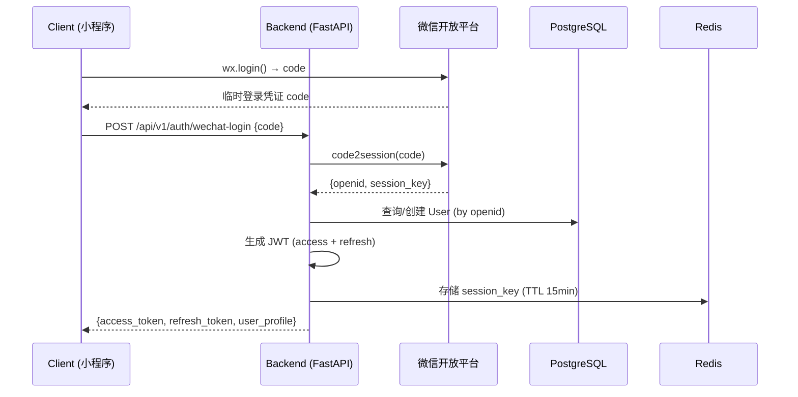

#### 验收标准

- [ ] 微信登录端点返回 JWT + 用户基础信息
- [ ] Token 刷新端点正确签发新 token 并撤销旧 refresh_token
- [ ] H5 Token 一次性使用，二次使用返回 401
- [ ] 登出后 jti 加入 Redis 黑名单，后续请求返回 401
- [ ] 限流配置生效（wechat-login: 10/min, send-sms: 1/min）

---

### 2.2 用户模块 (user)

#### 模块概述

| 属性 | 值 |
|------|-----|
| 模块名称 | `user` |
| 所属目录 | `app/api/v1/users/` |
| 一句话定位 | 管理用户个人档案、开球网积分、打法类型、装备配置、乒乓大数据 |
| 关联 API | 本文档第 5 节 API 契约 → 用户模块 |

#### 核心用户故事

| # | 角色 | 故事 | 价值 |
|---|------|------|------|
| US-1 | 登录用户 | 我想填写个人档案（积分/打法/装备） | 获得个性化训练建议 |
| US-2 | 登录用户 | 我想更新开球网积分 | 积分用于水平匹配 |
| US-3 | 登录用户 | 我想查看乒乓大数据 | 了解自己的运动成就 |

#### 功能清单

| # | 功能点 | 优先级 | 复杂度 | 依赖 | 备注 |
|---|--------|--------|--------|------|------|
| F1 | 获取个人档案 | P0 | 低 | auth | — |
| F2 | 更新个人档案 | P0 | 中 | — | 打法/装备/自评水平 |
| F3 | 更新开球网积分 | P0 | 中 | — | 手动填写或 ID |
| F4 | 积分历史记录 | P0 | 低 | — | 分页列表 |
| F5 | 乒乓大数据 | P0 | 高 | scoring, match_data | 间接胜利算法(架构 12.1)，缓存 24h |

#### 业务规则

**BR-1: 个人档案完整度**

| 属性 | 值 |
|------|-----|
| 规则名 | 档案完整度评分 |
| 描述 | 计算用户档案完整度，影响首页推荐和训练建议个性化程度 |
| 触发条件 | GET /users/profile 返回 profile_completeness 字段 |
| 预期行为 | 完整度 = (已填字段数 / 应填字段数) × 100%。应填字段：nickname, avatar_url, kqs_rating, playing_style, equipment_config |
| 异常处理 | — |

**BR-2: 开球网积分更新**

| 属性 | 值 |
|------|-----|
| 规则名 | 积分更新与历史记录 |
| 描述 | 用户更新积分时，旧积分自动写入历史记录 |
| 触发条件 | PATCH /users/rating |
| 预期行为 | 1. 读取当前 kqs_rating；2. 创建 rating_history 记录（旧积分 + source=manual）；3. 更新 user.kqs_rating |
| 异常处理 | 积分超出合理范围（<500 或 >3000）→ 400 "积分值不在合理范围内" |

**BR-3: 乒乓大数据间接胜利**

| 属性 | 值 |
|------|-----|
| 规则名 | 间接胜利算法 |
| 描述 | 基于比赛结果构建有向图，计算间接战胜的名人列表 |
| 触发条件 | 比赛结束后异步触发（Celery task），或 GET /users/big-data 时读缓存 |
| 预期行为 | 1. 从 A 出发沿胜利边 BFS（最大 4 层）；2. 匹配预置名人 ID 列表；3. 结果存 Redis `big_data:user:{user_id}` (TTL 24h) |
| 异常处理 | 用户量 <1000 时全量计算；缓存未命中时实时计算（限制最近 50 场比赛） |

#### 验收标准

- [ ] GET /users/profile 返回完整档案 + 完整度评分
- [ ] PATCH /users/rating 正确创建历史记录并更新当前积分
- [ ] GET /users/big-data 返回缓存数据（24h TTL）
- [ ] 装备配置 JSONB 结构正确存储和读取
- [ ] 积分历史记录支持分页查询

---

### 2.3 视频分析模块 (video_analysis)

#### 模块概述

| 属性 | 值 |
|------|-----|
| 模块名称 | `video_analysis` |
| 所属目录 | `app/api/v1/video_analysis/` |
| 一句话定位 | 管理视频上传（OSS 直传）、AI 分析任务创建与追踪、分析报告展示与反馈、报告分享 |
| 关联 API | 本文档第 5 节 API 契约 → 视频分析模块 |
| 依赖模块 | auth, user, ai_pipeline, file_management, membership (额度控制) |

#### 核心用户故事

| # | 角色 | 故事 | 价值 |
|---|------|------|------|
| US-1 | 免费用户 | 我想每天免费分析 3 次视频 | 零门槛体验核心价值 |
| US-2 | 会员用户 | 我想无限分析视频 | 不受额度限制 |
| US-3 | 登录用户 | 我想查看分析进度（实时） | 知道还需要等多久 |
| US-4 | 登录用户 | 我想查看完整分析报告 | 了解自己的技术短板 |
| US-5 | 登录用户 | 我想标记分析结果对/不对 | 帮助 AI 改进（数据飞轮） |
| US-6 | 登录用户 | 我想分享报告给球友 | 社交传播 |

#### 功能清单

| # | 功能点 | 优先级 | 复杂度 | 依赖 | 备注 |
|---|--------|--------|--------|------|------|
| F1 | 获取 OSS 上传凭证 | P0 | 中 | file_management | STS Token + 对象 Key |
| F2 | 上传完成确认 | P0 | 中 | file_management | HEAD Object 校验 |
| F3 | 创建分析任务 | P0 | 高 | membership, ai_pipeline | 消耗免费额度 → 入队 |
| F4 | 任务列表 | P0 | 低 | — | 分页 |
| F5 | 任务详情 + 进度 | P0 | 中 | ai_pipeline | 含 WebSocket 进度推送 |
| F6 | 分析报告详情 | P0 | 中 | — | JSONB 完整结果 |
| F7 | 报告列表 | P0 | 低 | — | 分页 |
| F8 | 提交反馈 | P0 | 中 | — | 数据飞轮入口 |
| F9 | 标注视频 URL | P0 | 低 | — | CDN URL |
| F10 | 生成分享 Token + 卡片图 | P0 | 高 | — | 5/天 限流 |
| F11 | 分享报告摘要页 | P0 | 中 | — | 公开只读，7 天有效 |

#### 业务规则

**BR-1: 免费额度控制**

| 属性 | 值 |
|------|-----|
| 规则名 | 每日免费分析额度 |
| 描述 | 免费用户每日 3 次 AI 分析额度，会员用户无限 |
| 触发条件 | POST /video-analysis/tasks |
| 预期行为 | 1. 检查会员状态：会员 → 直接入队；免费 → Redis INCR `quota:analysis:{user_id}:{date}`；2. INCR 后 > 3 → DECR 回退 → 403 "今日免费额度已用完，升级会员无限分析"；3. Key TTL 至当日 23:59:59 + 1h |
| 异常处理 | Redis 不可用 → 降级为数据库查询当日任务数 |

**BR-2: 分析任务状态机**

| 属性 | 值 |
|------|-----|
| 规则名 | 任务状态流转 |
| 描述 | 分析任务从创建到完成的状态流转 |
| 触发条件 | AI 流水线各步骤执行时 |

状态转换矩阵：

| 当前状态 → 目标状态 | queued | processing | completed | failed | cancelled |
|---------------------|--------|------------|-----------|--------|-----------|
| queued | - | YES | NO | NO | YES |
| processing | NO | - | YES | YES | NO |
| completed | NO | NO | - | NO | NO |
| failed | YES (重试) | NO | NO | - | NO |
| cancelled | NO | NO | NO | NO | - |

| 异常处理 | 非法转换返回 400 "任务状态不允许从 {current} 转换为 {target}" |

**BR-3: 分析反馈与数据飞轮**

| 属性 | 值 |
|------|-----|
| 规则名 | 用户反馈数据归档 |
| 描述 | 用户标记"对/不对"后，视频和 AI 结果进入数据飞轮标注流程 |
| 触发条件 | POST /video-analysis/reports/{id}/feedback |
| 预期行为 | 1. 创建 feedback_record (is_correct, comment)；2. is_correct=true → 视频标记为标注候选，自动归档到 OSS annotations/ 目录；3. is_correct=false → 进入人工审核队列 |
| 异常处理 | 已提交过反馈 → 400 "已提交过反馈"（允许更新反馈，覆盖旧记录） |

**BR-4: 报告分享访问控制**

| 属性 | 值 |
|------|-----|
| 规则名 | 分享 Token 生命周期 |
| 描述 | 生成 UUID Token，7 天有效，公开只读访问 |
| 触发条件 | POST /video-analysis/reports/{id}/share |
| 预期行为 | 1. 生成 share_token (UUID)；2. 生成分享卡片图（Pillow 绘制：封面图 + 关键数据）；3. 上传卡片图到 OSS；4. 创建 share_record (report_id, token, scope, expire_at) |
| 异常处理 | 限流 5/天；分享页不暴露原始 API 端点，通过 /share/{token} 返回 HTML |

#### 交互流程：视频分析全流程

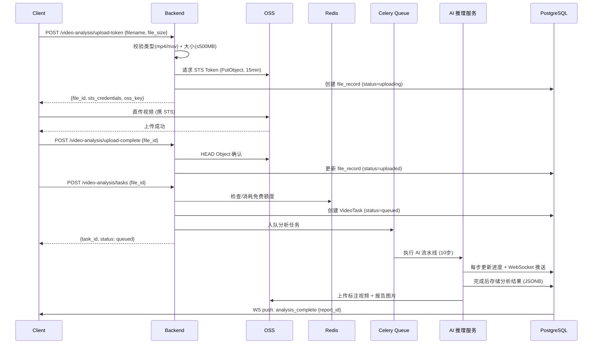

#### 验收标准

- [ ] OSS 直传流程完整：upload-token → 直传 → upload-complete → tasks
- [ ] 免费额度控制正确（每日 3 次，会员无限）
- [ ] 任务进度通过 WebSocket 实时推送（步骤 1-10）
- [ ] 分析报告 JSONB 结构完整（含落点/技术/回合/球速/文字结论）
- [ ] 反馈机制正确触发数据飞轮归档
- [ ] 分享 Token 7 天有效，过期返回"分享已过期"
- [ ] 标注视频通过 CDN 分发

---

### 2.4 记分牌模块 (scoring)

#### 模块概述

| 属性 | 值 |
|------|-----|
| 模块名称 | `scoring` |
| 所属目录 | `app/api/v1/scoring/` |
| 一句话定位 | 智能记分牌，支持比赛设置、实时记分、得分方式标记、多设备同步、比赛统计 |
| 关联 API | 本文档第 5 节 API 契约 → 记分牌模块 |
| 依赖模块 | auth, user, notification (WebSocket) |

#### 核心用户故事

| # | 角色 | 故事 | 价值 |
|---|------|------|------|
| US-1 | 登录用户 | 我想快速设置一场比赛（赛制/对手/类型） | 最少步骤开始记分 |
| US-2 | 记分者 | 我想单手大按钮记分 + 标记得分方式 | 打球时方便操作 |
| US-3 | 观赛者 | 我想在另一台设备同步看到比分 | 多设备观赛 |
| US-4 | 登录用户 | 我想撤销记错的最后一球 | 纠正失误 |
| US-5 | 登录用户 | 我想查看比赛结束后的统计 | 了解得分方式分布 |

#### 功能清单

| # | 功能点 | 优先级 | 复杂度 | 依赖 | 备注 |
|---|--------|--------|--------|------|------|
| F1 | 创建比赛 | P0 | 中 | — | 赛制/对手/类型 |
| F2 | 比赛列表 | P0 | 低 | — | 分页 |
| F3 | 比赛详情 | P0 | 中 | — | 含状态/比分/比分序列 |
| F4 | 记分（得分方+方式） | P0 | 高 | — | Redis 原子序号 + WS 推送 |
| F5 | 撤销最近一球 | P0 | 高 | — | 校验 max_seq + WS 推送 undo |
| F6 | 结束比赛 → 统计 | P0 | 高 | — | 状态机 → 生成 MatchStatistic |
| F7 | 比赛统计 | P0 | 中 | — | 得分分布/关键分/技术分解 |

#### 业务规则

**BR-1: 比赛状态机**

状态转换矩阵：

| 当前状态 → 目标状态 | setup | in_progress | finished | abandoned |
|---------------------|-------|-------------|----------|-----------|
| setup | - | YES | NO | YES |
| in_progress | NO | - | YES | YES |
| finished | NO | NO | - | NO |
| abandoned | NO | YES(24h内) | NO | - |

| 属性 | 值 |
|------|-----|
| 异常处理 | `POST /scoring/matches/{id}/score` 在非 `in_progress` 状态 → 400 "比赛未在进行中"；`POST /scoring/matches/{id}/finish` 在非 `in_progress` → 400 "比赛未在进行中" |

**BR-2: 多设备同步协议**

| 属性 | 值 |
|------|-----|
| 规则名 | 记分牌多设备同步 |
| 描述 | 多设备同时观赛时，比分更新通过 WebSocket 实时推送 |
| 触发条件 | POST /scoring/matches/{id}/score |
| 预期行为 | 1. Redis INCR `match:{id}:seq` 获取全局序号；2. 写入 score_record；3. 更新 `match:{id}:current_score`；4. WS push `score_update {sequence, score, scorer, method}` 到 `ws:match:{id}` 房间 |
| 异常处理 | 设备断连重连后发送 `sync_match` 全量同步事件（当前比分 + 比分序列 + 比赛状态） |

**BR-3: 撤销约束**

| 属性 | 值 |
|------|-----|
| 规则名 | 撤销最后一球 |
| 描述 | 仅允许撤销最后 1 球（seq == max_seq） |
| 触发条件 | POST /scoring/matches/{id}/undo |
| 预期行为 | 1. 查询 Redis `match:{id}:seq` 获取 max_seq；2. 校验请求中的 seq == max_seq；3. 删除最后一条 score_record；4. Redis DECR `match:{id}:seq`；5. 更新 current_score；6. WS push `score_update {action: undo, sequence: N-1, score}` |
| 异常处理 | seq != max_seq → 409 "比分已更新，请确认后撤销" |

**BR-4: 自动轮换发球**

| 属性 | 值 |
|------|-----|
| 规则名 | 发球轮换规则 |
| 描述 | 根据比分自动判断当前发球方 |
| 触发条件 | 记分时计算并返回 server 字段 |
| 预期行为 | 11 分制：每人 2 次发球轮换；10:10 后每人 1 次轮换；7 局 4 胜制等根据赛制配置 |
| 异常处理 | — |

#### 交互流程：多设备记分同步

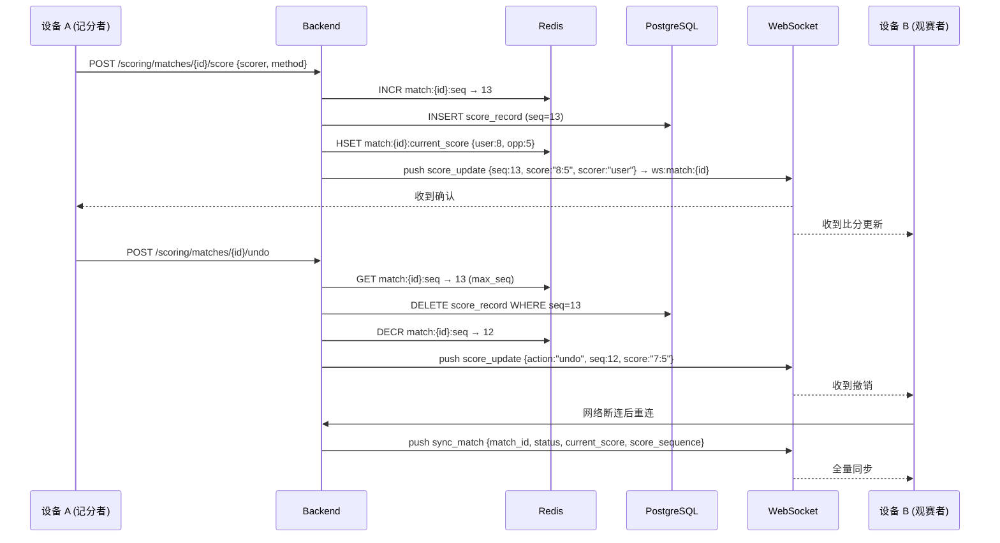
#### 验收标准

- [ ] 比赛状态机正确约束所有操作
- [ ] 多设备同步：设备 A 记分，设备 B 收到 WS 推送
- [ | 序号全局唯一递增（Redis INCR）
- [ ] 撤销仅允许最后一球
- [ ] 比赛结束后自动生成 MatchStatistic
- [ ] abandoned 状态 24h 内可恢复
- [ ] 发球轮换规则正确（11 分制 2 轮 + 10:10 后 1 轮）

---

### 2.5 比赛数据模块 (match_data)

#### 模块概述

| 属性 | 值 |
|------|-----|
| 模块名称 | `match_data` |
| 所属目录 | `app/api/v1/match_data/` |
| 一句话定位 | 手动录入比赛数据，支持快速录入（只录总比分）和详细录入（逐分技术动作） |
| 关联 API | 本文档第 5 节 API 契约 → 比赛数据模块 |
| 依赖模块 | auth, user, scoring (可选关联) |

#### 核心用户故事

| # | 角色 | 故事 | 价值 |
|---|------|------|------|
| US-1 | 登录用户 | 我想快速录入一场已打完的比赛结果（只录总比分） | 在数据看板中看到累计统计 |
| US-2 | 登录用户 | 我想详细录入每分的技术动作 | 生成更精准的技术统计 |
| US-3 | 登录用户 | 我想查看历史比赛记录列表 | 回顾战绩 |
| US-4 | 登录用户 | 我想将记分牌比赛关联为比赛记录 | 避免重复录入 |

#### 功能清单

| # | 功能点 | 优先级 | 复杂度 | 依赖 | 备注 |
|---|--------|--------|--------|------|------|
| F1 | 快速录入比赛（总比分） | P0 | 低 | — | 不逐分记录 |
| F2 | 详细录入（逐分技术动作） | P0 | 中 | — | 关联记分牌可选 |
| F3 | 比赛记录列表 | P0 | 低 | — | 分页 |
| F4 | 比赛记录详情 | P0 | 低 | — | — |
| F5 | 编辑比赛记录 | P0 | 中 | — | 仅未关联记分牌的可编辑 |

#### 业务规则

**BR-1: 快速录入与详细录入**

| 属性 | 值 |
|------|-----|
| 规则名 | 录入模式 |
| 描述 | 快速录入只记录总比分（my_score, opponent_score），详细录入记录每分得分方式和技术动作 |
| 触发条件 | POST /match_data/records |
| 预期行为 | 快速模式 → 创建 match_record（is_win 自动计算）；详细模式 → 创建 match_record + 多条 manual_score_detail |
| 异常处理 | 比分非合法值（如 11:12 在 11 分制中）→ 400 "比分不符合赛制规则" |

#### 交互流程：比赛数据录入

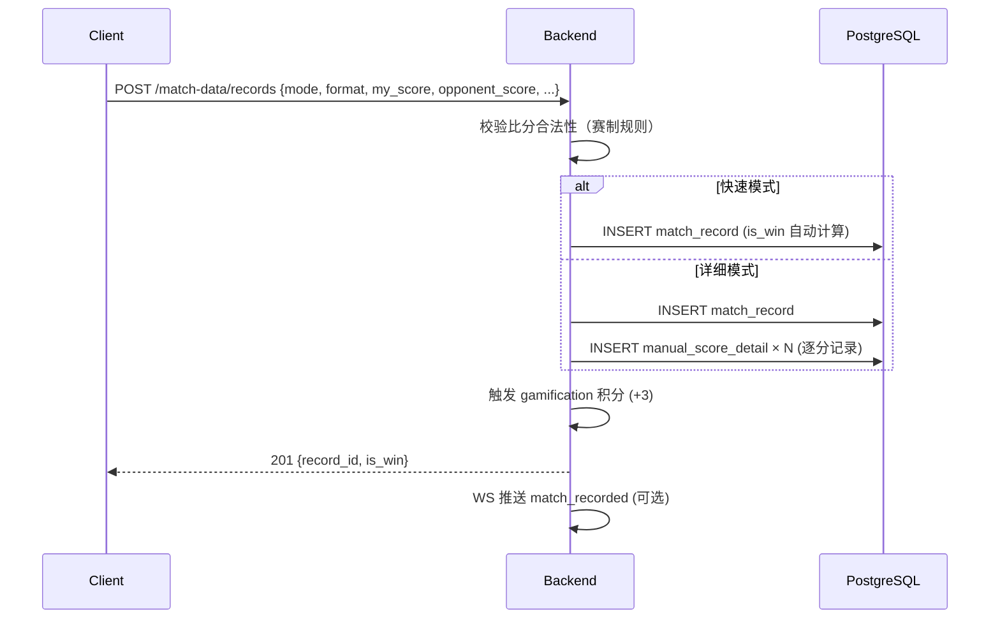

#### 验收标准

- [ ] 快速录入正确计算 is_win
- [ ] 详细录入的逐分记录正确关联 match_record
- [ ] 比赛记录支持按时间/胜负筛选
- [ ] 记分牌比赛可关联为 match_record（optional match_id）

---

### 2.6 数据看板模块 (data_dashboard)

#### 模块概述

| 属性 | 值 |
|------|-----|
| 模块名称 | `data_dashboard` |
| 所属目录 | `app/api/v1/dashboard/` |
| 一句话定位 | 聚合分析报告和比赛数据，提供战绩趋势、技术统计、累计落点热图等可视化数据 |
| 关联 API | 本文档第 5 节 API 契约 → 数据看板模块 |
| 依赖模块 | video_analysis, scoring, match_data |

#### 核心用户故事

| # | 角色 | 故事 | 价值 |
|---|------|------|------|
| US-1 | 登录用户 | 我想在首页看到胜率和训练频次概览 | 快速了解整体进步情况 |
| US-2 | 登录用户 | 我想查看战绩趋势折线图 | 直观看到进步或退步 |
| US-3 | 登录用户 | 我想查看累计落点热图 | 了解自己的落点分布习惯 |
| US-4 | 登录用户 | 我想查看技术统计环形图 | 了解正反手使用比例 |

#### 功能清单

| # | 功能点 | 优先级 | 复杂度 | 依赖 | 备注 |
|---|--------|--------|--------|------|------|
| F1 | 概览卡片 | P0 | 中 | — | 胜率/分析次数/训练频次，缓存 5min |
| F2 | 战绩趋势 | P0 | 中 | match_data | 折线图数据，缓存 1h |
| F3 | 技术统计 | P0 | 中 | video_analysis | 环形图数据，缓存 1h |
| F4 | 累计落点热图 | P0 | 高 | video_analysis | 预计算聚合，缓存 1h |
| F5 | 比赛记录列表 | P0 | 低 | match_data | 分页，实时查询 |

#### 业务规则

**BR-1: 预计算与缓存策略**

| 属性 | 值 |
|------|-----|
| 规则名 | 看板缓存失效 |
| 描述 | 写入时主动 bust 相关缓存，读取时未命中则实时计算并回填 |
| 触发条件 | 新分析报告完成 / 新比赛结束 / 报告删除 |
| 预期行为 | 分析完成 → Redis DEL `dashboard:overview:{user_id}`, `dashboard:technique:{user_id}`, `dashboard:heatmap:{user_id}`；比赛结束 → DEL `dashboard:overview:{user_id}`, `dashboard:winrate:{user_id}` |
| 异常处理 | 缓存未命中时降级实时计算（落点热图限制最近 10 次报告） |

#### 交互流程：看板缓存与预计算

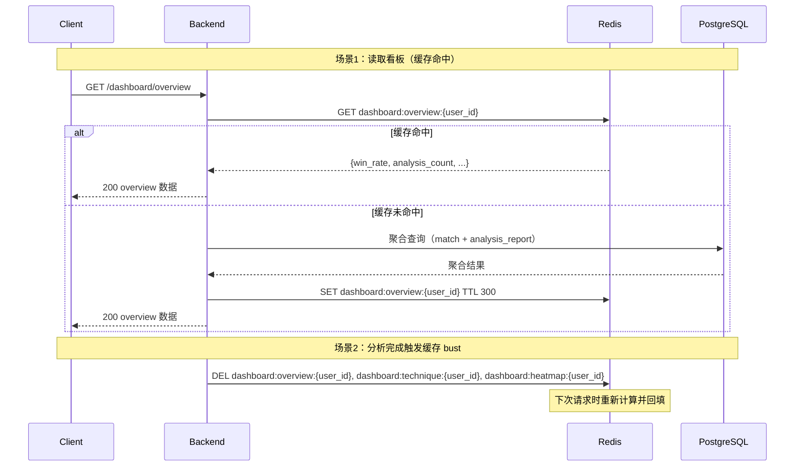

#### 验收标准

- [ ] 概览卡片缓存 5min
- [ ] 战绩趋势/技术统计缓存 1h
- [ ] 累计落点热图预计算正确（跨多次报告聚合九宫格）
- [ ] 新分析完成后相关缓存被 bust
- [ ] 比赛记录列表实时查询不缓存

---

### 2.7 训练建议模块 (training_advice)

#### 模块概述

| 属性 | 值 |
|------|-----|
| 模块名称 | `training_advice` |
| 所属目录 | `app/api/v1/training/` (与 `training_plan` 共用 training/ 目录) |
| 一句话定位 | 基于分析报告 + 历史趋势 + 知识库规则，生成个性化训练建议和训练计划模板 |
| 关联 API | 本文档第 5 节 API 契约 → 训练模块 |
| 依赖模块 | video_analysis, progress_analysis, knowledge_base |

#### 核心用户故事

| # | 角色 | 故事 | 价值 |
|---|------|------|------|
| US-1 | 登录用户 | 我想获得基于最新分析报告的训练建议 | 针对性改进技术短板 |
| US-2 | 登录用户 | 我想看到历史趋势对比（进步确认/持续问题） | 了解哪些问题在改善、哪些停滞 |
| US-3 | 会员用户 | 我想手动触发训练方案重新评估 | 主动调整训练方向 |
| US-4 | 登录用户 | 我想查看训练方案调整历史 | 了解方案变化轨迹 |

#### 功能清单

| # | 功能点 | 优先级 | 复杂度 | 依赖 | 备注 |
|---|--------|--------|--------|------|------|
| F1 | 基于报告的训练建议 | P0 | 高 | knowledge_base | 规则引擎 + 历史趋势 |
| F2 | 综合训练建议（自动取最新报告） | P0 | 高 | progress_analysis | 含进步确认/持续问题/新问题 |
| F3 | 训练方案模板列表 | P0 | 低 | knowledge_base | — |
| F4 | 模板详情 | P0 | 低 | — | — |
| F5 | 训练方案调整历史 | P0 | 中 | progress_analysis | 版本化记录 |

> **训练单生成 Phase 归属说明**（P1-5 修复）：
> - 需求 v0.4 Phase 1 含训练方案模板（Phase 2 提供训练单生成）（可跟随执行的内容清单）"，架构 §4 将 `training_plan` 模块（含训练单）归入 Phase 2。
> - **统一归属**：Phase 1 含训练方案模板（Phase 2 提供训练单生成）（从模板展开为每次训练的具体内容清单）+ 跟练模式 + 动态调整闭环。
> - **需求 v0.4 应同步更新**：Phase 1 含训练方案模板（Phase 2 提供训练单生成）"保持不变。

#### 业务规则

**BR-1: 训练建议生成规则**

| 属性 | 值 |
|------|-----|
| 规则名 | 基于历史对比的训练建议 |
| 描述 | 训练建议不可仅基于单次分析报告，必须结合历史趋势 |
| 触发条件 | GET /training/advice/{report_id} 或 GET /training/advice/contextual |
| 预期行为 | 1. 读取最新分析报告 + 历史趋势数据（technique_trend）+ 当前训练方案进度；2. 规则引擎匹配问题模式（单次规则 + 趋势规则）；3. 生成差异化建议：进步确认 / 持续问题警告 / 新问题识别 / 已改善确认 |
| 异常处理 | 无历史数据时 → 基于单次报告生成建议，标注"首次分析，建议持续记录以获得趋势分析" |

**BR-2: 训练方案动态调整**

| 属性 | 值 |
|------|-----|
| 规则名 | 方案有效性评估与调整 |
| 描述 | 每次新分析后自动评估当前训练方案有效性，必要时调整 |
| 触发条件 | AI 分析完成后自动触发 |
| 预期行为 | 改善中 → 维持方案；停滞(连续 3 次无改善) → 调整方案(更换方法/增加量)；退步 → 诊断原因；已达标 → 设新目标。每次调整生成 plan_adjustment 记录 |
| 异常处理 | 无当前方案 → 生成新方案 |

#### 交互流程：训练建议生成与方案调整

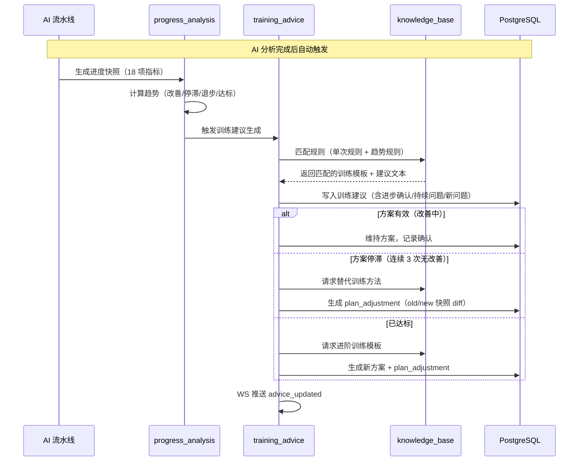

#### 验收标准

- [ ] 训练建议包含历史趋势对比内容
- [ ] 首次分析标注"首次分析"提示
- [ ] 方案调整记录版本化保存（old/new 快照 diff）
- [ ] 规则引擎正确匹配问题模式（单次 + 趋势）
- [ ] 训练方案模板可参数化生成

---

### 2.8 进度分析模块 (progress_analysis)

#### 模块概述

| 属性 | 值 |
|------|-----|
| 模块名称 | `progress_analysis` |
| 所属目录 | `app/api/v1/progress/` |
| 一句话定位 | 每次 AI 分析后自动生成进度快照，计算技术指标趋势，支持报告对比和方案有效性评估 |
| 关联 API | 本文档第 5 节 API 契约 → 进度分析模块 |
| 依赖模块 | video_analysis, match_data |

#### 核心用户故事

| # | 角色 | 故事 | 价值 |
|---|------|------|------|
| US-1 | 登录用户 | 我想对比两次分析报告的技术指标变化 | 量化看到进步幅度 |
| US-2 | 登录用户 | 我想查看单项技术指标的时间序列趋势 | 判断是否在持续改善 |
| US-3 | 登录用户 | 我想看到问题变化列表（新增/已解决/持续） | 了解技术短板的演变 |
| US-4 | 登录用户 | 我想看到进度综合摘要（含趋势预测） | 预估还需多久达成目标 |

#### 功能清单

| # | 功能点 | 优先级 | 复杂度 | 依赖 | 备注 |
|---|--------|--------|--------|------|------|
| F1 | 进度快照自动生成 | P0 | 高 | video_analysis | 18 项关键指标提取 |
| F2 | 技术指标趋势计算 | P0 | 高 | — | 方向/变化率/持续性 |
| F3 | 报告对比 | P0 | 高 | video_analysis | 两次报告全维度对比 |
| F4 | 进度综合摘要 | P0 | 高 | — | 趋势+问题变化+方案状态 |
| F5 | 问题变化列表 | P0 | 中 | — | 新增/已解决/持续 |
| F6 | 单项指标趋势详情 | P0 | 中 | — | 含时间序列数据 |

#### 业务规则

**BR-1: 进度快照自动生成**

| 属性 | 值 |
|------|-----|
| 规则名 | 18 项关键指标提取 |
| 描述 | AI 分析报告生成后，自动从 JSONB 中提取 18 项关键指标生成进度快照 |
| 触发条件 | AI 流水线 Step 9（报告生成）完成后自动触发 |
| 预期行为 | 读取 analysis_report.result_data → 提取 backhand_ratio, forehand_ratio, serve_ratio, landing_forehand_pct 等 18 项指标 → 写入 progress_snapshot.metrics_snapshot (JSONB) → 读取历史快照计算趋势 → 更新 technique_trend |
| 异常处理 | 指标缺失时填 null，不影响其他指标 |

**BR-2: 趋势判定规则**

| 趋势类型 | 判定条件 | 建议策略 |
|---------|---------|---------|
| 改善中 | 连续 ≥2 次分析，指标向目标值靠近，变化率 >5% | 进步确认 + 维持方案 |
| 停滞 | 连续 ≥3 次分析，变化率 <5%，未达目标 | 停滞警告 + 调整方案 |
| 退步 | 连续 ≥2 次分析，指标远离目标值，变化率 >5% | 退步警告 + 诊断原因 |
| 已达标 | 指标达到目标值并保持 ≥2 次 | 目标达成 + 设新目标 |
| 新问题 | 最新报告出现但历史未出现过 | 新问题识别 |
| 已解决 | 历史存在但最近 2 次消失 | 确认/巩固建议 |

#### 交互流程：进度快照生成与趋势计算

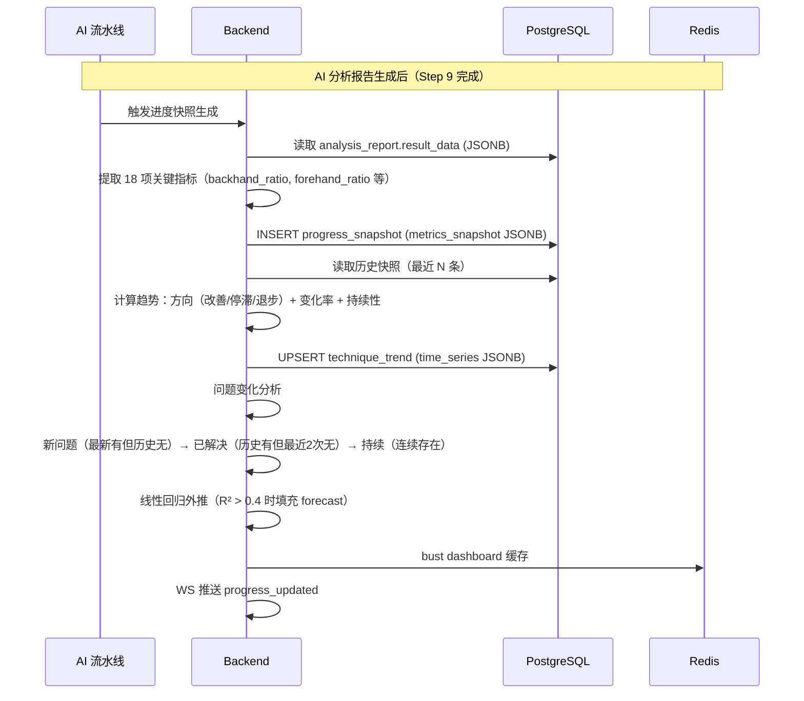

#### 验收标准

- [ ] AI 分析完成后自动生成进度快照
- [ ] 18 项指标全部可追踪
- [ ] 趋势计算结果正确（方向/变化率/持续性）
- [ ] 报告对比覆盖 6 个维度（技术/落点/回合/球速/得分/问题变化）
- [ ] 进度综合摘要包含 forecast 字段（R² > 0.4 时填充）

---

### 2.9 游戏化模块 (gamification)

#### 模块概述

| 属性 | 值 |
|------|-----|
| 模块名称 | `gamification` |
| 所属目录 | `app/api/v1/gamification/` (与 `badge_system` 共用，badge 逻辑在 badge_service.py) |
| 一句话定位 | 训练积分、打卡日历、基础徽章、连续打卡激励 |
| 关联 API | 本文档第 5 节 API 契约 → 游戏化模块 |
| 依赖模块 | auth, video_analysis, scoring |

#### 核心用户故事

| # | 角色 | 故事 | 价值 |
|---|------|------|------|
| US-1 | 登录用户 | 我想通过每日打卡获得训练积分 | 保持训练动力 |
| US-2 | 登录用户 | 我想查看打卡日历 | 回顾训练连续性 |
| US-3 | 登录用户 | 我想看到连续打卡火焰图标 | 获得成就感 |
| US-4 | 登录用户 | 我想查看徽章列表（已获得/未获得） | 有目标地解锁成就 |

#### 功能清单

| # | 功能点 | 优先级 | 复杂度 | 依赖 | 备注 |
|---|--------|--------|--------|------|------|
| F1 | 训练积分查询 | P0 | 低 | — | 总积分 + 月度积分 |
| F2 | 打卡日历 | P0 | 中 | — | 月度可视化 |
| F3 | 手动打卡 | P0 | 低 | — | 1/天 限流 |
| F4 | 基础徽章列表 | P0 | 中 | — | 已获得/未获得 |

#### 业务规则

**BR-1: 训练积分获取规则**

| 事件 | 积分 | 说明 |
|------|------|------|
| 完成 AI 分析 | +10 | 每次分析 |
| 完成记分牌比赛 | +5 | 每场比赛 |
| 手动录入比赛 | +3 | 每场记录 |
| 每日打卡 | +2 | 每日首次 |
| 连续打卡 7 天 | +20 | 额外奖励 |
| 连续打卡 30 天 | +100 | 额外奖励 |
| 完成训练单 | +5 | 每次完成训练会话（Phase 2 上线训练方案后生效） |

**BR-2: 连续打卡计算**

| 属性 | 值 |
|------|-----|
| 规则名 | 连续打卡火焰 |
| 描述 | 连续训练天数，断裂后归零 |
| 触发条件 | 打卡/分析/记分时更新 |
| 预期行为 | 读取 Redis `streak:user:{user_id}` → 与上次打卡日期比较：相邻 → INCR；间隔 1 天 → 重置为 1；间隔 >1 天 → 重置为 1 |
| 异常处理 | — |

#### 交互流程：积分获取与徽章检测

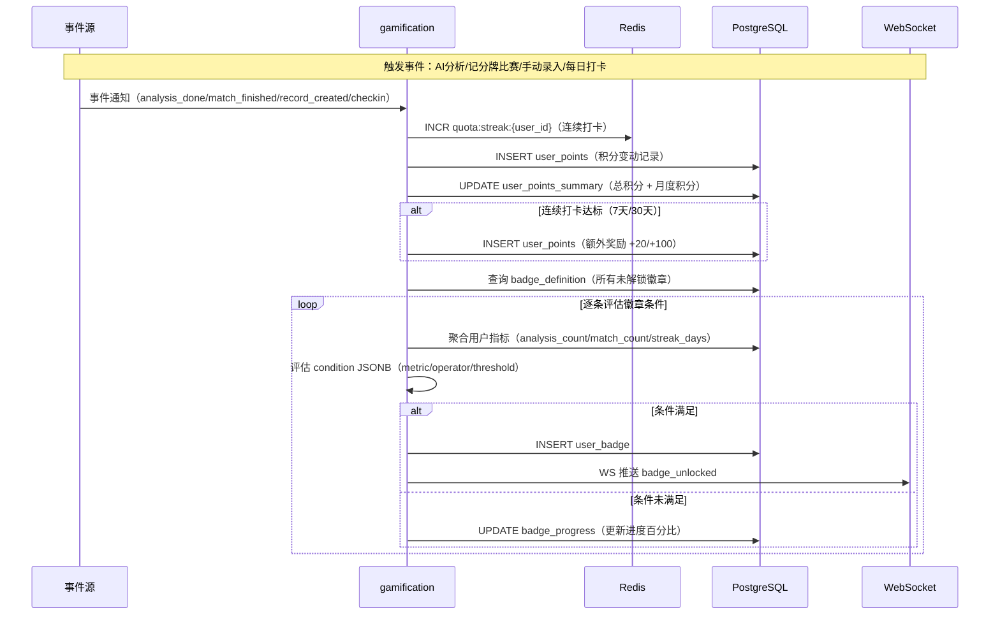

#### 验收标准

- [ ] 积分正确累加（分析/记分/录入/打卡）
- [ ] 连续打卡正确计算和重置
- [ ] 打卡日历返回月度打卡记录
- [ ] 徽章列表区分已获得/未获得 + 进度

---

### 2.10 会员模块 (membership)

#### 模块概述

| 属性 | 值 |
|------|-----|
| 模块名称 | `membership` |
| 所属目录 | `app/api/v1/membership/` |
| 一句话定位 | 会员等级管理、权益配置、订阅/续费、免费额度控制 |
| 关联 API | 本文档第 5 节 API 契约 → 会员模块 |
| 依赖模块 | auth, payment |

#### 核心用户故事

| # | 角色 | 故事 | 价值 |
|---|------|------|------|
| US-1 | 免费用户 | 我想查看会员等级权益对比 | 决定是否升级 |
| US-2 | 免费用户 | 我想查看今日剩余免费分析次数 | 规划当日使用 |
| US-3 | 会员用户 | 我想查看当前会员状态和到期时间 | 知道何时需要续费 |
| US-4 | 到期会员 | 我希望在到期前收到续费提醒 | 避免权益中断 |

#### 功能清单

| # | 功能点 | 优先级 | 复杂度 | 依赖 | 备注 |
|---|--------|--------|--------|------|------|
| F1 | 会员等级与权益对比 | P0 | 低 | — | 缓存 1h |
| F2 | 当前会员状态 | P0 | 低 | — | 含到期时间 |
| F3 | 今日剩余免费额度 | P0 | 中 | — | Redis 计数 |

#### 业务规则

**BR-1: 订阅生命周期**

状态转换：`active → expiring_soon (到期前 3 天) → expired → grace_period (7 天宽限) → closed`

**BR-2: 到期检测机制**

| 属性 | 值 |
|------|-----|
| 规则名 | 会员到期检测 |
| 描述 | Celery Beat 每日 00:30 扫描 subscription 表 + 实时校验兜底 |
| 触发条件 | 定时任务 + 每次请求会员功能时 |
| 预期行为 | 到期前 3 天标记 expiring_soon + 发送续费提醒；到期后标记 expired + 触发权益降级；7 天后标记 closed |
| 异常处理 | Celery 延迟时实时校验兜底（检查 expire_at） |

**BR-3: 权益到期后的数据访问**

| 数据类型 | 到期后 | 说明 |
|---------|--------|------|
| 历史分析报告 | ✅ 只读 | 不可新建分析（免费额度 3/天） |
| 标注视频 | ✅ 30 天内 | CDN 缓存自然过期 |
| 训练方案 | ✅ 只读 | 不可生成新方案 |
| 3D 教学 | ❌ | 入口隐藏 |
| 进度分析/趋势对比 | ❌ | 入口隐藏 |
| 数据看板 | ✅ 基础 | 胜率/比赛记录可见；热图/技术统计降级 |

#### 交互流程：会员到期检测与权益降级

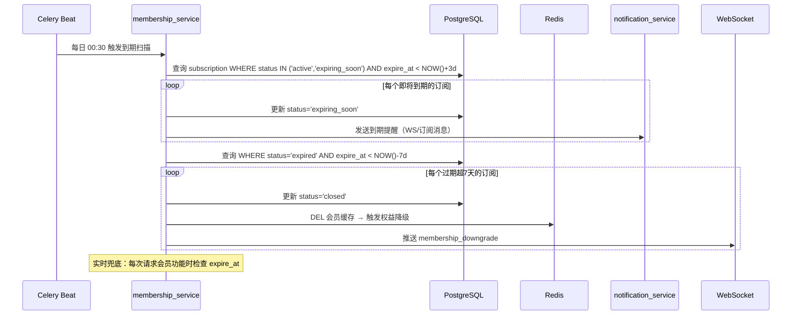

#### 验收标准

- [ ] 会员等级权益配置正确（免费/会员 ¥19/专业 ¥39/教练 ¥99）
- [ ] 免费额度计数器正确工作（每日重置）
- [ ] 到期检测准确（3 天提醒/到期降级/7 天关闭）
- [ ] 权益降级策略正确（数据保留/功能隐藏）

---

### 2.11 支付模块 (payment)

#### 模块概述

| 属性 | 值 |
|------|-----|
| 模块名称 | `payment` |
| 所属目录 | `app/api/v1/payment/` |
| 一句话定位 | 微信支付集成、订单管理、支付回调、退款 |
| 关联 API | 本文档第 5 节 API 契约 → 支付模块 |
| 依赖模块 | auth, membership |

#### 核心用户故事

| # | 角色 | 故事 | 价值 |
|---|------|------|------|
| US-1 | 免费用户 | 我想通过微信支付购买会员 | 解锁无限分析等权益 |
| US-2 | 登录用户 | 我想查看历史订单记录 | 核对消费明细 |
| US-3 | 登录用户 | 支付成功后我想立即收到通知 | 确认支付到账并开始使用权益 |
| US-4 | 登录用户 | 支付回调重复发送时系统不应重复扣款 | 保证支付安全可靠 |

#### 功能清单

| # | 功能点 | 优先级 | 复杂度 | 依赖 | 备注 |
|---|--------|--------|--------|------|------|
| F1 | 创建订单 | P0 | 高 | membership | 会员订阅/分析次数包 |
| F2 | 订单列表 | P0 | 低 | — | 分页 |
| F3 | 微信支付回调 | P0 | 高 | — | 验签 + 解密 + 业务触发 |

#### 业务规则

**BR-1: 订单创建与支付流程**

| 属性 | 值 |
|------|-----|
| 规则名 | 微信支付流程 |
| 描述 | 创建订单 → 调用微信统一下单 → 返回支付参数 → 用户支付 → 异步回调更新订单 |
| 触发条件 | POST /payment/orders |
| 预期行为 | 1. 创建 order (status=pending)；2. 调用微信统一下单 (JSAPI/APP)；3. 返回 prepay_id + 签名参数；4. 等待异步回调 |
| 异常处理 | 微信下单失败 → 500 "支付服务暂时不可用"；回调验签失败 → 400 "签名验证失败" |

**BR-2: 支付回调业务触发**

| 属性 | 值 |
|------|-----|
| 规则名 | 支付成功后业务处理 |
| 描述 | 支付成功后根据订单类型触发对应业务逻辑 |
| 触发条件 | 微信支付异步回调 |
| 预期行为 | 订阅 → 创建/续期 subscription；分析包 → 增加额外额度；电商 → 创建发货单 |
| 异常处理 | 订单已处理（重复回调）→ 200 ACK 幂等返回 |

#### 交互流程：支付回调全流程

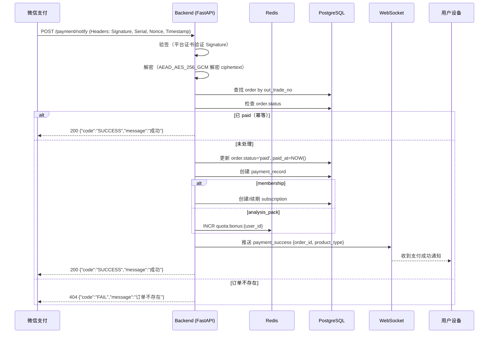

#### 验收标准

- [ ] 订单创建 → 微信下单 → 回调更新 全流程正确
- [ ] 回调验签正确（APIv3 证书验证）
- [ ] 重复回调幂等处理
- [ ] 支付成功后正确触发业务逻辑（会员开通等）
- [ ] WS 推送支付成功通知

---

### 2.12 通知模块 (notification)

#### 模块概述

| 属性 | 值 |
|------|-----|
| 模块名称 | `notification` |
| 所属目录 | `app/api/v1/notification/` |
| 一句话定位 | WebSocket 实时推送、微信订阅消息、训练提醒、离线消息补偿 |
| 关联 API | 本文档第 5 节 API 契约 → 通知模块 |
| 依赖模块 | auth |

#### 核心用户故事

| # | 角色 | 故事 | 价值 |
|---|------|------|------|
| US-1 | 登录用户 | 我想在 AI 分析完成后收到推送通知 | 不需要一直等在页面 |
| US-2 | 登录用户 | 我想在多设备间同步看到比分更新 | 多人观赛体验 |
| US-3 | 离线用户 | 断连重连后我想自动拉取期间遗漏的消息 | 不丢失任何通知 |
| US-4 | 登录用户 | 我想通过微信订阅消息收到训练提醒 | 保持训练频率 |

#### 功能清单

| # | 功能点 | 优先级 | 复杂度 | 依赖 | 备注 |
|---|--------|--------|--------|------|------|
| F1 | 通知列表 | P0 | 低 | — | 分页 |
| F2 | 标记已读 | P0 | 低 | — | — |
| F3 | 微信订阅消息授权 | P0 | 中 | — | 一次性订阅 |

#### 业务规则

**BR-1: 通知通道选择**

| 通知类型 | 用户在线 (WS) | 用户离线 (小程序) | 用户离线 (App) |
|---------|-------------|----------------|--------------|
| AI 分析完成 | ✅ WS 推送 | ✅ 微信订阅消息 | ✅ 推送通知 |
| 记分牌实时同步 | ✅ WS 推送 | ❌ | ❌ |
| 训练提醒 | ❌ | ✅ 微信订阅消息 | ✅ 推送通知 |
| 支付成功 | ✅ WS 推送 | ✅ 微信订阅消息 | ✅ 推送通知 |

**BR-2: 断连期间消息补偿**

| 属性 | 值 |
|------|-----|
| 规则名 | 离线消息补偿 |
| 描述 | 用户断连期间的消息写入 notification_record，重连后拉取 |
| 触发条件 | WebSocket 重连 |
| 预期行为 | AI 分析完成时断连 → 消息写入 DB → 重连后 GET /notification/list 拉取 + WS `sync` 事件 |
| 异常处理 | — |

#### 交互流程：通知通道选择与离线补偿

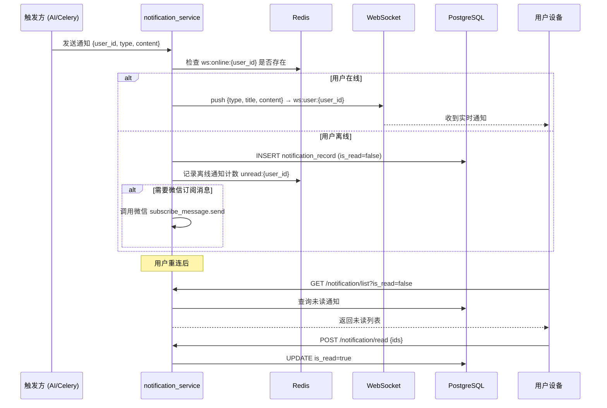

#### 验收标准

- [ ] WebSocket 通道选择矩阵正确实现
- [ ] 离线消息正确写入 DB 并在重连后拉取
- [ ] 训练提醒 Celery Beat 定时触发（每日 19:00，>3 天未训练）
- [ ] 频率控制（同一用户每周最多 2 次训练提醒）

---

## 3. Phase 1 基础设施模块

### 3.1 知识库模块 (knowledge_base)

| 属性 | 值 |
|------|-----|
| 模块名称 | `knowledge_base` |
| 所属目录 | `app/services/knowledge_base_service.py`（无独立路由，供 training_advice 调用） |
| 一句话定位 | 乒乓球专业知识库结构化存储、规则引擎、训练方案模板 |
| 关联数据表 | knowledge_category, knowledge_entry, rule_definition, training_template |
| 依赖模块 | admin (CRUD 管理), training_advice (调用规则引擎) |

#### 功能清单

| # | 功能点 | 优先级 | 复杂度 | 依赖 | 备注 |
|---|--------|--------|--------|------|------|
| F1 | 技术动作分类树管理 | P0 | 中 | — | 8 大类，JSONB 存储 |
| F2 | 常见问题库 CRUD | P0 | 低 | — | 10+ 问题，结构化 |
| F3 | 规则定义 CRUD | P0 | 中 | — | 单次规则 + 趋势规则 |
| F4 | 训练方案模板 CRUD | P0 | 中 | — | 参数化模板 |
| F5 | 规则引擎匹配 | P0 | 高 | progress_analysis | 核心逻辑 |
| F6 | 知识库初始化脚本 | P0 | 低 | — | scripts/init_knowledge_base.py |

#### 业务规则

**BR-1: 规则引擎匹配流程**

| 属性 | 值 |
|------|-----|
| 规则名 | 多层规则匹配 |
| 描述 | 根据分析报告 + 历史趋势数据，依次执行 4 类规则匹配 |
| 触发条件 | training_advice_service 调用 |
| 预期行为 | 1. **单次规则**：检查当前报告指标是否触发阈值（如 backhand_ratio < 0.30 → PROBLEM_003）；2. **趋势规则**：检查 technique_trend 趋势方向（improving/stagnant/declining）；3. **改善规则**：指标连续改善 ≥2 次 → 生成进步确认建议；4. **停滞规则**：指标连续停滞 ≥3 次 → 生成停滞警告 + 方案调整建议 |
| 异常处理 | 规则 condition JSONB 解析失败 → 跳过该规则，记录日志 |

**BR-2: 模板参数化规则**

| 属性 | 值 |
|------|-----|
| 规则名 | 训练方案模板参数化 |
| 描述 | 模板中含占位符（如 `{target_ratio}`），根据用户当前指标值填充 |
| 触发条件 | 生成训练建议时 |
| 预期行为 | 读取 training_template.template_data → 用当前指标值替换占位符 → 生成个性化训练方案 |
| 异常处理 | 模板占位符与指标不匹配 → 使用模板默认值 |

**BR-3: 知识库 CRUD 接口**

| 操作 | 权限 | 说明 |
|------|------|------|
| 分类树查询 | 登录 | 返回 8 大分类树 |
| 条目查询 | 登录 | 按 category_code 查询 |
| 规则查询 | 登录 | 按 problem_id 查询关联规则 |
| 模板查询 | 登录 | 按 problem_id 筛选模板 |
| 分类/条目/规则/模板 CRUD | 管理员 | 通过 admin 模块调用 |

#### 验收标准

- [ ] 8 大技术动作分类树正确存储和查询
- [ ] 规则引擎正确执行 4 类匹配（单次/趋势/改善/停滞）
- [ ] 训练方案模板占位符正确填充
- [ ] 初始化脚本正确解析 Markdown 知识库文件并写入 DB
- [ ] 管理员可通过 admin 接口管理知识库 CRUD

### 3.2 AI 流水线模块 (ai_pipeline)

| 属性 | 值 |
|------|-----|
| 模块名称 | `ai_pipeline` |
| 所属目录 | `app/services/ai_pipeline_service.py` + `app/tasks/ai_pipeline.py`（Celery） |
| 一句话定位 | AI 分析流水线编排、Celery 任务定义、进度追踪、结果聚合 |
| 关联数据表 | video_task, pipeline_step, analysis_report |
| 依赖模块 | ai_inference, video_analysis, notification |

#### 功能清单

| # | 功能点 | 优先级 | 复杂度 | 依赖 | 备注 |
|---|--------|--------|--------|------|------|
| F1 | 10 步流水线编排 | P0 | 高 | ai_inference | Celery chain/group |
| F2 | 进度追踪与推送 | P0 | 中 | notification | 每步 WS push |
| F3 | 结果聚合 | P0 | 高 | — | 10 步结果合并为 JSONB |
| F4 | 超时与重试 | P0 | 中 | — | 600s 超时，2 次重试 |
| F5 | 失败处理 | P0 | 中 | — | 标记 failed + 退还额度 |

#### 10 步流水线详细规格

| Step | 名称 | 输入 | 输出 | 依赖步骤 | 超时(s) | 重试 |
|------|------|------|------|---------|---------|------|
| 1 | 视频预处理 | oss_key (原始视频) | 标准化帧序列 (fps=30, 1080p) | — | 120 | 2 |
| 2 | 球台检测 | 帧序列 | 球台四角坐标 + 单应性矩阵 | — | 60 | 2 |
| 3 | 球体检测 | 帧序列 + 球台坐标 | 每帧球体 bbox | 1,2 | 180 | 2 |
| 4 | 球体追踪 | 球体 bbox 序列 | 卡尔曼滤波轨迹 | 3 | 60 | 1 |
| 5 | 落点估算 | 轨迹 + 单应性矩阵 | 九宫格落点坐标 | 4 | 30 | 1 |
| 6 | 姿态估计 | 帧序列 | MediaPipe 33 关键点 | 1 | 120 | 2 |
| 7 | 动作识别 | 关键点序列 + 帧序列 | 击球动作分类（正手攻/拉/搓等） | 6 | 120 | 2 |
| 8 | 回合分割 | 轨迹 + 动作 + 落点 | 回合边界 + 每回合技术统计 | 5,7 | 30 | 1 |
| 9 | 报告生成 | Step 3-8 全部结果 | result_data JSONB + report_text JSONB | 8 | 60 | 1 |
| 10 | 标注视频 | 帧序列 + 全部检测结果 | 标注视频 MP4 (上传 OSS) | 9 | 120 | 1 |

**并行策略**：Step 1-2 可并行；Step 3-5 串行（级联依赖）；Step 6-7 串行；Step 3-5 与 Step 6-7 可并行执行。

#### 业务规则

**BR-1: 流水线编排**

| 属性 | 值 |
|------|-----|
| 规则名 | Celery 编排策略 |
| 描述 | 使用 Celery chain + group 实现串行/并行编排 |
| 触发条件 | POST /video-analysis/tasks 入队后 |
| 预期行为 | group(step1, step2) → chain(step3→4→5) | chain(step6→7) → chain(step8→9→10)，两个 chain 并行后 join |
| 异常处理 | 任一步骤失败 → 中断后续步骤 → 标记 task.status=failed |

**BR-2: 进度推送协议**

| 属性 | 值 |
|------|-----|
| 规则名 | WebSocket 进度推送 |
| 描述 | 每步开始和完成时推送进度 |
| 触发条件 | 每步执行前后 |
| 预期行为 | 开始时 WS push `{event:"analysis_progress", data:{task_id, step:N, total:10, message:"球体检测中..."}}`；完成时更新 pipeline_step.status=completed |
| 异常处理 | WS 推送失败 → 仅写 DB，不阻塞流水线 |

**BR-3: 超时与重试策略**

| 属性 | 值 |
|------|-----|
| 规则名 | 单步超时与指数退避重试 |
| 描述 | 每步独立超时控制，失败后指数退避重试 |
| 触发条件 | 步骤执行超时或异常 |
| 预期行为 | 超时 → Celery `time_limit` 触发 → 标记 step.status=timeout → 重试（间隔 10s, 30s）→ 达到最大重试次数 → 标记 task.status=failed |
| 异常处理 | 重试次数耗尽 → 退还免费额度（Redis DECR）→ WS push `analysis_failed` |

**BR-4: 结果聚合**

| 属性 | 值 |
|------|-----|
| 规则名 | 10 步结果合并 |
| 描述 | Step 9 将 Step 3-8 的输出聚合为 analysis_report.result_data |
| 触发条件 | Step 8 完成后 |
| 预期行为 | 合并落点(Step5) + 技术统计(Step7) + 回合(Step8) + 球速(Step3-4 推算) → result_data JSONB → LLM 生成 report_text → 写入 analysis_report |
| 异常处理 | LLM 不可用 → 使用模板生成 report_text，标记 is_llm_generated=false |

#### 验收标准

- [ ] 10 步流水线按依赖关系正确执行
- [ ] Step 1-2 并行 + Step 3-5 与 6-7 并行
- [ ] 每步进度通过 WebSocket 实时推送
- [ ] 超时正确触发重试，重试次数耗尽后标记 failed
- [ ] 失败后免费额度正确退还
- [ ] 结果 JSONB 结构完整（含落点/技术/回合/球速/文字结论）

### 3.3 AI 推理服务 (ai_inference)

| 属性 | 值 |
|------|-----|
| 模块名称 | `ai_inference` |
| 部署方式 | 独立部署在 GPU 实例（T4 Spot），通过 HTTP API 供 ai_pipeline 调用 |
| 一句话定位 | 模型加载、推理 API、健康检查、降级策略 |
| 依赖模块 | ai_pipeline（调用方） |

#### 功能清单

| # | 功能点 | 优先级 | 复杂度 | 依赖 | 备注 |
|---|--------|--------|--------|------|------|
| F1 | 球检测推理 API | P0 | 高 | TTNet/TrackNetV5 | POST /infer/ball-detection |
| F2 | 球台检测推理 API | P0 | 中 | YOLO-pose | POST /infer/table-detection |
| F3 | 姿态估计推理 API | P0 | 中 | MediaPipe | POST /infer/pose |
| F4 | 动作识别推理 API | P0 | 中 | Temporal CNN | POST /infer/action |
| F5 | 模型加载与切换 | P0 | 中 | — | 热加载 + 版本管理 |
| F6 | 健康检查 | P0 | 低 | — | GET /health |
| F7 | 超时与降级 | P0 | 中 | — | 超时降级策略 |

#### 推理 API 设计

| 端点 | Method | 输入 | 输出 | 超时 |
|------|--------|------|------|------|
| /infer/ball-detection | POST | `{oss_key, frame_range}` | `{frames: [{frame_id, boxes: [{x,y,w,h,conf}]}]}` | 180s |
| /infer/table-detection | POST | `{oss_key}` | `{corners: [{x,y}], homography: [[...]]}` | 60s |
| /infer/pose | POST | `{oss_key, frame_range}` | `{frames: [{frame_id, keypoints: [[x,y,vis]...33]}]}` | 120s |
| /infer/action | POST | `{keypoints_sequence, frames_range}` | `{actions: [{frame_range, label, conf}]}` | 120s |

#### 业务规则

**BR-1: 模型加载与切换**

| 属性 | 值 |
|------|-----|
| 规则名 | 热加载模型 |
| 描述 | 服务启动时加载默认模型版本，支持运行时切换 |
| 触发条件 | 服务启动 / 管理员触发切换 |
| 预期行为 | 1. 启动时加载默认版本模型到 GPU 显存；2. 切换时异步加载新模型 → 加载完成后原子替换 → 释放旧模型显存 |
| 异常处理 | 新模型加载失败 → 保持旧模型运行，记录错误日志 |

**BR-2: 超时与降级**

| 属性 | 值 |
|------|-----|
| 规则名 | 推理超时降级 |
| 描述 | 推理请求超时后返回降级结果而非直接失败 |
| 规发条件 | 推理 API 响应超时 |
| 预期行为 | 球检测超时 → 返回空结果（流水线标记 failed）；姿态估计超时 → 跳过姿态/动作步骤（报告标注"未含动作分析"） |
| 异常处理 | GPU OOM → 重启服务 + 重新排队任务 |

**BR-3: 健康检查**

| 属性 | 值 |
|------|-----|
| 规则名 | 推理服务健康检查 |
| 描述 | Celery Beat 每 30s 检查推理服务可用性 |
| 触发条件 | 定时任务 |
| 预期行为 | GET /health → 200 则标记可用；超时/5xx → 标记不可用 + 告警；恢复后自动标记可用 |
| 异常处理 | 不可用时 ai_pipeline 进入降级模式（拒绝新任务 + WS 通知排队中） |

#### 验收标准

- [ ] 4 个推理 API 端点正确返回检测结果
- [ ] 模型热加载切换不影响正在执行的推理任务
- [ ] 推理超时后降级策略正确执行
- [ ] 健康检查每 30s 执行，不可用时正确告警
- [ ] GPU OOM 自动恢复

### 3.4 文件管理模块 (file_management)

| 属性 | 值 |
|------|-----|
| 模块名称 | `file_management` |
| 所属目录 | `app/api/v1/files/` |
| 一句话定位 | STS Token 发放、OSS 直传校验、文件生命周期管理、孤儿文件清理 |
| 关联 API | API 详细设计 → 视频分析模块（upload-token / upload-complete 端点由 video_analysis 路由调用 file_service） |
| 依赖模块 | auth, core/oss.py |

#### 核心用户故事

| # | 角色 | 故事 | 价值 |
|---|------|------|------|
| US-1 | 登录用户 | 我想获取上传凭证直接传视频到 OSS | 减少后端中转，提高上传速度 |
| US-2 | 登录用户 | 我想在上传失败后重试 | 弱网环境下不丢失上传进度 |
| US-3 | 系统 | 自动清理未完成上传的孤儿文件 | 控制 OSS 存储成本 |

#### 功能清单

| # | 功能点 | 优先级 | 复杂度 | 依赖 | 备注 |
|---|--------|--------|--------|------|------|
| F1 | STS Token 签发 | P0 | 中 | core/oss.py | PutObject 权限，15min 过期 |
| F2 | 上传完成校验 | P0 | 中 | core/oss.py | HEAD Object 确认 |
| F3 | 孤儿文件清理 | P0 | 中 | Celery Beat | 定时扫描 status=uploading 超时 |
| F4 | 文件软删除 | P0 | 低 | — | status=deleted，24h 后物理删除 |
| F5 | OSS Lifecycle 规则管理 | P1 | 低 | — | 通过 OSS API 配置生命周期 |

#### 业务规则

**BR-1: STS Token 签发**

| 属性 | 值 |
|------|-----|
| 规则名 | STS 直传凭证 |
| 描述 | 为用户签发限定权限的 STS Token，允许直传 OSS |
| 触发条件 | POST /video-analysis/upload-token |
| 预期行为 | 1. 校验文件类型（mp4/mov）+ 大小（≤500MB）；2. 生成 OSS Key：`videos/raw/{user_id}/{yyyymmdd}/{uuid}.mp4`；3. 请求 STS Token（PutObject 权限，15min 过期）；4. 创建 file_record（status=uploading） |
| 异常处理 | 文件类型不支持 → 400 "仅支持 MP4/MOV 格式"；文件过大 → 400 "视频文件不能超过 500MB" |

**BR-2: 上传完成校验**

| 属性 | 值 |
|------|-----|
| 规则名 | HEAD Object 校验 |
| 描述 | 客户端上传完成后，后端通过 HEAD Object 确认文件存在且大小匹配 |
| 触发条件 | POST /video-analysis/upload-complete |
| 预期行为 | 1. HEAD Object 获取文件元数据；2. 校验 Content-Length 与 file_record.file_size 一致；3. 更新 file_record（status=uploaded, oss_etag, actual_size, uploaded_at） |
| 异常处理 | OSS 文件不存在 → 404 "未检测到上传的文件，请重新上传"；大小不匹配 → 400 "上传文件大小与声明不符" |

**BR-3: 孤儿文件清理**

| 属性 | 值 |
|------|-----|
| 规则名 | 定时清理孤儿文件 |
| 描述 | Celery Beat 每小时扫描 status=uploading 且 created_at 超过 1 小时的记录 |
| 触发条件 | Celery Beat 定时任务 |
| 预期行为 | 1. 查询 file_record WHERE status='uploading' AND created_at < NOW() - INTERVAL '1 hour'；2. 尝试删除 OSS 对象（忽略 404）；3. 更新 file_record.status='abandoned' |
| 异常处理 | OSS 删除失败 → 记录日志，不阻塞状态更新 |

**BR-4: 文件软删除**

| 属性 | 值 |
|------|-----|
| 规则名 | 软删除机制 |
| 描述 | 用户删除分析报告时，关联的源视频文件标记为软删除，24h 后物理删除 |
| 触发条件 | 分析报告删除 / 用户注销 |
| 预期行为 | 1. file_record.status='deleted'，记录 deleted_at；2. Celery 延迟任务 24h 后删除 OSS 对象 |
| 异常处理 | — |

#### 验收标准

- [ ] STS Token 可成功直传 OSS（PutObject 权限）
- [ ] HEAD Object 校验正确拒绝不存在的文件
- [ ] HEAD Object 校验正确检测大小不匹配
- [ ] 孤儿文件清理正确执行（uploading + 1h 超时 → abandoned）
- [ ] 软删除后 24h 内 OSS 对象被物理删除
- [ ] OSS Key 命名遵循 `videos/raw/{user_id}/{yyyymmdd}/{uuid}.mp4` 规范

---

### 3.5 管理后台模块 (admin)

| 属性 | 值 |
|------|-----|
| 模块名称 | `admin` |
| 所属目录 | `app/api/v1/admin/` |
| 一句话定位 | 管理员认证、用户管理、内容审核、系统配置管理、知识库管理、审计日志 |
| 关联 API | Phase 1 暴露管理 API（管理员认证、用户管理、知识库 CRUD、审计日志、系统配置），路径前缀 `/api/v1/admin/`；使用独立 AdminUser 认证（非普通 JWT）；**MA-1 已对齐**：架构 §4.1 已更新，Phase 1 暴露管理 API 为正式设计决策，RBAC 角色守卫（get_current_admin / require_super_admin）控制访问权限 |
| 依赖模块 | auth (独立 AdminUser 认证), knowledge_base, ai_inference |

#### 核心用户故事

| # | 角色 | 故事 | 价值 |
|---|------|------|------|
| US-1 | 超级管理员 | 我想管理用户（封禁/解禁/查看详情） | 维护社区秩序 |
| US-2 | 内容管理员 | 我想审核用户反馈的 AI 分析结果 | 推进数据飞轮标注流程 |
| US-3 | 超级管理员 | 我想管理知识库（分类/条目/规则 CRUD） | 优化训练建议质量 |
| US-4 | 超级管理员 | 我想修改系统配置（开关/阈值） | 无需重启即可调整运行参数 |
| US-5 | 超级管理员 | 我想查看操作审计日志 | 追溯管理操作 |

#### 功能清单

| # | 功能点 | 优先级 | 复杂度 | 依赖 | 备注 |
|---|--------|--------|--------|------|------|
| F1 | 管理员认证 | P0 | 中 | — | 独立 AdminUser 表，用户名+密码，不使用 JWT |
| F2 | 用户管理 | P0 | 中 | user | 封禁/解禁/角色调整/列表查询 |
| F3 | 内容审核队列 | P1 | 中 | video_analysis | Phase 3 社区上线后激活 |
| F4 | 系统配置管理 | P0 | 低 | system_config | 键值对 CRUD + 缓存刷新 |
| F5 | 审计日志查询 | P0 | 低 | audit_log | 按管理员/操作类型/时间筛选 |
| F6 | 知识库管理 | P0 | 中 | knowledge_base | 分类/条目/规则 CRUD |
| F7 | 模型版本管理 | P2 | 中 | ai_inference | Phase 2+ 模型版本切换 |

#### 业务规则

**BR-1: 管理员独立认证**

| 属性 | 值 |
|------|-----|
| 规则名 | AdminUser 认证 |
| 描述 | 管理后台使用独立的 AdminUser 表，不使用普通用户 JWT 认证体系 |
| 触发条件 | 管理后台登录 |
| 预期行为 | 1. 用户名+密码（bcrypt 验证）；2. 签发管理员 session（Redis 存储，30min 过期）；3. 后续请求校验 session + role 权限 |
| 异常处理 | 密码错误 → 401 "用户名或密码错误"；账号被禁用 → 403 "管理员账号已禁用" |

**BR-2: 操作审计**

| 属性 | 值 |
|------|-----|
| 规则名 | 全操作审计记录 |
| 描述 | 所有管理操作必须记录 audit_log |
| 触发条件 | 任何管理 Service 方法执行后 |
| 预期行为 | 1. 写入 audit_log（admin_id, action, target_type, target_id, changes）；2. changes 为 JSONB 格式 {field: {old, new}} |
| 异常处理 | 审计日志写入失败 → 记录错误日志，不阻塞主操作 |

**BR-3: 系统配置热更新**

| 属性 | 值 |
|------|-----|
| 规则名 | 配置缓存刷新 |
| 描述 | 修改 system_config 后清除 Redis 缓存，实现配置热更新 |
| 触发条件 | 更新 system_config |
| 预期行为 | 1. 更新 system_config 表；2. Redis DEL `config:{config_key}`；3. 下次读取时从 DB 重新加载并缓存 |
| 异常处理 | — |

#### 验收标准

- [ ] 管理员认证独立于普通用户（AdminUser 表，不使用 JWT）
- [ ] 用户封禁/解禁操作正确更新 user.status
- [ ] 所有管理操作写入 audit_log
- [ ] 系统配置修改后 Redis 缓存被清除，下次读取获取最新值
- [ ] 知识库 CRUD 操作正确更新 knowledge_category / knowledge_entry / rule_definition 表 |

---

## 4. Phase 2-4 模块规格摘要

### 4.1 advanced_analysis（高级视频分析）

| 属性 | 值 |
|------|-----|
| 模块名称 | `advanced_analysis` |
| 所属目录 | `app/api/v1/advanced_analysis/` |
| 一句话定位 | 在 Phase 1 基础分析之上提供球速范围值、击球动作细节、弧度分析、攻防转换时间轴 |
| 依赖模块 | video_analysis, ai_pipeline |
| 权限 | 专业版及以上 |

#### 核心用户故事

| # | 角色 | 故事 | 价值 |
|---|------|------|------|
| US-1 | 专业版用户 | 我想查看精确的球速范围数据 | 了解自己的击球力量水平 |
| US-2 | 专业版用户 | 我想查看每板击球的弧度分析 | 判断击球质量 |
| US-3 | 专业版用户 | 我想查看攻防转换时间轴 | 分析比赛节奏变化 |

#### 功能清单

| # | 功能点 | 优先级 | 复杂度 | 依赖 | 备注 |
|---|--------|--------|--------|------|------|
| F1 | 高级分析报告详情 | P2 | 中 | video_analysis | 球速/弧度/动作细节/攻防转换 |
| F2 | 球速数据看板 | P2 | 低 | — | 范围值 + 历史趋势 |
| F3 | 攻防转换时间轴 | P2 | 中 | — | 可视化数据 |

#### 业务规则

**BR-1: 高级分析触发**

| 属性 | 值 |
|------|-----|
| 规则名 | AI 流水线扩展 |
| 描述 | 专业版用户的分析任务在 Step 9 后增加高级分析步骤 |
| 触发条件 | AI 分析完成 + 用户为专业版 |
| 预期行为 | 从基础 result_data 中提取球速分布、击球弧度、攻防转换序列 → 写入 advanced_report 表 |
| 异常处理 | 基础分析已有球速范围值，高级分析补充逐板球速和弧度 |

#### 验收标准

- [ ] 专业版用户分析完成后自动生成 advanced_report
- [ ] 球速数据展示范围值（非精确值，误差 20-30%）
- [ ] 攻防转换时间轴正确标注每回合攻防角色
- [ ] 非专业版用户无法访问高级分析端点

---

### 4.2 opponent_analysis（对手分析）

| 属性 | 值 |
|------|-----|
| 模块名称 | `opponent_analysis` |
| 所属目录 | `app/api/v1/opponent_analysis/` |
| 一句话定位 | 基于历史比赛数据构建对手画像，提供习惯落点、发球偏好、弱点区域和赛前 Scout 报告 |
| 依赖模块 | video_analysis, data_dashboard, scoring, match_data |
| 权限 | 专业版及以上 |

#### 核心用户故事

| # | 角色 | 故事 | 价值 |
|---|------|------|------|
| US-1 | 专业版用户 | 我想查看对手的习惯落点分布 | 赛前针对性制定战术 |
| US-2 | 专业版用户 | 我想查看对手的发球偏好 | 准备接发球策略 |
| US-3 | 专业版用户 | 我想生成赛前 Scout 报告 | 全面了解对手 |

#### 功能清单

| # | 功能点 | 优先级 | 复杂度 | 依赖 | 备注 |
|---|--------|--------|--------|------|------|
| F1 | 对手列表 | P2 | 低 | — | 分页 |
| F2 | 对手 Scout 报告 | P2 | 高 | video_analysis | 习惯落点/发球偏好/弱点区域 |

#### 业务规则

**BR-1: 对手画像构建**

| 属性 | 值 |
|------|-----|
| 规则名 | 对手数据聚合 |
| 描述 | 从历史比赛（记分牌 + 手动录入）中聚合对手技术统计 |
| 触发条件 | 用户查看对手详情或请求 Scout 报告 |
| 预期行为 | 1. 按 opponent_name 聚合所有比赛记录；2. 从分析报告中提取对手的落点分布/技术动作分布；3. 构建 opponent_profile（习惯落点 JSONB + 发球偏好 JSONB + 弱点区域 JSONB） |
| 异常处理 | 对手比赛场次 <3 场 → 提示"数据不足，建议多记录比赛" |

#### 验收标准

- [ ] 对手列表按比赛次数排序
- [ ] Scout 报告包含落点热图 + 发球偏好 + 弱点区域
- [ ] 对手数据不足时正确提示
- [ ] 非专业版用户无法访问

---

### 4.3 3d_teaching（3D 教学）

| 属性 | 值 |
|------|-----|
| 模块名称 | `3d_teaching` |
| 所属目录 | `app/api/v1/3d_teaching/` |
| 一句话定位 | 3D 数字人物动作教学，含模型库管理、动作分类、交互查看器 API、用户视频 vs 3D 标准动作对比 |
| 依赖模块 | auth, video_analysis |
| 权限 | 会员版及以上 |
| 前端组件 | React Three Fiber + @react-three/drei（H5 降级页） |

#### 核心用户故事

| # | 角色 | 故事 | 价值 |
|---|------|------|------|
| US-1 | 会员用户 | 我想浏览 3D 教学模型库 | 学习标准技术动作 |
| US-2 | 会员用户 | 我想在 3D 模型上查看关节标注和关键姿势 | 理解动作细节 |
| US-3 | 会员用户 | 我想将自己的视频与 3D 标准动作对比 | 找出动作差距 |

#### 功能清单

| # | 功能点 | 优先级 | 复杂度 | 依赖 | 备注 |
|---|--------|--------|--------|------|------|
| F1 | 3D 模型列表 | P2 | 低 | — | 按分类筛选 |
| F2 | 模型详情 + CDN URL | P2 | 低 | — | Draco 压缩 .glb |
| F3 | 关节标注数据 | P2 | 中 | — | JSONB key_poses + annotations |
| F4 | 关键姿势数据 | P2 | 中 | — | 多帧关键姿态 |
| F5 | 用户视频 vs 3D 对比 | P2 | 高 | video_analysis | 并排/叠加显示 |

#### 业务规则

**BR-1: 3D 内容生产流程**

| 属性 | 值 |
|------|-----|
| 规则名 | Blender → Draco → OSS → PostgreSQL |
| 描述 | 3D 模型通过 Blender 制作，Draco 压缩后上传 OSS，元数据注册到 PostgreSQL |
| 触发条件 | 内容生产流程（离线） |
| 预期行为 | 1. Blender 制作 .blend → 导出 .glb；2. Draco 压缩（几何体+动画）；3. 上传 OSS `3d/models/{model_id}/model.glb`；4. 写入 model_3d_asset 表（status=published）；5. 关键姿势数据写入 key_poses JSONB |
| 异常处理 | 模型文件 >20MB → 拒绝；Draco 压缩失败 → 使用原始 .glb |

**BR-2: 视频对比分析**

| 属性 | 值 |
|------|-----|
| 规则名 | 用户视频 vs 3D 对比 |
| 描述 | 用户上传视频后，提取姿态数据与 3D 标准动作进行对比 |
| 触发条件 | POST /3d-teaching/compare |
| 预期行为 | 1. 提取用户视频 MediaPipe 关键点序列；2. 时间规整（DTW）对齐 3D 标准动作关键点；3. 计算关节角度差异 → 输出差异热图数据 |
| 异常处理 | 用户视频无姿态数据 → 提示"视频无法识别人体姿态" |

#### 验收标准

- [ ] 3D 模型列表按分类（8 大技术动作）筛选
- [ ] 模型 .glb 文件通过 CDN 分发，支持 Draco 压缩格式
- [ ] 关节标注数据正确渲染到前端 R3F 场景
- [ ] 视频对比返回关节角度差异数据
- [ ] 首批覆盖 8 大类技术动作，每类 1-3 个标准动作

---

### 4.4 training_plan（训练方案）

| 属性 | 值 |
|------|-----|
| 模块名称 | `training_plan` |
| 所属目录 | `app/api/v1/training/`（与 training_advice 共用） |
| 一句话定位 | 体系化训练方案管理，含诊断短板、个性化方案生成、进度追踪、训练单跟练、方案动态调整闭环 |
| 依赖模块 | training_advice, progress_analysis, knowledge_base |
| 权限 | 会员版及以上 |

#### 核心用户故事

| # | 角色 | 故事 | 价值 |
|---|------|------|------|
| US-1 | 会员用户 | 我想获得个性化的体系化训练方案 | 系统性提升技术 |
| US-2 | 会员用户 | 我想在训练单中跟练并标记完成 | 追踪训练执行情况 |
| US-3 | 会员用户 | 我想查看方案调整历史和原因 | 了解方案变化逻辑 |

#### 功能清单

| # | 功能点 | 优先级 | 复杂度 | 依赖 | 备注 |
|---|--------|--------|--------|------|------|
| F1 | 训练方案列表 | P2 | 低 | — | 分页 |
| F2 | 方案详情 | P2 | 中 | — | 含训练单列表 |
| F3 | 训练单列表 | P2 | 低 | — | 按方案查询 |
| F4 | 完成训练单 | P2 | 低 | — | 标记完成 + 记录 |
| F5 | 方案调整历史 | P2 | 中 | progress_analysis | 版本化记录 |

#### 业务规则

**BR-1: 方案动态调整闭环**

| 属性 | 值 |
|------|-----|
| 规则名 | AI 分析后自动评估方案 |
| 描述 | 每次新分析后自动评估当前训练方案有效性，必要时调整 |
| 触发条件 | AI 分析完成级联链中 training_advice 步骤 |
| 预期行为 | 改善中 → 维持方案；停滞(连续 3 次无改善) → 调整方案(更换方法/增加量)；退步 → 诊断原因；已达标 → 设新目标。每次调整生成 plan_adjustment 记录（old/new 快照） |
| 异常处理 | 无当前方案 → 基于 training_template 生成新方案 |

#### 验收标准

- [ ] 方案详情包含训练单列表和进度
- [ ] 完成训练单后正确更新进度
- [ ] 方案调整记录版本化保存（old/new 快照 diff）
- [ ] 动态调整闭环正确触发（改善/停滞/退步/达标）

---

### 4.5 monthly_report（月度报告）

| 属性 | 值 |
|------|-----|
| 模块名称 | `monthly_report` |
| 所属目录 | `app/api/v1/monthly_report/` |
| 一句话定位 | 月度训练概览，含技术进步趋势、成就展示、下月建议、训练负荷分析、趋势预测、PDF 导出 |
| 依赖模块 | data_dashboard, progress_analysis, gamification |
| 权限 | 专业版及以上 |
| 定时任务 | Celery Beat 每月 1 日 02:00 自动生成上月报告 |

#### 核心用户故事

| # | 角色 | 故事 | 价值 |
|---|------|------|------|
| US-1 | 专业版用户 | 我想查看月度训练概览 | 了解整体进步情况 |
| US-2 | 专业版用户 | 我想看到训练负荷与水平变化的关联 | 科学调整训练量 |
| US-3 | 专业版用户 | 我想导出月度报告 PDF | 分享给教练或存档 |

#### 功能清单

| # | 功能点 | 优先级 | 复杂度 | 依赖 | 备注 |
|---|--------|--------|--------|------|------|
| F1 | 当月报告 | P2 | 中 | — | 自动生成 |
| F2 | 报告详情 | P2 | 中 | — | 含训练负荷 + 趋势预测 |
| F3 | 导出 PDF | P2 | 中 | — | WeasyPrint HTML→PDF |

#### 业务规则

**BR-1: 月度报告自动生成**

| 属性 | 值 |
|------|-----|
| 规则名 | Celery 定时任务 |
| 描述 | 每月 1 日 02:00 自动为所有专业版用户生成上月报告 |
| 触发条件 | Celery Beat cron |
| 预期行为 | 1. 聚合上月 progress_snapshot + match_record + rating_history；2. 计算技术进步趋势；3. 计算训练负荷（频次 + Pearson 相关系数）；4. 线性回归外推趋势预测；5. 生成成就展示（徽章解锁）；6. 写入 monthly_report 表 |
| 异常处理 | 上月无分析记录 → 跳过该用户 |

**BR-2: 训练负荷分析**

| 属性 | 值 |
|------|-----|
| 规则名 | Pearson 相关分析 |
| 描述 | 计算训练频次与积分变化的相关系数 |
| 触发条件 | 月度报告生成时 |
| 预期行为 | 从 progress_snapshot 聚合月度训练次数 + 从 rating_history 获取积分变化 → 计算 Pearson r → |r|<0.3 无关联, 0.3-0.5 弱关联, >0.5 强关联 → 生成负荷建议 |
| 异常处理 | 数据不足 3 个数据点 → 跳过相关分析 |

**BR-3: PDF 导出**

| 属性 | 值 |
|------|-----|
| 规则名 | WeasyPrint HTML→PDF |
| 描述 | 将月度报告渲染为 PDF 文件 |
| 触发条件 | POST /monthly-report/{id}/export |
| 预期行为 | 1. Jinja2 模板渲染 HTML（含 pyecharts 图表）；2. WeasyPrint 转换为 PDF；3. 上传 OSS 临时存储；4. 返回下载链接（1h 有效） |
| 异常处理 | WeasyPrint 失败 → 返回 500 "PDF 生成失败" |

#### 验收标准

- [ ] 每月 1 日自动生成上月报告（专业版用户）
- [ ] 报告包含技术趋势 + 训练负荷 + 趋势预测 + 成就
- [ ] Pearson 相关系数正确计算
- [ ] 趋势预测在 R²>0.4 时展示
- [ ] PDF 导出包含图表和文字内容

---

### 4.6 badge_system（徽章系统）

| 属性 | 值 |
|------|-----|
| 模块名称 | `badge_system` |
| 所属目录 | `app/api/v1/gamification/`（与 gamification 共用，badge 逻辑在 badge_service.py） |
| 一句话定位 | 完整徽章/成就系统，含进步徽章、百场徽章、分析达人、进度追踪、解锁条件 |
| 依赖模块 | gamification |
| 权限 | 登录 |

#### 核心用户故事

| # | 角色 | 故事 | 价值 |
|---|------|------|------|
| US-1 | 登录用户 | 我想查看完整徽章列表和进度 | 有目标地训练 |
| US-2 | 登录用户 | 我想在达成条件时自动解锁徽章 | 获得成就感 |

#### 功能清单

| # | 功能点 | 优先级 | 复杂度 | 依赖 | 备注 |
|---|--------|--------|--------|------|------|
| F1 | 完整徽章列表 | P2 | 低 | — | 含进度 |
| F2 | 徽章进度查询 | P2 | 低 | — | 单个徽章进度 |

#### 业务规则

**BR-1: 徽章解锁条件**

| 徽章类别 | condition JSONB 示例 | 说明 |
|---------|---------------------|------|
| 首分析 | `{"metric":"analysis_count","operator":">=","threshold":1}` | 完成 1 次分析 |
| 连续7天 | `{"metric":"streak_days","operator":">=","threshold":7}` | 连续打卡 7 天 |
| 连续30天 | `{"metric":"streak_days","operator":">=","threshold":30}` | 连续打卡 30 天 |
| 百场比赛 | `{"metric":"match_count","operator":">=","threshold":100}` | 完成 100 场比赛 |
| 分析达人 | `{"metric":"analysis_count","operator":">=","threshold":50}` | 完成 50 次分析 |
| 反手改善 | `{"metric":"backhand_ratio_trend","operator":"==","threshold":"improving"}` | 反手使用率趋势改善 |

**BR-2: 徽章检测触发**

| 属性 | 值 |
|------|-----|
| 规则名 | 事件驱动检测 |
| 描述 | 在关键事件（分析完成/比赛结束/打卡）后检查徽章条件 |
| 触发条件 | AI 分析完成 / 比赛结束 / 打卡 |
| 预期行为 | 1. 读取 badge_definition 表；2. 逐条评估 condition JSONB；3. 满足条件 → INSERT user_badge → WS push badge_unlocked |
| 异常处理 | 已解锁的徽章不重复触发 |

#### 验收标准

- [ ] 徽章列表区分已获得/未获得 + 进度
- [ ] 条件满足时自动解锁并推送通知
- [ ] Phase 2 首批覆盖 10+ 徽章定义

### 4.7 community（社区信息流）

| 属性 | 值 |
|------|-----|
| 模块名称 | `community` |
| 所属目录 | `app/api/v1/community/` |
| 一句话定位 | 社区信息流、帖子/动态发布、评论/点赞/收藏/分享、标签管理 |
| 依赖模块 | auth, user, content_moderation |
| 权限 | 登录 |

#### 核心用户故事

| # | 角色 | 故事 | 价值 |
|---|------|------|------|
| US-1 | 登录用户 | 我想浏览社区推荐信息流 | 发现有趣内容 |
| US-2 | 登录用户 | 我想发布动态/帖子分享训练心得 | 社交互动 |
| US-3 | 登录用户 | 我想评论/点赞/收藏帖子 | 参与社区互动 |

#### 功能清单

| # | 功能点 | 优先级 | 复杂度 | 依赖 | 备注 |
|---|--------|--------|--------|------|------|
| F1 | 信息流(推荐/关注) | P3 | 高 | — | 分页 |
| F2 | 发布帖子 | P3 | 中 | — | 图文/视频 |
| F3 | 帖子详情 | P3 | 低 | — | — |
| F4 | 点赞/收藏/分享 | P3 | 低 | — | 多态 |
| F5 | 评论(含回复) | P3 | 中 | — | 两级评论 |

#### 业务规则

**BR-1: 信息流推荐算法**

| 属性 | 值 |
|------|-----|
| 规则名 | 混合推荐 |
| 描述 | 新帖 + 关注 + 热门混合推荐 |
| 触发条件 | GET /community/feed |
| 预期行为 | 30% 关注用户 + 40% 热门(like_count+comment_count 加权) + 30% 新帖，按 created_at DESC 排序 |
| 异常处理 | 无关注用户 → 100% 热门+新帖 |

#### 验收标准

- [ ] 信息流混合推荐正确执行
- [ ] 帖子支持图文和嵌入视频
- [ ] 点赞/收藏使用多态表（target_type + target_id）
- [ ] 评论支持两级回复

---

### 4.8 qa（技术问答）

| 属性 | 值 |
|------|-----|
| 模块名称 | `qa` |
| 所属目录 | `app/api/v1/community/`（共用 community 路由前缀） |
| 一句话定位 | 技术问答，提问/回答/最佳答案/采纳机制 |
| 依赖模块 | community |
| 权限 | 登录 |

#### 功能清单

| # | 功能点 | 优先级 | 复杂度 | 备注 |
|---|--------|--------|--------|------|
| F1 | 问答列表 | P3 | 低 | 分页 |
| F2 | 提问 | P3 | 中 | 含标签 |
| F3 | 回答 | P3 | 低 | — |
| F4 | 采纳答案 | P3 | 低 | 提问者权限 |

#### 业务规则

**BR-1: 采纳机制**

| 属性 | 值 |
|------|-----|
| 规则名 | 最佳答案 |
| 描述 | 提问者可采纳一条回答为最佳答案 |
| 触发条件 | POST /community/answers/{id}/accept |
| 预期行为 | 1. 校验操作者为提问者；2. 更新 question.best_answer_id；3. 回答者获得积分奖励(+5) |
| 异常处理 | 非提问者 → 403 |

#### 验收标准

- [ ] 只有提问者可采纳答案
- [ ] 采纳后回答者获得积分
- [ ] 已采纳的问题不可重复采纳

---

### 4.9 learning_video（学习视频）

| 属性 | 值 |
|------|-----|
| 模块名称 | `learning_video` |
| 所属目录 | `app/api/v1/learning_videos/` |
| 一句话定位 | 学习视频库，支持嵌入/授权/UGC 三种模式、跟练模式、智能推荐 |
| 依赖模块 | auth, community, video_analysis |
| 权限 | 登录 |

#### 功能清单

| # | 功能点 | 优先级 | 复杂度 | 备注 |
|---|--------|--------|--------|------|
| F1 | 视频列表 | P3 | 低 | 分类筛选 |
| F2 | 视频详情 | P3 | 低 | 含 CDN URL |
| F3 | 跟练模式 | P3 | 高 | 视频同步 + 动作对比 |

#### 业务规则

**BR-1: 三种视频来源**

| 类型 | 说明 | 权限要求 |
|------|------|---------|
| embed | 嵌入第三方视频(B站/YouTube) | 登录 |
| authorized | 官方授权教学视频 | 登录 |
| ugc | 创作者上传视频 | 登录 + 创作者认证 |

#### 验收标准

- [ ] 三种视频类型正确分类展示
- [ ] 跟练模式同步播放 + 动作对比

---

### 4.10 creator_center（创作者中心）

| 属性 | 值 |
|------|-----|
| 模块名称 | `creator_center` |
| 所属目录 | `app/api/v1/creator_center/` |
| 一句话定位 | 创作者经济，上传/定价/审核/收益/提现、分成管理(75-80%) |
| 依赖模块 | learning_video, payment |
| 权限 | 创作者 |

#### 功能清单

| # | 功能点 | 优先级 | 复杂度 | 备注 |
|---|--------|--------|--------|------|
| F1 | 创作者数据概览 | P3 | 低 | 收益/播放量/粉丝 |
| F2 | 上传视频 | P3 | 中 | OSS 直传 + 定价 |
| F3 | 收益记录 | P3 | 低 | 分页 |
| F4 | 提现 | P3 | 高 | 微信企业付款 |

#### 业务规则

**BR-1: 分成规则**

| 属性 | 值 |
|------|-----|
| 规则名 | 75-80% 分成 |
| 描述 | 创作者获得付费视频收入的 75-80% |
| 触发条件 | 用户付费观看 UGC 视频 |
| 预期行为 | 1. 收入金额 × 分成比例 → creator 可用余额；2. 平台抽成 20-25%；3. 写入 revenue_record |
| 异常处理 | 分成比例由 system_config 配置 |

**BR-2: 提现规则**

| 属性 | 值 |
|------|-----|
| 规则名 | 微信企业付款 |
| 描述 | 创作者可提现可用余额到微信钱包 |
| 触发条件 | POST /creator-center/withdrawals |
| 预期行为 | 1. 校验余额 ≥ 提现金额；2. 冻结提现金额(frozen_balance)；3. 调用微信企业付款 API；4. 成功 → 扣减可用余额，记录 withdrawal_record；失败 → 解冻 |
| 异常处理 | 微信付款失败 → 解冻余额，返回错误；最低提现 ¥100 |

#### 验收标准

- [ ] 分成比例可配置（默认 75%）
- [ ] 提现流程正确冻结/解冻余额
- [ ] 收益记录正确关联视频和用户

---

### 4.11 circle（圈子）

| 属性 | 值 |
|------|-----|
| 模块名称 | `circle` |
| 所属目录 | `app/api/v1/circles/` |
| 一句话定位 | 圈子/话题管理，圈子列表、话题详情、加入/退出 |
| 依赖模块 | community |
| 权限 | 登录 |

#### 功能清单

| # | 功能点 | 优先级 | 复杂度 | 备注 |
|---|--------|--------|--------|------|
| F1 | 圈子列表 | P3 | 低 | — |
| F2 | 加入/退出圈子 | P3 | 低 | — |

#### 验收标准

- [ ] 圈子列表按成员数排序
- [ ] 加入/退出正确更新 member_count

---

### 4.12 leaderboard（排行榜）

| 属性 | 值 |
|------|-----|
| 模块名称 | `leaderboard` |
| 所属目录 | `app/api/v1/leaderboard/` |
| 一句话定位 | 周榜/月榜/总榜，训练达人/分析达人/社区内容榜 |
| 依赖模块 | gamification, community |
| 权限 | 登录 |
| 定时任务 | Celery Beat 每周一 00:00 生成周榜，每月 1 日生成月榜 |

#### 功能清单

| # | 功能点 | 优先级 | 复杂度 | 备注 |
|---|--------|--------|--------|------|
| F1 | 排行榜查询 | P3 | 低 | 按 type+period |

#### 业务规则

**BR-1: 排行榜快照**

| 属性 | 值 |
|------|-----|
| 规则名 | 定时生成快照 |
| 描述 | Celery Beat 定时聚合数据生成排行榜快照 |
| 触发条件 | 每周一/每月一日 |
| 预期行为 | 聚合 user_points/analysis_count/like_count → 写入 leaderboard_snapshot.rank_data JSONB |
| 异常处理 | — |

#### 验收标准

- [ ] 排行榜按维度(训练/分析/社区)和周期(周/月/总)正确展示
- [ ] 快照定时生成

---

### 4.13 coach_service（教练服务）

| 属性 | 值 |
|------|-----|
| 模块名称 | `coach_service` |
| 所属目录 | `app/api/v1/coaches/` |
| 一句话定位 | 教练入驻、教练列表/详情、线上指导服务、学员评价 |
| 依赖模块 | auth, payment, video_analysis |
| 权限 | 登录（浏览）；教练（入驻） |

#### 功能清单

| # | 功能点 | 优先级 | 复杂度 | 备注 |
|---|--------|--------|--------|------|
| F1 | 教练列表 | P3 | 低 | 按评分/地区 |
| F2 | 教练详情 | P3 | 低 | 资质/服务/评价 |
| F3 | 预约教练 | P3 | 中 | 线上指导订单 |
| F4 | 教练评价 | P3 | 低 | 评分+文字 |

#### 验收标准

- [ ] 教练入驻需审核资质
- [ ] 预约教练创建订单并支付
- [ ] 评价后更新教练评分

---

### 4.14 social_match（同城约球）

| 属性 | 值 |
|------|-----|
| 模块名称 | `social_match` |
| 所属目录 | `app/api/v1/play-dates/` |
| 一句话定位 | 同城约球，LBS 匹配、约球发布/报名/管理 |
| 依赖模块 | auth, user, venue_search |
| 权限 | 登录 |

#### 功能清单

| # | 功能点 | 优先级 | 复杂度 | 备注 |
|---|--------|--------|--------|------|
| F1 | 约球列表 | P3 | 中 | LBS 附近 |
| F2 | 发布约球 | P3 | 中 | 时间/地点/水平要求 |
| F3 | 报名约球 | P3 | 低 | — |

#### 业务规则

**BR-1: LBS 匹配**

| 属性 | 值 |
|------|-----|
| 规则名 | 附近约球 |
| 描述 | 基于用户地理位置筛选附近约球 |
| 触发条件 | GET /play-dates?lat=xxx&lng=xxx |
| 预期行为 | PostGIS ST_Distance 计算距离 → 按 distance ASC 排序 → 默认 10km 范围 |
| 异常处理 | 未授权位置 → 返回最新发布列表 |

#### 验收标准

- [ ] LBS 匹配正确使用 PostGIS
- [ ] 报名人数达到上限时自动关闭

---

### 4.15 venue_search（球馆搜索）

| 属性 | 值 |
|------|-----|
| 模块名称 | `venue_search` |
| 所属目录 | `app/api/v1/venues/` |
| 一句话定位 | 球馆搜索，地图/列表双模式、球馆详情、用户评价 |
| 依赖模块 | auth, social_match |
| 权限 | 登录 |

#### 功能清单

| # | 功能点 | 优先级 | 复杂度 | 备注 |
|---|--------|--------|--------|------|
| F1 | 球馆列表 | P3 | 中 | 地图/列表双模式 |
| F2 | 球馆详情 | P3 | 低 | 设施/价格/评价 |
| F3 | 球馆评价 | P3 | 低 | 评分+文字 |

#### 验收标准

- [ ] 球馆列表支持地图模式（PostGIS POINT）
- [ ] 评价后更新球馆评分

---

### 4.16 content_moderation（内容审核）

| 属性 | 值 |
|------|-----|
| 模块名称 | `content_moderation` |
| 所属目录 | `app/services/moderation_service.py`（无独立路由，供 community/learning_video 调用） |
| 一句话定位 | 内容审核，敏感词过滤、自动审核、人工审核队列、举报处理 |
| 依赖模块 | community, learning_video |
| 权限 | 管理员（人工审核） |

#### 功能清单

| # | 功能点 | 优先级 | 复杂度 | 备注 |
|---|--------|--------|--------|------|
| F1 | 敏感词过滤 | P3 | 中 | DFA 算法 |
| F2 | 自动审核规则 | P3 | 中 | 文本/图片 |
| F3 | 人工审核队列 | P3 | 低 | admin 模块 |
| F4 | 举报处理 | P3 | 低 | 用户举报 → 审核 |

#### 业务规则

**BR-1: 审核流程**

| 属性 | 值 |
|------|-----|
| 规则名 | 三级审核 |
| 描述 | 发布内容经过自动审核 → 人工审核 → 发布 |
| 触发条件 | 帖子/评论/视频发布时 |
| 预期行为 | 1. DFA 敏感词过滤 → 命中 → 自动拒绝；2. 通过 → status=pending（待人工审核）；3. 管理员审核 → approved/rejected |
| 异常处理 | 敏感词命中 → 记录 moderation_record + 通知作者修改 |

#### 验收标准

- [ ] 敏感词过滤正确拦截
- [ ] 审核队列正常工作
- [ ] 举报处理流程完整

### 4.17 tournament（赛事管理）

| 属性 | 值 |
|------|-----|
| 模块名称 | `tournament` |
| 所属目录 | `app/api/v1/tournaments/` |
| 一句话定位 | 赛事报名与管理，赛事列表/详情/报名/缴费/成绩录入、对接开球网 |
| 依赖模块 | auth, payment, kqs_integration |
| 权限 | 登录 |

#### 功能清单

| # | 功能点 | 优先级 | 复杂度 | 备注 |
|---|--------|--------|--------|------|
| F1 | 赛事列表 | P4 | 低 | 按级别/状态筛选 |
| F2 | 赛事详情 | P4 | 低 | 规则/赛程/已报名列表 |
| F3 | 赛事报名 | P4 | 中 | 缴费 + 名额控制 |
| F4 | 成绩录入 | P4 | 中 | 管理员录入 + 对接开球网 |

#### 业务规则

**BR-1: 报名流程**

| 属性 | 值 |
|------|-----|
| 规则名 | 报名+缴费 |
| 描述 | 用户报名赛事后需缴费确认 |
| 触发条件 | POST /tournaments/{id}/register |
| 预期行为 | 1. 创建 tournament_registration(status=pending)；2. 如有报名费 → 创建 order + 微信支付；3. 支付成功 → status=confirmed + registered_count+1 |
| 异常处理 | 名额已满 → 409 "赛事名额已满" |

#### 验收标准

- [ ] 报名流程含缴费确认
- [ ] 名额控制正确（registered_count ≤ capacity）
- [ ] 成绩录入后可对接开球网同步

---

### 4.18 ranking（积分排名）

| 属性 | 值 |
|------|-----|
| 模块名称 | `ranking` |
| 所属目录 | `app/api/v1/rankings/` |
| 一句话定位 | 全国/省/市三级排名、积分变化历史、对接开球网 |
| 依赖模块 | kqs_integration, user |
| 权限 | 登录 |

#### 功能清单

| # | 功能点 | 优先级 | 复杂度 | 备注 |
|---|--------|--------|--------|------|
| F1 | 排名列表 | P4 | 中 | 按范围/性别 |
| F2 | 我的排名 | P4 | 低 | — |

#### 业务规则

**BR-1: 排名快照**

| 属性 | 值 |
|------|-----|
| 规则名 | 定时生成排名 |
| 描述 | Celery Beat 每周生成排名快照 |
| 触发条件 | 定时任务 |
| 预期行为 | 聚合 user.kqs_rating → 按全国/省/市分组排序 → 写入 ranking_snapshot |
| 异常处理 | 用户无 kqs_rating → 不参与排名 |

#### 验收标准

- [ ] 三级排名（全国/省/市）正确分组
- [ ] 排名快照定时更新

---

### 4.19 activity（活动与智能组队）

| 属性 | 值 |
|------|-----|
| 模块名称 | `activity` |
| 所属目录 | `app/api/v1/activities/` |
| 一句话定位 | 活动组织、创建/邀请/管理、现场智能组队（蛇形分配算法） |
| 依赖模块 | auth, social_match |
| 权限 | 登录 |

#### 功能清单

| # | 功能点 | 优先级 | 复杂度 | 备注 |
|---|--------|--------|--------|------|
| F1 | 活动列表 | P4 | 低 | — |
| F2 | 创建活动 | P4 | 中 | 含组队模式 |
| F3 | 智能组队 | P4 | 高 | 蛇形分配算法 |

#### 业务规则

**BR-1: 蛇形分配组队**

| 属性 | 值 |
|------|-----|
| 规则名 | 蛇形分配 |
| 描述 | 按积分排序后蛇形分配到各队，使各队实力均衡 |
| 触发条件 | POST /activities/{id}/team-assignment |
| 预期行为 | 1. 按 kqs_rating 降序排序所有报名者；2. 蛇形分配：第1人→队1, 第2人→队2, ..., 第N人→队N, 第N+1人→队N, ...；3. 写入 team_assignment |
| 异常处理 | 报名人数不足以分组 → 提示 |

#### 验收标准

- [ ] 蛇形分配算法正确均衡各队实力
- [ ] 组队结果可查看

---

### 4.20 equipment（装备评测）

| 属性 | 值 |
|------|-----|
| 模块名称 | `equipment` |
| 所属目录 | `app/api/v1/equipment/` |
| 一句话定位 | 装备评测与推荐，含装备评测、打法适配推荐 |
| 依赖模块 | auth, user |
| 权限 | 登录 |

#### 功能清单

| # | 功能点 | 优先级 | 复杂度 | 备注 |
|---|--------|--------|--------|------|
| F1 | 装备列表 | P4 | 低 | 分类筛选 |
| F2 | 装备详情 | P4 | 低 | 规格/评测/适配打法 |
| F3 | 装备评测 | P4 | 低 | 评分+文字 |

#### 验收标准

- [ ] 装备支持按品牌/类别/打法筛选
- [ ] 评测后更新装备评分

---

### 4.21 ecommerce（装备商城）

| 属性 | 值 |
|------|-----|
| 模块名称 | `ecommerce` |
| 所属目录 | `app/api/v1/ecommerce/` |
| 一句话定位 | 装备商城、商品管理、订单管理、物流追踪、实体奖牌 |
| 依赖模块 | payment, equipment |
| 权限 | 登录 |

#### 功能清单

| # | 功能点 | 优先级 | 复杂度 | 备注 |
|---|--------|--------|--------|------|
| F1 | 商品列表 | P4 | 低 | — |
| F2 | 创建商品订单 | P4 | 中 | 微信支付 |
| F3 | 物流追踪 | P4 | 低 | 查询快递 API |

#### 业务规则

**BR-1: 电商订单流程**

| 属性 | 值 |
|------|-----|
| 规则名 | 商品订单 |
| 描述 | 下单 → 支付 → 发货 → 物流追踪 → 确认收货 |
| 触发条件 | POST /orders |
| 预期行为 | 1. 创建 order(product_type=equipment)；2. 微信支付；3. 支付成功 → 创建 shipment 记录；4. 管理员发货 → 更新 tracking_no；5. 物流 API 查询状态 |
| 异常处理 | 库存不足 → 409 "商品库存不足" |

#### 验收标准

- [ ] 订单流程完整（下单→支付→发货→物流→确认）
- [ ] 物流追踪对接快递 API
- [ ] 实体奖牌可通过商城购买

---

### 4.22 credit_score（信用分）

| 属性 | 值 |
|------|-----|
| 模块名称 | `credit_score` |
| 所属目录 | `app/api/v1/credit-score/` |
| 一句话定位 | 信用分体系，0-100 分制、加减分规则、信用等级权益 |
| 依赖模块 | auth, tournament |
| 权限 | 登录 |

#### 功能清单

| # | 功能点 | 优先级 | 复杂度 | 备注 |
|---|--------|--------|--------|------|
| F1 | 信用分查询 | P4 | 低 | 含等级 |
| F2 | 信用记录 | P4 | 低 | 分页 |

#### 业务规则

**BR-1: 信用分规则**

| 事件 | 分值变化 | 说明 |
|------|---------|------|
| 按时参加赛事 | +2 | 报名后按时签到 |
| 赛事缺席 | -5 | 报名后未到场 |
| 赛事获奖 | +5 | 前三名 |
| 社区违规 | -10 | 内容被举报且确认 |
| 约球爽约 | -3 | 报名后未到场 |

**BR-2: 信用等级**

| 分数范围 | 等级 | 权益 |
|---------|------|------|
| 90-100 | 优秀 | 赛事优先报名 |
| 70-89 | 良好 | 正常 |
| 50-69 | 一般 | 赛事报名需审核 |
| 0-49 | 差 | 限制赛事报名 |

#### 验收标准

- [ ] 信用分加减规则正确执行
- [ ] 信用等级正确映射
- [ ] 低信用用户限制赛事报名

---

### 4.23 kqs_integration（开球网对接）

| 属性 | 值 |
|------|-----|
| 模块名称 | `kqs_integration` |
| 所属目录 | `app/services/kqs_service.py`（无独立路由，供 user/tournament/ranking 调用） |
| 一句话定位 | 开球网 API 对接、积分同步、赛事数据同步、降级策略 |
| 依赖模块 | user, tournament, ranking |
| 权限 | 登录（绑定/同步操作） |

#### 功能清单

| # | 功能点 | 优先级 | 复杂度 | 备注 |
|---|--------|--------|--------|------|
| F1 | 绑定开球网 | P4 | 中 | 用户授权 |
| F2 | 手动同步积分 | P4 | 低 | 拉取最新积分 |
| F3 | 赛事数据同步 | P4 | 高 | 双向同步 |

#### 业务规则

**BR-1: 降级策略**

| 属性 | 值 |
|------|-----|
| 规则名 | 开球网不可用降级 |
| 描述 | 开球网 API 不可用时降级处理 |
| 触发条件 | API 调用超时/错误 |
| 预期行为 | 1. 积分同步失败 → 使用本地缓存 kqs_rating_cache；2. 赛事同步失败 → 标记待重试；3. 连续失败 3 次 → 告警 + 降级为手动录入 |
| 异常处理 | 记录 kqs_sync_log（status=failed + error_message） |

#### 验收标准

- [ ] 积分同步正确写入 kqs_rating_cache
- [ ] 赛事数据双向同步
- [ ] 降级策略正确执行（缓存兜底 + 告警）
- [ ] 同步日志完整记录

---

### 4.24 map_navigation（地图导航）

| 属性 | 值 |
|------|-----|
| 模块名称 | `map_navigation` |
| 所属目录 | 无后端目录（纯前端模块） |
| 一句话定位 | 高德地图 SDK 集成，提供球馆导航、赛事地点导航功能 |
| 依赖模块 | venue_search, tournament |
| 权限 | 登录 |
| 备注 | 无独立 API 端点和数据库表，复用 venue_search 和 tournament 的 API 端点获取地理坐标，前端调用高德地图 JS SDK 实现导航 |

#### 功能清单

| # | 功能点 | 优先级 | 复杂度 | 备注 |
|---|--------|--------|--------|------|
| F1 | 球馆导航 | P4 | 低 | 高德地图路线规划（驾车/步行/公交） |
| F2 | 赛事地点导航 | P4 | 低 | 赛事详情页→导航按钮→高德地图 |

#### 验收标准

- [ ] 球馆详情页"导航"按钮正确调起高德地图
- [ ] 赛事详情页"导航"按钮正确调起高德地图
- [ ] 支持驾车/步行/公交三种路线模式

---

## 5. 模块间依赖关系图

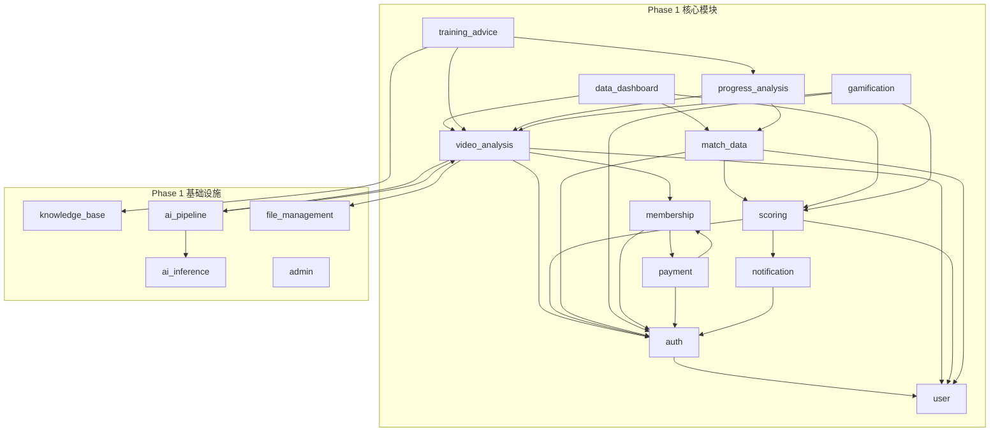

---

## 6. 跨模块协作与级联事件

### 6.1 AI 分析完成级联链

AI 分析完成后触发一系列级联操作，分散在多个模块中。以下统一定义级联触发链：

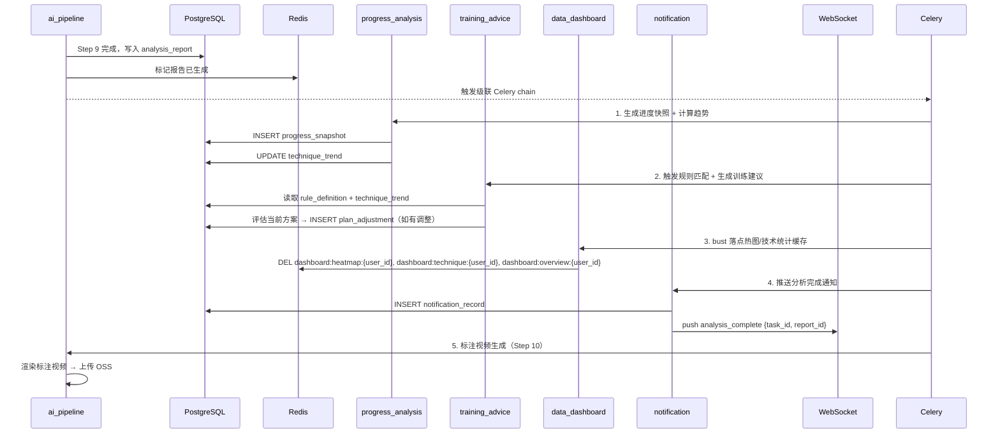

### 6.2 级联事件实现方式

| 级联步骤 | 实现方式 | 失败策略 |
|---------|---------|---------|
| 进度快照 + 趋势 | Celery chain task `generate_progress_snapshot` | 失败 → 记录日志，不影响后续 |
| 训练建议生成 | Celery chain task `generate_training_advice` | 失败 → 用户手动触发 GET /training/advice/{report_id} |
| 看板缓存 bust | Celery chain task `bust_dashboard_cache` | 失败 → 缓存 TTL 自然过期 |
| 通知推送 | Celery chain task `send_analysis_notification` | 失败 → notification_record 已写入，用户重连后拉取 |
| 标注视频 | 独立 Celery task `render_annotated_video` | 失败 → 报告可用但无标注视频，异步重试 |

### 6.3 支付成功级联链

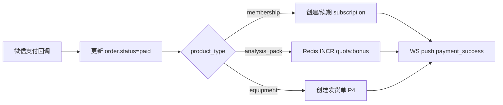

### 6.4 比赛结束级联链

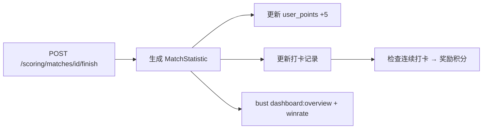

---

## 7. PIPL 合规：数据导出功能

### 7.1 功能定义

| 属性 | 值 |
|------|-----|
| 所属模块 | user（数据导出端点挂在 `/users/export-data` 下） |
| 触发方式 | 用户主动请求 |
| 限流 | 1 次/月/用户 |
| 数据范围 | 用户档案 + 比赛记录 + 分析报告摘要 + 训练方案历史 + 积分记录 |

### 7.2 端点设计

| 端点 | Method | 权限 | 说明 |
|------|--------|------|------|
| `/users/export-data` | POST | 登录 | 发起导出请求（异步生成） |
| `/users/export-data/{task_id}` | GET | 登录 | 查询导出状态 + 下载链接 |

### 7.3 业务流程

1. 用户发起 `POST /users/export-data` → 创建导出任务（status=pending）
2. Celery 异步任务聚合数据：user（含个人档案字段）+ match_record 列表 + analysis_report 摘要列表 + training_plan 历史 + user_points 记录
3. 生成 JSON 文件 → 上传 OSS（临时存储，7 天后自动删除）
4. 更新导出任务 status=completed + 生成下载链接（STS Token，1h 有效）
5. WS 推送 `export_complete` 通知
6. 用户通过 `GET /users/export-data/{task_id}` 获取下载链接

### 7.4 数据结构

导出 JSON 包含以下顶层字段：

| 字段 | 内容 |
|------|------|
| `profile` | 用户档案（不含手机号等敏感信息） |
| `match_records` | 所有比赛记录列表 |
| `analysis_reports` | 分析报告摘要列表（不含完整 JSONB，仅 summary + issues） |
| `training_plans` | 训练方案历史 + 调整记录 |
| `points_history` | 积分变动记录 |

---

## 8. 数据飞轮回流闭环

> 需求 v0.4 模块 3 提到"用户标记对/不对→数据回流用于模型优化"。
> 架构 §5.3 video_analysis F8 是数据飞轮入口。
> 本节补充完整的反馈数据回流 AI 模型优化闭环设计（P3-2 修复）。

### 8.1 飞轮全流程

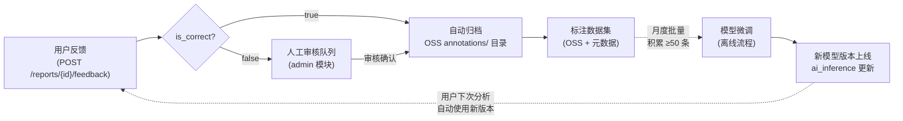

### 8.2 飞轮阶段定义

| 阶段 | 触发 | 处理 | 产出 |
|------|------|------|------|
| 1. 反馈采集 | 用户 POST /reports/{id}/feedback | 创建 feedback_record | is_correct + comment |
| 2. 自动归档 | is_correct=true | 视频 + AI 结果复制到 OSS `annotations/{report_id}/` | 标注候选数据集 |
| 3. 人工审核 | is_correct=false | 管理员在 admin 模块审核 → 确认后归档 | 修正后的标注数据 |
| 4. 数据集积累 | OSS annotations/ 目录 | 月度检查积累量 | ≥50 条触发微调评估 |
| 5. 模型微调 | 积累量达标 | 离线 fine-tune TTNet/动作识别模型 | 新版本模型文件 |
| 6. 版本上线 | 微调完成 | ai_inference 模型版本切换 + 回滚机制 | 更新后的推理服务 |

### 8.3 飞轮设计约束

| 约束 | 说明 |
|------|------|
| 隐私保护 | 归档视频仅保留运动画面，不含用户身份信息（文件名使用 report_id 不含 uid） |
| 微调阈值 | 标注数据 < 50 条不触发微调（避免过拟合） |
| 版本回滚 | 新模型上线后精度下降 → 自动回滚到上一版本（A/B 测试 + 精度监控） |
| 用户知情 | 反馈页提示"您的反馈将帮助 AI 改进"，不强制 |
| 归档时效 | 归档视频保留 2 年后清理（OSS Lifecycle 规则） |

---

## 9. 反幻觉约束

1. **模块名 snake_case**：与 `app/api/v1/` 下目录名一致
2. **业务规则可测试**：每条 BR 必须有明确的触发条件和预期行为
3. **API 路径不在本文档定义**：完整 API 契约在 `04详细设计/05-API详细设计.md` 中定义
4. **数据库 Schema 不在本文档定义**：完整表结构在 `04详细设计/04-数据库详细设计.md` 中定义
5. **Phase 归属明确**：每个功能点标注 P0-P4，与需求 v0.4 和架构 v2.4 对齐
6. **枚举值与后端一致**：状态、类型等枚举值在 `app/core/enums.py` 中集中定义
