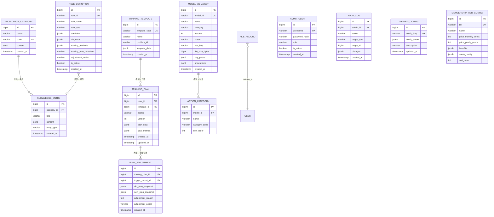

# 乒乓智能分析平台 — 数据库详细设计文档

> **版本**：v1.6
> **日期**：2026-10-12
> **依据**：系统架构设计 v2.4 第 9 节、模块详细设计 v1.1
> **技术栈**：PostgreSQL 15+ + SQLAlchemy 2.0 (async) + Alembic
> **说明**：本文档对架构设计 9.1 节 ER 图进行补全和细化，覆盖 Phase 1 全部表定义和 Phase 2-4 表结构摘要。v1.4 变更：video_task 补 5 字段、analysis_report 加 is_anonymized、match 补 6 字段、match_record 加 is_detailed+updated_at、subscription tier 改 VARCHAR(32)、order 统一 subscription_id+product_ref_id、新增 refund_record 表、新增 export_task 表、membership_tier_config 加 3 字段、score_record 代码块补 game_number+is_key_point、ShareRecord 字段名对齐切片。v1.6 变更：user_profile 表合并入 user 表（设计决策）、user 表补 scheduled_deletion_at+deletion_reason 字段、审计日志保留期限统一为 3 年。

---

## 1. 全局 ER 关系图

### 1.1 Phase 1 核心 ER 图

```mermaid
erDiagram
    USER ||--o{ RATING_HISTORY : "积分历史"
    USER ||--o{ VIDEO_TASK : "上传视频"
    USER ||--o{ ANALYSIS_REPORT : "分析报告(通过任务)"
    USER ||--o{ MATCH : "记分牌比赛"
    USER ||--o{ MATCH_RECORD : "手动录入比赛"
    USER ||--o{ USER_POINTS : "训练积分"
    USER ||--o{ CHECKIN_RECORD : "打卡记录"
    USER ||--o{ SUBSCRIPTION : "订阅"
    USER ||--o{ ORDER : "订单"
    USER ||--o{ NOTIFICATION_RECORD : "通知"
    USER ||--o{ FEEDBACK_RECORD : "分析反馈"
    USER ||--o{ PROGRESS_SNAPSHOT : "进度快照"
    USER ||--o{ TECHNIQUE_TREND : "技术趋势"
    USER ||--o{ SHARE_RECORD : "分享记录"
    USER ||--o{ USER_BADGE : "已获得徽章"
    USER ||--o{ BADGE_PROGRESS : "徽章进度"
    BADGE_DEFINITION ||--o{ USER_BADGE : "定义→已获得"
    BADGE_DEFINITION ||--o{ BADGE_PROGRESS : "定义→进度"

    FILE_RECORD ||--|| VIDEO_TASK : "文件→任务"
    VIDEO_TASK ||--|| ANALYSIS_REPORT : "任务→报告"
    VIDEO_TASK ||--o{ PIPELINE_STEP : "流水线步骤"
    ANALYSIS_REPORT ||--o{ FEEDBACK_RECORD : "报告→反馈"
    ANALYSIS_REPORT ||--|| PROGRESS_SNAPSHOT : "报告→快照"
    ANALYSIS_REPORT ||--o{ SHARE_RECORD : "报告→分享"

    MATCH ||--o{ SCORE_RECORD : "逐球记录"
    MATCH ||--|| MATCH_STATISTIC : "比赛统计"
    MATCH_RECORD ||--o{ MANUAL_SCORE_DETAIL : "手动得分明细"

    ORDER ||--o{ PAYMENT_RECORD : "支付记录"
    SUBSCRIPTION ||--o{ ORDER : "订阅订单"

    MATCH_RECORD }o--o| MATCH : "可选关联记分牌"

    USER {
        bigint id PK
        varchar openid UK
        varchar phone
        varchar nickname
        varchar avatar_url
        varchar status
        timestamp scheduled_deletion_at
        text deletion_reason
        int kqs_rating
        varchar kqs_username
        varchar playing_style
        jsonb equipment_config
        varchar self_assessed_level
        int profile_completeness
        timestamp created_at
        timestamp updated_at
    }
    RATING_HISTORY {
        bigint id PK
        bigint user_id FK
        int rating
        varchar source
        timestamp recorded_at
    }
    FILE_RECORD {
        bigint id PK
        bigint user_id FK
        varchar oss_key UK
        varchar original_filename
        bigint file_size
        varchar status
        varchar oss_etag
        timestamp created_at
        timestamp uploaded_at
    }
    VIDEO_TASK {
        bigint id PK
        bigint user_id FK
        bigint file_id FK
        varchar oss_key
        int duration_sec
        varchar status
        int current_step
        varchar task_uuid
        int total_steps
        varchar step_name
        int progress
        int estimated_remaining_seconds
        text error_message
        int retry_count
        timestamp created_at
        timestamp completed_at
    }
    PIPELINE_STEP {
        bigint id PK
        bigint task_id FK
        int step_number
        varchar step_name
        varchar status
        int duration_ms
        jsonb step_result
        timestamp started_at
        timestamp completed_at
    }
    ANALYSIS_REPORT {
        bigint id PK
        bigint task_id FK
        bigint user_id FK
        jsonb result_data
        jsonb report_text
        varchar annotated_video_url
        varchar cover_image_url
        jsonb report_images
        boolean is_llm_generated
        boolean is_anonymized
        timestamp created_at
    }
    FEEDBACK_RECORD {
        bigint id PK
        bigint report_id FK
        bigint user_id FK
        boolean is_correct
        text comment
        varchar status
        timestamp created_at
        timestamp updated_at
    }
    SHARE_RECORD {
        bigint id PK
        bigint report_id FK
        bigint user_id FK
        varchar share_token UK
        varchar share_scope
        varchar card_image_url
        timestamp expire_at
        int view_count
        timestamp created_at
    }
    MATCH {
        bigint id PK
        bigint user_id FK
        varchar opponent_name
        int opponent_rating
        varchar format
        varchar match_type
        varchar status
        int current_score_user
        int current_score_opp
        jsonb score_sequence
        timestamp created_at
        timestamp finished_at
    }
    SCORE_RECORD {
        bigint id PK
        bigint match_id FK
        int sequence
        varchar scorer
        varchar score_method
        varchar technique_action
        timestamp created_at
    }
    MATCH_STATISTIC {
        bigint id PK
        bigint match_id FK
        jsonb stats_data
        timestamp created_at
    }
    MATCH_RECORD {
        bigint id PK
        bigint user_id FK
        bigint match_id FK
        varchar opponent_name
        int opponent_rating
        int my_score
        int opponent_score
        boolean is_win
        varchar format
        varchar match_type
        timestamp match_date
        timestamp created_at
    }
    MANUAL_SCORE_DETAIL {
        bigint id PK
        bigint match_record_id FK
        int sequence
        varchar scorer
        varchar score_method
        varchar technique_action
    }
    USER_POINTS {
        bigint id PK
        bigint user_id FK_UK
        int total_points
        int monthly_points
        int current_streak
        date last_checkin_date
        timestamp updated_at
    }
    CHECKIN_RECORD {
        bigint id PK
        bigint user_id FK
        date checkin_date
        varchar checkin_type
        int points_earned
        timestamp created_at
    }
    BADGE_DEFINITION {
        varchar id PK
        varchar name
        text description
        varchar icon
        varchar category
        jsonb condition
        int points_reward
        int sort_order
        boolean is_active
    }
    USER_BADGE {
        bigint id PK
        bigint user_id FK
        varchar badge_id FK
        timestamp earned_at
    }
    BADGE_PROGRESS {
        bigint id PK
        bigint user_id FK
        varchar badge_id FK
        int current_value
        int target_value
        int progress_pct
        timestamp updated_at
    }
    SUBSCRIPTION {
        bigint id PK
        bigint user_id FK
        varchar tier
        timestamp start_at
        timestamp expire_at
        varchar status
        varchar payment_method
        boolean auto_renew
        timestamp created_at
        timestamp updated_at
        timestamp cancelled_at
    }
    ORDER {
        bigint id PK
        bigint user_id FK
        varchar order_no UK
        varchar product_type
        int amount_cents
        varchar status
        jsonb extra_data
        timestamp created_at
        timestamp paid_at
    }
    PAYMENT_RECORD {
        bigint id PK
        bigint order_id FK
        varchar transaction_id UK
        varchar payment_method
        int amount_cents
        timestamp paid_at
        jsonb callback_raw
    }
    NOTIFICATION_RECORD {
        bigint id PK
        bigint user_id FK
        varchar type
        varchar title
        text content
        boolean is_read
        jsonb extra_data
        timestamp created_at
    }
    PROGRESS_SNAPSHOT {
        bigint id PK
        bigint user_id FK
        bigint report_id FK
        jsonb metrics_snapshot
        timestamp created_at
    }
    TECHNIQUE_TREND {
        bigint id PK
        bigint user_id FK
        varchar metric_name
        float current_value
        float previous_value
        float change_rate
        varchar trend
        float target_value
        int persistence_count
        jsonb time_series
        timestamp updated_at
    }
```

### 1.2 Phase 1 基础设施 ER 图



---

## 2. Phase 1 表定义

> **R18-P3-20 修复（已在 R18 落地）**：表数口径说明。本节 §2.1-§2.34 共定义 **39 张表**，与实施计划 §1.1 声明的 **Phase 1 共 35 张表**存在口径差异，现显式说明如下：
> - **35 张核心 Phase 1 业务表**：用户/分析/记分/支付/通知/进度/知识库/训练模板等核心 MVP 表，全部在 Phase 1 Sprint 交付清单中列出（见实施计划 §3.1-§5.1 Sprint 规划表）
> - **4 张 Phase 2 提前实现表**：`plan_adjustment`（§2.23，方案调整停滞检测）、`action_category`（§2.30，技术动作分类）、`model_3d_asset`（§2.29，3D 资产管理）、`training_plan`（§2.28，训练计划生成）——这 4 张表在需求 §5 Phase 2 中正式交付，但 DB §2 提前定义以便 Phase 1 的 video_analysis/scoring/training_advice 模块引用外键
> - **统计口径**：实施计划 §1.1 "Phase 1 = 35 表" 指 Sprint 交付清单的核心表数；DB §2 "39 张表定义" 包含 Phase 2 提前实现的 4 张表；两个口径在不同上下文中使用，不冲突
> - **Sprint 交付表完整性**：Sprint 表（实施计划 §3.1-§5.1）未单独列出 `rating_history`/`consent_log`/`export_task`/`refund_record`/`manual_score_detail` 等附属表，这些表在 §2 中有完整定义，Sprint 交付时通过其主表一并交付（如 `consent_log` 随 §2.1 user 表在 S1 交付）

### 2.1 user 表

| 字段名 | 数据类型 | 必填 | 约束/默认值 | 描述 | 备注 |
|--------|---------|------|------------|------|------|
| id | BIGSERIAL | Y | PK | 主键 | — |
| openid | VARCHAR(128) | N | UNIQUE, NULL | 微信 openid | App 用户无 openid |
| phone | VARCHAR(20) | N | NULL | 手机号(AES-256 加密) | App 用户使用 |
| nickname | VARCHAR(64) | Y | — | 昵称 | — |
| avatar_url | VARCHAR(512) | N | NULL | 头像 URL | OSS/CDN |
| status | VARCHAR(20) | Y | DEFAULT 'active' | 用户状态 | active/pending_deletion/deleted |
| scheduled_deletion_at | TIMESTAMPTZ | N | NULL | 计划删除时间 | 注销后 72h 延迟删除 |
| deletion_reason | TEXT | N | NULL | 注销原因 | — |
| kqs_rating | INT | N | NULL | 开球网积分 | 原 user_profile 表 |
| kqs_username | VARCHAR(64) | N | NULL | 开球网用户名 | 原 user_profile 表 |
| playing_style | VARCHAR(32) | N | NULL | 打法类型 | 枚举值 |
| equipment_config | JSONB | N | NULL | 装备配置 | {blade, rubber_fh, rubber_bh, shoes} |
| self_assessed_level | VARCHAR(32) | N | NULL | 自评水平 | 未注册开球网用户 |
| profile_completeness | INT | Y | DEFAULT 0 | 档案完整度(0-100) | 计算字段 |
| created_at | TIMESTAMPTZ | Y | DEFAULT NOW() | 创建时间 | — |
| updated_at | TIMESTAMPTZ | Y | DEFAULT NOW() | 更新时间 | — |

**业务约束**：
- `openid` 和 `phone` 至少有一个非 NULL
- `openid` 唯一（部分唯一索引 WHERE openid IS NOT NULL）
- `phone` 唯一（部分唯一索引 WHERE phone IS NOT NULL）
- 用户注销时 `status` 设为 `deleted`，`nickname` 改为"已注销用户"

### 2.2 user_profile 表（已合并入 user 表）

> **设计决策（v1.6）**：user_profile 表已合并入 user 表（§2.1）。原一对一关系导致频繁 JOIN 查询，合并后简化 ORM 模型，减少查询复杂度。合并字段：kqs_rating、kqs_username、playing_style、equipment_config、self_assessed_level、profile_completeness，均已在 §2.1 user 表中定义。切片 `02-user/backend.md` 的 User 模型已实现合并，与此设计决策一致。

**JSONB 结构示例 (equipment_config)**：
```json
{
  "blade": {"brand": "蝴蝶", "model": "Viscaria"},
  "rubber_fh": {"brand": "红双喜", "model": "狂飙3", "hardness": "39°"},
  "rubber_bh": {"brand": "蝴蝶", "model": "T05"},
  "shoes": "美津浓 Wave-Up"
}
```

### 2.3 rating_history 表

| 字段名 | 数据类型 | 必填 | 约束/默认值 | 描述 | 备注 |
|--------|---------|------|------------|------|------|
| id | BIGSERIAL | Y | PK | 主键 | — |
| user_id | BIGINT | Y | FK→user.id, CASCADE | 用户 ID | — |
| rating | INT | Y | — | 积分值 | — |
| source | VARCHAR(20) | Y | DEFAULT 'manual' | 来源 | manual/kqs_api/tournament。R18-P3-3: 补充 DEFAULT（与切片 02 对齐） |
| recorded_at | TIMESTAMPTZ | Y | DEFAULT NOW() | 记录时间 | — |

**索引**：`(user_id, recorded_at DESC)`

### 2.4 file_record 表

| 字段名 | 数据类型 | 必填 | 约束/默认值 | 描述 | 备注 |
|--------|---------|------|------------|------|------|
| id | BIGSERIAL | Y | PK | 主键 | — |
| user_id | BIGINT | Y | FK→user.id, CASCADE | 用户 ID | — |
| oss_key | VARCHAR(512) | Y | UNIQUE | OSS 对象 Key | — |
| original_filename | VARCHAR(255) | N | NULL | 原始文件名 | 不含特殊字符 |
| file_size | BIGINT | Y | ≥1048576 且 ≤524288000（应用层校验） | 文件大小(bytes) | 1MB≤file_size≤500MB，R32 测试审查修复 |
| file_type | VARCHAR(20) | Y | — | 文件类型 | mp4/mov/jpg/png |
| status | VARCHAR(20) | Y | DEFAULT 'uploading' | 状态 | uploading/uploaded/abandoned/deleted |
| oss_etag | VARCHAR(128) | N | NULL | OSS ETag | HEAD Object 返回 |
| actual_size | BIGINT | N | NULL | 实际大小 | HEAD Object 确认 |
| created_at | TIMESTAMPTZ | Y | DEFAULT NOW() | 创建时间 | — |
| uploaded_at | TIMESTAMPTZ | N | NULL | 上传完成时间 | — |
| updated_at | TIMESTAMPTZ | Y | DEFAULT NOW() | 更新时间 | P2 补充：切片已定义 |

**索引**：`(user_id, created_at DESC)`, `(status, created_at)` — 孤儿文件清理

> **P2 字段对齐说明**：`file_size` / `actual_size` 均为 BIGINT 类型，DB 设计已定义，切片已对齐。`updated_at` 字段由切片定义，DB 设计 v1.4 补齐。

### 2.5 video_task 表

| 字段名 | 数据类型 | 必填 | 约束/默认值 | 描述 | 备注 |
|--------|---------|------|------------|------|------|
| id | BIGSERIAL | Y | PK | 主键 | — |
| user_id | BIGINT | Y | FK→user.id, CASCADE | 用户 ID | — |
| file_id | BIGINT | Y | FK→file_record.id, CASCADE | 文件 ID | — |
| oss_key | VARCHAR(512) | Y | — | OSS Key | 与 file_record 相同 |
| duration_sec | INT | N | NULL（upload-complete 时 ffprobe 填充，≥5 且 ≤600） | 视频时长(秒) | upload-complete 阶段获取，应用层校验 5s≤duration≤600s |
| status | VARCHAR(20) | Y | DEFAULT 'queued' | 任务状态 | queued/processing/completed/failed/cancelled |
| current_step | INT | Y | DEFAULT 0 | 当前流水线步骤 | 0-10 |
| task_uuid | VARCHAR(64) | Y | UNIQUE | 任务 UUID | 外部 API 引用 |
| total_steps | INT | Y | DEFAULT 10 | 总步数 | — |
| step_name | VARCHAR(32) | N | NULL | 当前步骤名 | — |
| progress | INT | Y | DEFAULT 0 | 进度百分比 | 0-100 |
| estimated_remaining_seconds | INT | N | NULL | 预估剩余秒数 | — |
| error_message | TEXT | N | NULL | 错误信息 | 失败时填充 |
| retry_count | INT | Y | DEFAULT 0 | 重试次数 | — |
| created_at | TIMESTAMPTZ | Y | DEFAULT NOW() | 创建时间 | — |
| completed_at | TIMESTAMPTZ | N | NULL | 完成时间 | — |

**索引**：`(user_id, created_at DESC)`, `(status, created_at)` — 队列监控
**分区策略**：按月分区 `PARTITION BY RANGE (created_at)`

### 2.6 pipeline_step 表

| 字段名 | 数据类型 | 必填 | 约束/默认值 | 描述 | 备注 |
|--------|---------|------|------------|------|------|
| id | BIGSERIAL | Y | PK | 主键 | — |
| task_id | BIGINT | Y | FK→video_task.id, CASCADE | 任务 ID | — |
| step_number | INT | Y | — | 步骤号 | 1-10 |
| step_name | VARCHAR(64) | Y | — | 步骤名 | video_preprocessing 等 |
| status | VARCHAR(20) | Y | DEFAULT 'pending' | 状态 | pending/running/completed/failed/skipped |
| duration_ms | INT | N | NULL | 耗时(ms) | — |
| step_result | JSONB | N | NULL | 步骤结果 | 各步骤输出 |
| error_message | TEXT | N | NULL | 错误信息 | — |
| started_at | TIMESTAMPTZ | N | NULL | 开始时间 | — |
| completed_at | TIMESTAMPTZ | N | NULL | 完成时间 | — |

**索引**：`(task_id, step_number)`

### 2.7 analysis_report 表

| 字段名 | 数据类型 | 必填 | 约束/默认值 | 描述 | 备注 |
|--------|---------|------|------------|------|------|
| id | BIGSERIAL | Y | PK | 主键 | — |
| task_id | BIGINT | Y | FK→video_task.id, CASCADE, UNIQUE | 任务 ID | 一对一 |
| user_id | BIGINT | Y | FK→user.id, CASCADE | 用户 ID | 冗余，加速查询 |
| result_data | JSONB | Y | — | 完整分析结果 | 架构 6.3 节 JSON |
| report_text | JSONB | Y | — | 文字报告 | {summary, issues[], suggestions[]} |
| annotated_video_url | VARCHAR(512) | N | NULL | 标注视频 CDN URL | — |
| cover_image_url | VARCHAR(512) | N | NULL | 封面图 URL | — |
| report_images | JSONB | N | NULL | 报告图表 URL | {heatmap, technique_chart, ...} |
| is_llm_generated | BOOLEAN | Y | DEFAULT true | 是否 LLM 生成 | 降级标记 |
| is_anonymized | BOOLEAN | Y | DEFAULT false | 是否匿名化 | 隐私保护 |
| created_at | TIMESTAMPTZ | Y | DEFAULT NOW() | 创建时间 | — |

**索引**：
- `(user_id, created_at DESC)` — 用户报告列表
- `GIN(to_tsvector('simple', report_text::text))` — 全文搜索
- `GIN(report_text)` — JSONB 查询

### 2.8 feedback_record 表

| 字段名 | 数据类型 | 必填 | 约束/默认值 | 描述 | 备注 |
|--------|---------|------|------------|------|------|
| id | BIGSERIAL | Y | PK | 主键 | — |
| report_id | BIGINT | Y | FK→analysis_report.id, CASCADE | 报告 ID | — |
| user_id | BIGINT | Y | FK→user.id, CASCADE | 用户 ID | — |
| is_correct | BOOLEAN | Y | — | 反馈：对/不对 | — |
| comment | TEXT | N | NULL | 反馈评论 | — |
| status | VARCHAR(20) | Y | DEFAULT 'pending' | 数据飞轮审核状态 | pending/archived/manual_review |
| created_at | TIMESTAMPTZ | Y | DEFAULT NOW() | 创建时间 | — |
| updated_at | TIMESTAMPTZ | Y | DEFAULT NOW() | 更新时间 | 允许更新 |

**约束**：`(report_id, user_id)` UNIQUE — 每用户每报告一条反馈（可更新）

> **X-28 同步说明**：切片 `03-video_analysis/backend.md` 中 FeedbackRecord 已含 `status` 字段（数据飞轮审核入口），DB 设计 v1.2 此前遗漏，现已补齐。原 `data_flywheel_action` 字段被 `status` 替代。

> **P1-DBRW/➕-1 确认**：`status` 字段（VARCHAR(20) NOT NULL DEFAULT 'pending'）已在 DB 设计 §2.8 中定义，与切片 `FeedbackRecord.status` 完全对齐。枚举值：pending/archived/manual_review。

### 2.9 share_record 表

| 字段名 | 数据类型 | 必填 | 约束/默认值 | 描述 | 备注 |
|--------|---------|------|------------|------|------|
| id | BIGSERIAL | Y | PK | 主键 | — |
| report_id | BIGINT | Y | FK→analysis_report.id, CASCADE | 报告 ID | — |
| user_id | BIGINT | Y | FK→user.id, CASCADE | 用户 ID | — |
| share_token | VARCHAR(64) | Y | UNIQUE | 分享 Token | UUID |
| share_scope | VARCHAR(20) | Y | DEFAULT 'public' | 分享范围 | public/friend |
| card_image_url | VARCHAR(512) | N | NULL | 卡片图 URL | — |
| expire_at | TIMESTAMPTZ | Y | — | 过期时间 | created_at + 7d |
| view_count | INT | Y | DEFAULT 0 | 浏览次数 | — |
| created_at | TIMESTAMPTZ | Y | DEFAULT NOW() | 创建时间 | — |

### 2.10 match 表

| 字段名 | 数据类型 | 必填 | 约束/默认值 | 描述 | 备注 |
|--------|---------|------|------------|------|------|
| id | BIGSERIAL | Y | PK | 主键 | — |
| user_id | BIGINT | Y | FK→user.id, CASCADE | 用户 ID | 记分者 |
| opponent_name | VARCHAR(64) | N | NULL | 对手名 | — |
| opponent_rating | INT | N | NULL | 对手积分 | — |
| format | VARCHAR(20) | Y | DEFAULT 'bo5' | 赛制 | bo1/bo3/bo5/bo7/custom。R18-P3-6: 补充 DEFAULT（与切片 04 对齐） |
| match_type | VARCHAR(20) | Y | DEFAULT 'friendly' | 比赛类型 | friendly/tournament/training。R18-P3-6: 补充 DEFAULT（与切片 04 对齐） |
| target_score | INT | Y | DEFAULT 11 | 目标分 | 11 分制 |
| status | VARCHAR(20) | Y | DEFAULT 'setup' | 状态 | setup/in_progress/finished/abandoned |
| current_score_user | INT | Y | DEFAULT 0 | 当前用户得分 | — |
| current_score_opp | INT | Y | DEFAULT 0 | 当前对手得分 | — |
| current_server | VARCHAR(10) | N | NULL | 当前发球方 | user/opponent |
| current_game | INT | Y | DEFAULT 1 | 当前局数 | bo3/bo5/bo7 |
| is_win | BOOLEAN | N | NULL | 是否胜利 | 比赛结束计算 |
| final_score | VARCHAR(20) | N | NULL | 最终比分 | 如 "3:1" |
| started_at | TIMESTAMPTZ | N | NULL | 开始时间 | — |
| abandoned_at | TIMESTAMPTZ | N | NULL | 弃赛时间 | — |
| updated_at | TIMESTAMPTZ | Y | DEFAULT NOW() | 更新时间 | — |
| score_sequence | JSONB | N | NULL | 比分序列缓存 | Redis 镜像 |
| created_at | TIMESTAMPTZ | Y | DEFAULT NOW() | 创建时间 | — |
| finished_at | TIMESTAMPTZ | N | NULL | 结束时间 | — |

**索引**：`(user_id, created_at DESC)`, `(status)` — 恢复比赛

### 2.11 score_record 表

| 字段名 | 数据类型 | 必填 | 约束/默认值 | 描述 | 备注 |
|--------|---------|------|------------|------|------|
| id | BIGSERIAL | Y | PK | 主键 | — |
| match_id | BIGINT | Y | FK→match.id, CASCADE | 比赛 ID | — |
| sequence | INT | Y | — | 全局序号 | Redis INCR |
| scorer | VARCHAR(10) | Y | — | 得分方 | user/opponent |
| score_method | VARCHAR(32) | N | NULL | 得分方式 | serve_point/rally_point/opponent_error/...
| technique_action | VARCHAR(32) | N | NULL | 技术动作 | forehand_drive/...
| game_number | INT | Y | DEFAULT 1 | 当前局数 | — |
| is_key_point | BOOLEAN | N | NULL | 是否关键分 | 10:10 后 |
| created_at | TIMESTAMPTZ | Y | DEFAULT NOW() | 创建时间 | — |

**索引**：`(match_id, sequence)`, `(match_id, game_number)`
**分区策略**：按月分区

### 2.12 match_statistic 表

| 字段名 | 数据类型 | 必填 | 约束/默认值 | 描述 | 备注 |
|--------|---------|------|------------|------|------|
| id | BIGSERIAL | Y | PK | 主键 | — |
| match_id | BIGINT | Y | FK→match.id, CASCADE, UNIQUE | 比赛 ID | 一对一 |
| stats_data | JSONB | Y | — | 统计数据 | {score_distribution, key_points, technique_breakdown} |
| created_at | TIMESTAMPTZ | Y | DEFAULT NOW() | 创建时间 | — |

### 2.13 match_record 表

| 字段名 | 数据类型 | 必填 | 约束/默认值 | 描述 | 备注 |
|--------|---------|------|------------|------|------|
| id | BIGSERIAL | Y | PK | 主键 | — |
| user_id | BIGINT | Y | FK→user.id, CASCADE | 用户 ID | — |
| match_id | BIGINT | N | FK→match.id, SET_NULL | 关联记分牌比赛 | 可选 |
| opponent_name | VARCHAR(64) | N | NULL | 对手名 | — |
| opponent_rating | INT | N | NULL | 对手积分 | — |
| my_score | INT | Y | — | 我的得分 | — |
| opponent_score | INT | Y | — | 对手得分 | — |
| is_win | BOOLEAN | Y | — | 是否获胜 | 自动计算 |
| format | VARCHAR(20) | Y | DEFAULT 'bo5' | 赛制 | 与切片 05 default="bo5" 对齐（R19-P3-8） |
| match_type | VARCHAR(20) | Y | DEFAULT 'friendly' | 比赛类型 | 与切片 05 default="friendly" 对齐（R19-P3-8） |
| match_date | TIMESTAMPTZ | Y | DEFAULT NOW() | 比赛日期 | — |
| is_detailed | BOOLEAN | Y | DEFAULT false | 是否详细录入 | 标记快速/详细 |
| created_at | TIMESTAMPTZ | Y | DEFAULT NOW() | 创建时间 | — |
| updated_at | TIMESTAMPTZ | Y | DEFAULT NOW() | 更新时间 | — |

**索引**：`(user_id, match_date DESC)`

### 2.14 manual_score_detail 表

| 字段名 | 数据类型 | 必填 | 约束/默认值 | 描述 | 备注 |
|--------|---------|------|------------|------|------|
| id | BIGSERIAL | Y | PK | 主键 | — |
| match_record_id | BIGINT | Y | FK→match_record.id, CASCADE | 比赛记录 ID | — |
| sequence | INT | Y | — | 得分序号 | — |
| scorer | VARCHAR(10) | Y | — | 得分方 | user/opponent |
| score_method | VARCHAR(32) | N | NULL | 得分方式 | — |
| technique_action | VARCHAR(32) | N | NULL | 技术动作 | — |
| created_at | TIMESTAMPTZ | Y | DEFAULT NOW() | 创建时间 | — |

### 2.15 user_points 表

| 字段名 | 数据类型 | 必填 | 约束/默认值 | 描述 | 备注 |
|--------|---------|------|------------|------|------|
| id | BIGSERIAL | Y | PK | 主键 | — |
| user_id | BIGINT | Y | FK→user.id, CASCADE, UNIQUE | 用户 ID | 一对一 |
| total_points | INT | Y | DEFAULT 0 | 总积分 | — |
| monthly_points | INT | Y | DEFAULT 0 | 月度积分 | 每月重置 |
| current_streak | INT | Y | DEFAULT 0 | 连续打卡天数 | — |
| bonus_points | INT | Y | DEFAULT 0 | 额外奖励积分 | 连续打卡等 |
| last_checkin_date | DATE | N | NULL | 上次打卡日期 | — |
| updated_at | TIMESTAMPTZ | Y | DEFAULT NOW() | 更新时间 | — |

### 2.16 checkin_record 表

| 字段名 | 数据类型 | 必填 | 约束/默认值 | 描述 | 备注 |
|--------|---------|------|------------|------|------|
| id | BIGSERIAL | Y | PK | 主键 | — |
| user_id | BIGINT | Y | FK→user.id, CASCADE | 用户 ID | — |
| checkin_date | DATE | Y | — | 打卡日期 | — |
| checkin_type | VARCHAR(16) | Y | DEFAULT 'manual' | 打卡类型 | analysis/match/manual |
| points_earned | INT | Y | DEFAULT 2 | 获得积分 | — |
| bonus_points | INT | Y | DEFAULT 0 | 奖励积分 | P2 补充：切片已定义 |
| created_at | TIMESTAMPTZ | Y | DEFAULT NOW() | 创建时间 | — |

**约束**：`(user_id, checkin_date)` UNIQUE — 每日一次打卡

### 2.17 subscription 表

| 字段名 | 数据类型 | 必填 | 约束/默认值 | 描述 | 备注 |
|--------|---------|------|------------|------|------|
| id | BIGSERIAL | Y | PK | 主键 | — |
| user_id | BIGINT | Y | FK→user.id, CASCADE | 用户 ID | — |
| tier | VARCHAR(20) | Y | — | 会员等级 | free/member/pro/coach | R19-P2-7: 统一 VARCHAR(20)（与 §2.31/§5/切片10 MembershipTier.tier 对齐） |
| start_at | TIMESTAMPTZ | Y | — | 开始时间 | — |
| expire_at | TIMESTAMPTZ | Y | — | 到期时间 | — |
| status | VARCHAR(20) | Y | DEFAULT 'active' | 状态 | active/expiring_soon/expired/grace_period/cancelled/closed |
| payment_method | VARCHAR(20) | N | NULL | 支付方式 | manual/auto_deduct |
| auto_renew | BOOLEAN | Y | DEFAULT false | 是否自动续费 | Phase 2+ |
| created_at | TIMESTAMPTZ | Y | DEFAULT NOW() | 创建时间 | — |
| updated_at | TIMESTAMPTZ | Y | DEFAULT NOW() | 更新时间 | — |
| cancelled_at | TIMESTAMPTZ | N | NULL | 取消时间 | 退款撤销订阅时记录 |

**索引**：`(user_id, status)`, `(status, expire_at)` — 到期检测扫描

### 2.18 order 表

| 字段名 | 数据类型 | 必填 | 约束/默认值 | 描述 | 备注 |
|--------|---------|------|------------|------|------|
| id | BIGSERIAL | Y | PK | 主键 | — |
| user_id | BIGINT | Y | FK→user.id, CASCADE | 用户 ID | — |
| order_no | VARCHAR(64) | Y | UNIQUE | 订单号 | UUID + 时间戳 |

> **P2 字段对齐说明**：`order.order_no` 为 VARCHAR(64)，DB 设计已定义，切片已对齐。
| product_type | VARCHAR(32) | Y | — | 产品类型 | membership/analysis_pack/equipment/tournament |
| product_ref_id | BIGINT | N | NULL | 关联产品 ID | subscription_id 等 |
| subscription_id | BIGINT | N | FK→subscription.id, SET_NULL | 订阅 ID | 与 product_ref_id 互补 |
| amount_cents | INT | Y | — | 金额(分) | ¥19 = 1900 |
| status | VARCHAR(20) | Y | DEFAULT 'pending' | 状态 | pending/paid/refunded/cancelled |
| extra_data | JSONB | N | NULL | 额外数据 | {tier, period, ...} |
| created_at | TIMESTAMPTZ | Y | DEFAULT NOW() | 创建时间 | — |
| paid_at | TIMESTAMPTZ | N | NULL | 支付时间 | — |

**索引**：`(user_id, created_at DESC)`, `(order_no)`, `(status)`

### 2.19 payment_record 表

| 字段名 | 数据类型 | 必填 | 约束/默认值 | 描述 | 备注 |
|--------|---------|------|------------|------|------|
| id | BIGSERIAL | Y | PK | 主键 | — |
| order_id | BIGINT | Y | FK→order.id, CASCADE | 订单 ID | — |
| transaction_id | VARCHAR(64) | Y | UNIQUE | 微信支付单号 | — |
| payment_method | VARCHAR(20) | Y | — | 支付方式 | wechat_jsapi/wechat_app |
| amount_cents | INT | Y | — | 支付金额(分) | — |
| paid_at | TIMESTAMPTZ | Y | — | 支付时间 | — |
| callback_raw | JSONB | N | NULL | 回调原始数据 | 验签后存储 |
| created_at | TIMESTAMPTZ | Y | DEFAULT NOW() | 创建时间 | P2 补充：切片已定义 |


### 2.19b refund_record 表

| 字段名 | 数据类型 | 必填 | 约束/默认值 | 描述 | 备注 |
|--------|---------|------|------------|------|------|
| id | BIGSERIAL | Y | PK | 主键 | — |
| order_id | BIGINT | Y | FK→order.id, CASCADE | 订单 ID | — |
| refund_no | VARCHAR(64) | Y | UNIQUE | 退款单号 | UUID + 时间戳 |
| refund_amount_cents | INT | Y | — | 退款金额(分) | — |
| reason | TEXT | N | NULL | 退款原因 | — |
| status | VARCHAR(20) | Y | DEFAULT 'pending' | 状态 | pending/processing/succeeded/failed |
| reversal_type | VARCHAR(20) | N | NULL | 冲正类型 | P2 补充：切片已定义 |
| operator_id | BIGINT | N | NULL | 操作管理员 ID | — |
| callback_raw | JSONB | N | NULL | 回调原始数据 | 验签后存储 |
| created_at | TIMESTAMPTZ | Y | DEFAULT NOW() | 创建时间 | — |
| updated_at | TIMESTAMPTZ | Y | DEFAULT NOW() | 更新时间 | — |

**索引**：`(order_id)`, `(refund_no)`

> **P2 字段对齐说明**：`refund_record.status` DEFAULT 'pending'，DB 设计已定义，切片已对齐。`reversal_type` VARCHAR(20) 由切片定义，DB 设计 v1.4 补齐。

### 2.20 notification_record 表

| 字段名 | 数据类型 | 必填 | 约束/默认值 | 描述 | 备注 |
|--------|---------|------|------------|------|------|
| id | BIGSERIAL | Y | PK | 主键 | — |
| user_id | BIGINT | Y | FK→user.id, CASCADE | 用户 ID | — |
| type | VARCHAR(32) | Y | — | 通知类型 | analysis_complete/payment_success/training_reminder/... |
| title | VARCHAR(128) | Y | — | 标题 | — |
| content | TEXT | N | NULL | 内容 | — |
| is_read | BOOLEAN | Y | DEFAULT false | 是否已读 | — |
| extra_data | JSONB | N | NULL | 附加数据 | {task_id, match_id, ...} |
| created_at | TIMESTAMPTZ | Y | DEFAULT NOW() | 创建时间 | — |

**索引**：`(user_id, is_read, created_at DESC)` — 未读通知列表
**分区策略**：按月分区，pg_cron 管理分区生命周期（3 个月前分区自动 drop）；已读通知记录 90 天前由 Celery Beat 清理（见 `beat_schedule.py`）

### 2.21 progress_snapshot 表

| 字段名 | 数据类型 | 必填 | 约束/默认值 | 描述 | 备注 |
|--------|---------|------|------------|------|------|
| id | BIGSERIAL | Y | PK | 主键 | — |
| user_id | BIGINT | Y | FK→user.id, CASCADE | 用户 ID | — |
| report_id | BIGINT | Y | FK→analysis_report.id, CASCADE | 报告 ID | — |
| metrics_snapshot | JSONB | Y | — | 18 项指标快照 | GIN 索引 |
| created_at | TIMESTAMPTZ | Y | DEFAULT NOW() | 创建时间 | — |

**索引**：`(user_id, created_at DESC)`, `GIN(metrics_snapshot)` — 按指标查询

**metrics_snapshot JSONB 结构**：
```json
{
  "backhand_ratio": 0.25,
  "forehand_ratio": 0.68,
  "serve_ratio": 0.07,
  "landing_forehand_pct": 0.68,
  "landing_backhand_pct": 0.25,
  "landing_middle_pct": 0.07,
  "landing_dispersion": 3.2,
  "avg_rally_length": 5.2,
  "max_rally_length": 18,
  "rally_frequency": 1.2,
  "avg_ball_speed": 18.5,
  "max_ball_speed": 25.3,
  "score_win_rate": 0.55,
  "key_point_win_rate": 0.60,
  "serve_point_win_rate": 0.65,
  "receive_point_win_rate": 0.45,
  "attack_transition_rate": 0.38,
  "error_rate": 0.12
}
```

### 2.22 technique_trend 表

| 字段名 | 数据类型 | 必填 | 约束/默认值 | 描述 | 备注 |
|--------|---------|------|------------|------|------|
| id | BIGSERIAL | Y | PK | 主键 | — |
| user_id | BIGINT | Y | FK→user.id, CASCADE | 用户 ID | — |
| metric_name | VARCHAR(64) | Y | — | 指标名 | backhand_ratio 等 |
| current_value | FLOAT | N | NULL | 当前值 | — |
| previous_value | FLOAT | N | NULL | 上一次值 | — |
| change_rate | FLOAT | N | NULL | 变化率 | — |
| trend | VARCHAR(20) | N | NULL | 趋势方向 | improving/stagnant/declining/achieved/new/resolved |
| target_value | FLOAT | N | NULL | 目标值 | — |
| persistence_count | INT | Y | DEFAULT 0 | 持续次数 | — |
| time_series | JSONB | N | NULL | 时间序列 | [{date, value}] |
| updated_at | TIMESTAMPTZ | Y | DEFAULT NOW() | 更新时间 | — |

**约束**：`(user_id, metric_name)` UNIQUE — 每用户每指标一条（更新而非新增）

> **P1-DBRW/X-3 确认**：TechniqueTrend 表字段名已与切片对齐：
> - `trend`（VARCHAR(20)，非 `trend_direction`）— 趋势方向，枚举值 improving/stagnant/declining/achieved/new/resolved
> - `current_value`（FLOAT）— 当前值
> - `previous_value`（FLOAT）— 上一次值
> - `target_value`（FLOAT）— 目标值
> 以上字段在 DB 设计 §2.22 和 SQLAlchemy Model（§5.6 TechniqueTrend）中均一致使用。

### 2.23 plan_adjustment 表

| 字段名 | 数据类型 | 必填 | 约束/默认值 | 描述 | 备注 |
|--------|---------|------|------------|------|------|
| id | BIGSERIAL | Y | PK | 主键 | — |
| training_plan_id | BIGINT | Y | FK→training_plan.id, CASCADE | 训练方案 ID | — |
| trigger_report_id | BIGINT | N | FK→analysis_report.id, SET NULL | 触发报告 ID | — |
| old_plan_snapshot | JSONB | N | NULL | 旧方案快照 | — |
| new_plan_snapshot | JSONB | Y | — | 新方案快照 | — |
| adjustment_reason | TEXT | Y | — | 调整原因 | — |
| adjustment_action | VARCHAR(32) | Y | — | 调整动作 | maintain/adjust/escalate/new_goal |
| created_at | TIMESTAMPTZ | Y | DEFAULT NOW() | 创建时间 | — |

### 2.24 knowledge_category 表

| 字段名 | 数据类型 | 必填 | 约束/默认值 | 描述 | 备注 |
|--------|---------|------|------------|------|------|
| id | BIGSERIAL | Y | PK | 主键 | — |
| name | VARCHAR(64) | Y | — | 分类名 | — |
| code | VARCHAR(32) | Y | UNIQUE | 分类编码 | technique_action/common_problem/... |
| content | JSONB | Y | — | 分类内容 | 结构化数据 |
| created_at | TIMESTAMPTZ | Y | DEFAULT NOW() | 创建时间 | — |

### 2.25 knowledge_entry 表

| 字段名 | 数据类型 | 必填 | 约束/默认值 | 描述 | 备注 |
|--------|---------|------|------------|------|------|
| id | BIGSERIAL | Y | PK | 主键 | — |
| category_id | BIGINT | Y | FK→knowledge_category.id, CASCADE | 分类 ID | — |
| title | VARCHAR(128) | Y | — | 标题 | — |
| content | JSONB | Y | — | 条目内容 | GIN 索引 |
| entry_type | VARCHAR(32) | Y | — | 条目类型 | action/problem/method/style/template |
| created_at | TIMESTAMPTZ | Y | DEFAULT NOW() | 创建时间 | — |

### 2.26 rule_definition 表

| 字段名 | 数据类型 | 必填 | 约束/默认值 | 描述 | 备注 |
|--------|---------|------|------------|------|------|
| id | BIGSERIAL | Y | PK | 主键 | — |
| rule_id | VARCHAR(64) | Y | UNIQUE | 规则编码 | RULE_001 / RULE_TREND_001 |
| rule_name | VARCHAR(128) | Y | — | 规则名 | — |
| rule_type | VARCHAR(32) | Y | — | 规则类型 | single/trend_persistent/trend_improving/stagnant/plan_effectiveness |
| condition | JSONB | Y | — | 条件 | {field, operator, threshold, ...} |
| diagnosis | JSONB | Y | — | 诊断 | {problem_id, problem_name, severity, description} |
| training_methods | JSONB | N | NULL | 训练方法 ID 列表 | ["METHOD_012", ...] |
| training_plan_template | VARCHAR(64) | N | NULL | 训练方案模板编码 | — |
| adjustment_action | VARCHAR(32) | N | NULL | 方案调整动作 | maintain/adjust/escalate/new_goal |
| is_active | BOOLEAN | Y | DEFAULT true | 是否启用 | — |
| created_at | TIMESTAMPTZ | Y | DEFAULT NOW() | 创建时间 | — |

### 2.27 training_template 表

> **P1-DB5 回写**：training_template 表字段已与切片对齐，新增 category / difficulty / description / template_config / updated_at 字段。

| 字段名 | 数据类型 | 必填 | 约束/默认值 | 描述 | 备注 |
|--------|---------|------|------------|------|------|
| id | BIGSERIAL | Y | PK | 主键 | — |
| template_code | VARCHAR(64) | Y | UNIQUE | 模板编码 | TPL_BACKHAND_IMPROVE |
| name | VARCHAR(64) | Y | — | 模板名 | — |
| category | VARCHAR(32) | Y | — | 模板分类 | P1-DB5 新增：切片已定义 |
| difficulty | VARCHAR(16) | Y | DEFAULT 'intermediate' | 难度等级 | beginner/intermediate/advanced |
| description | TEXT | N | NULL | 模板描述 | P1-DB5 新增：切片已定义 |
| problem_id | VARCHAR(64) | N | NULL | 关联问题 ID | — |
| template_data | JSONB | Y | — | 模板数据 | {goal, sessions[], exercises[], metrics[]} |
| template_config | JSONB | Y | — | 模板配置 | P1-DB5 新增：切片已定义 |
| created_at | TIMESTAMPTZ | Y | DEFAULT NOW() | 创建时间 | — |
| updated_at | TIMESTAMPTZ | Y | DEFAULT NOW() | 更新时间 | P1-DB5 新增：切片已定义 |

### 2.28 training_plan 表

| 字段名 | 数据类型 | 必填 | 约束/默认值 | 描述 | 备注 |
|--------|---------|------|------------|------|------|
| id | BIGSERIAL | Y | PK | 主键 | — |
| user_id | BIGINT | Y | FK→user.id, CASCADE | 用户 ID | — |
| template_id | BIGINT | N | FK→training_template.id, SET NULL | 模板 ID | — |
| status | VARCHAR(20) | Y | DEFAULT 'active' | 状态 | active/completed/abandoned |
| version | INT | Y | DEFAULT 1 | 版本号 | 每次调整 +1 |
| plan_data | JSONB | Y | — | 方案数据 | 参数化后内容 |
| goal_metrics | JSONB | N | NULL | 目标指标 | {metric: target_value} |
| created_at | TIMESTAMPTZ | Y | DEFAULT NOW() | 创建时间 | — |
| updated_at | TIMESTAMPTZ | Y | DEFAULT NOW() | 更新时间 | — |

### 2.29 model_3d_asset 表

| 字段名 | 数据类型 | 必填 | 约束/默认值 | 描述 | 备注 |
|--------|---------|------|------------|------|------|
| id | BIGSERIAL | Y | PK | 主键 | — |
| model_id | VARCHAR(64) | Y | UNIQUE | 模型编码 | M_FOREHAND_DRIVE_001 |
| name | VARCHAR(128) | Y | — | 名称 | — |
| category | VARCHAR(32) | Y | — | 分类 | forehand/backhand/serve/footwork |
| version | INT | Y | DEFAULT 1 | 版本 | — |
| status | VARCHAR(20) | Y | DEFAULT 'draft' | 状态 | draft/published/archived |
| oss_key | VARCHAR(512) | Y | — | OSS Key | models/3d/{cat}/{model_id}_v{n}.glb |
| file_size_bytes | BIGINT | N | NULL | 文件大小 | — |
| draco_compressed | BOOLEAN | Y | DEFAULT true | Draco 压缩 | — |
| key_poses | JSONB | N | NULL | 关键姿势 | [{name, time, description}] |
| annotations | JSONB | N | NULL | 关节标注 | [{joint, angle_range, label}] |
| difficulty | VARCHAR(20) | N | NULL | 难度 | beginner/intermediate/advanced |
| related_techniques | JSONB | N | NULL | 关联技术 | ["forehand_drive"] |
| created_at | TIMESTAMPTZ | Y | DEFAULT NOW() | 创建时间 | — |
| updated_at | TIMESTAMPTZ | Y | DEFAULT NOW() | 更新时间 | — |

### 2.30 action_category 表

> ER 图 §1.2 中 MODEL_3D_ASSET ||--o{ ACTION_CATEGORY 关系对应的表定义。Phase 2 3D 教学模块使用，此处提前定义以便 Phase 1 数据库迁移一并创建。

| 字段名 | 数据类型 | 必填 | 约束/默认值 | 描述 | 备注 |
|--------|---------|------|------------|------|------|
| id | BIGSERIAL | Y | PK | 主键 | — |
| model_id | BIGINT | Y | FK→model_3d_asset.id, CASCADE | 3D 模型 ID | — |
| name | VARCHAR(64) | Y | — | 动作分类名 | 如"正手攻球" |
| category_code | VARCHAR(32) | Y | — | 分类编码 | 如 forehand_drive |
| sort_order | INT | Y | DEFAULT 0 | 排序 | — |
| created_at | TIMESTAMPTZ | Y | DEFAULT NOW() | 创建时间 | — |

**索引**：`(model_id, sort_order)` — 按模型查动作分类列表
**约束**：`(model_id, category_code)` UNIQUE — 同一模型下分类编码不重复

### 2.31 admin_user / audit_log / system_config / membership_tier_config 表

**admin_user 表**：

| 字段名 | 数据类型 | 必填 | 约束/默认值 | 描述 |
|--------|---------|------|------------|------|
| id | BIGSERIAL | Y | PK | 主键 |
| username | VARCHAR(64) | Y | UNIQUE | 管理员用户名 |
| password_hash | VARCHAR(255) | Y | — | bcrypt 密码哈希 |
| role | VARCHAR(20) | Y | — | 角色: super_admin/content_admin/model_admin |
| is_active | BOOLEAN | Y | DEFAULT true | 是否启用 |
| last_login_at | TIMESTAMPTZ | N | NULL | 最后登录时间。R18-P3-5: 补充（§5 AdminUser 已定义，切片 admin.md 已定义） |
| created_at | TIMESTAMPTZ | Y | DEFAULT NOW() | 创建时间 |

**audit_log 表**：

| 字段名 | 数据类型 | 必填 | 约束/默认值 | 描述 |
|--------|---------|------|------------|------|
| id | BIGSERIAL | Y | PK | 主键 |
| admin_id | BIGINT | Y | FK→admin_user.id, RESTRICT | 操作管理员（R17-P2: SET NULL→RESTRICT，与NOT NULL和切片一致） |
| action | VARCHAR(32) | Y | — | 操作: create/update/delete/publish/reject |
| target_type | VARCHAR(32) | Y | — | 目标类型: user/report/video/model/config |
| target_id | BIGINT | N | NULL | 目标 ID |
| changes | JSONB | N | NULL | 变更内容 {field: {old, new}} |
| user_id | BIGINT | N | NULL, FK→user.id, SET NULL | 用户 ID（非管理员操作时填写，如支付模块） |
| detail | TEXT | N | NULL | 操作详情（支付等模块使用） |
| ip_address | VARCHAR(45) | N | NULL | 操作者 IP 地址（支持 IPv4/IPv6） |
| created_at | TIMESTAMPTZ | Y | DEFAULT NOW() | 操作时间 |

> **审计日志保留策略**：审计日志（audit_log）保留期限不少于 3 年，符合 PIPL 对个人信息处理记录的保留要求。超期记录通过 Celery Beat 定期清理任务（`audit.cleanup_old_logs`，每日 03:00 执行）归档至冷存储。

**system_config 表**：

| 字段名 | 数据类型 | 必填 | 约束/默认值 | 描述 |
|--------|---------|------|------------|------|
| id | BIGSERIAL | Y | PK | 主键 |
| config_key | VARCHAR(64) | Y | UNIQUE | 配置键 |
| config_value | JSONB | Y | — | 配置值 |
| description | TEXT | N | NULL | 描述 |
| updated_at | TIMESTAMPTZ | Y | DEFAULT NOW() | 更新时间 |

**membership_tier_config 表**：

| 字段名 | 数据类型 | 必填 | 约束/默认值 | 描述 |
|--------|---------|------|------------|------|
| id | BIGSERIAL | Y | PK | 主键 |
| tier | VARCHAR(20) | Y | UNIQUE | 等级: free/member/pro/coach |
| name | VARCHAR(32) | Y | — | 名称 |
| price_monthly_cents | INT | N | NULL | 月价(分) |
| price_quarterly_cents | INT | N | NULL | 季价(分) |
| price_yearly_cents | INT | N | NULL | 年价(分) |
| benefits | JSONB | Y | — | 权益列表 |
| quota_config | JSONB | Y | — | 额度配置 {daily_analysis_limit: 3} |
| sort_order | INT | Y | DEFAULT 0 | 排序 |
| is_active | BOOLEAN | Y | DEFAULT true | 是否启用 |
| created_at | TIMESTAMPTZ | Y | DEFAULT NOW() | 创建时间 |
| updated_at | TIMESTAMPTZ | Y | DEFAULT NOW() | 更新时间 |

> **P3 注释修正**：`membership_tier_config` 表的 `is_active` / `created_at` / `updated_at` 字段——DB 设计已定义。

---

### 2.32 badge 表引用（Phase 1 提前实现）

> **P1-DBRW/X-5 回写**：以下 3 张 badge 表的完整定义位于 §3.1.4-3.1.6（Phase 2 新增表）。Phase 1 切片已提前实现核心功能，ER 图 §1.1 已纳入 Phase 1 关系。此处添加引用注释，确保 §2 Phase 1 表定义的完整性。

| 表名 | 定义位置 | 说明 |
|------|---------|------|
| badge_definition | §3.1.4 | 徽章定义表（PK 为 VARCHAR(64) 语义化编码）。Phase 1 提前实现，详见 §3.1.4 |
| user_badge | §3.1.5 | 用户已获得徽章记录表。Phase 1 提前实现，详见 §3.1.5 |
| badge_progress | §3.1.6 | 用户未解锁徽章进度跟踪表。Phase 1 提前实现，详见 §3.1.6 |

### 2.33 export_task 表

**说明**：导出任务记录，用于异步生成并提供下载链接

> **Phase 归属调整（P1-IMP-02）**：原属 Phase 2（§3.1.15），因 PIPL 合规需求前移至 Phase 1。

| 字段名 | 数据类型 | 必填 | 约束/默认值 | 描述 | 备注 |
|--------|---------|------|------------|------|------|
| id | BIGSERIAL | Y | PK | 主键 | — |
| user_id | BIGINT | Y | FK→user.id, CASCADE | 用户 ID | — |
| task_id | VARCHAR(64) | Y | UNIQUE | 任务 ID | UUID |
| status | VARCHAR(20) | Y | DEFAULT 'pending' | 状态 | pending/processing/completed/failed |
| download_url | VARCHAR(512) | N | NULL | 下载地址 | 完成后填充 |
| file_size | BIGINT | N | NULL | 文件大小(bytes) | — |
| expire_at | TIMESTAMPTZ | N | NULL | 过期时间 | 下载链接失效 |
| created_at | TIMESTAMPTZ | Y | DEFAULT NOW() | 创建时间 | — |
| completed_at | TIMESTAMPTZ | N | NULL | 完成时间 | — |

**索引**：`(user_id, created_at DESC)`, `(task_id)`

### 2.34 consent_log 表

**说明**：用户同意记录，用于 PIPL 合规审计，记录用户对隐私政策、数据处理等条款的同意与撤回

> **Phase 归属调整（P1-IMP-02）**：原属 Phase 2（§3.1.16），因 PIPL 合规需求前移至 Phase 1。

| 字段名 | 数据类型 | 必填 | 约束/默认值 | 描述 | 备注 |
|--------|---------|------|------------|------|------|
| id | BIGSERIAL | Y | PK | 主键 | — |
| user_id | BIGINT | Y | FK→user.id, CASCADE | 用户 ID | — |
| consent_type | VARCHAR(32) | Y | — | 同意类型 | privacy_policy/data_processing 等 |
| policy_version | VARCHAR(16) | Y | — | 政策版本号 | — |
| consent_at | TIMESTAMPTZ | Y | DEFAULT NOW() | 同意时间 | — |
| ip_address | VARCHAR(45) | N | NULL | 用户 IP 地址 | 支持 IPv6 |
| user_agent | VARCHAR(256) | N | NULL | 用户设备信息 | — |
| withdrawn_at | TIMESTAMPTZ | N | NULL | 撤回同意时间 | NULL 表示未撤回 |

**索引**：`(user_id, consent_at DESC)`, `(consent_type, withdrawn_at)`

---

## 3. Phase 2-4 表定义

### 3.1 Phase 2 新增表

#### 3.1.1 advanced_report 表

**说明**：高级分析结果，存储球速、动作细节、弧线和攻防转换等深度分析数据

| 字段 | 类型 | 约束 | 描述 |
|------|------|------|------|
| id | BIGINT | PK, AUTO_INCREMENT | 主键 |
| report_id | BIGINT | FK → analysis_report(id), NOT NULL, UNIQUE | 关联分析报告，一对一 |
| ball_speed_data | JSONB | — | 球速分析数据 {avg, max, distribution, by_action} |
| action_detail | JSONB | — | 技术动作细节 {actions: [{name, count, success_rate, avg_speed}]} |
| arc_data | JSONB | — | 弧线数据 {arcs: [{type, trajectory_points, peak_height}]} |
| transition_timeline | JSONB | — | 攻防转换时间线 [{timestamp, event, from, to}] |
| created_at | TIMESTAMPTZ | DEFAULT NOW() | 创建时间 |

**索引**：
- idx_advanced_report_report_id (report_id) — 按报告查询高级分析

---

#### 3.1.2 opponent_profile 表

**说明**：对手建模，记录用户交手对手的打法特征与弱点

| 字段 | 类型 | 约束 | 描述 |
|------|------|------|------|
| id | BIGINT | PK, AUTO_INCREMENT | 主键 |
| user_id | BIGINT | FK → user(id), NOT NULL | 用户ID |
| opponent_name | VARCHAR(64) | NOT NULL | 对手名称 |
| playing_style | VARCHAR(32) | — | 对手打法类型 fast_attack/loop/chop/all_round |
| landing_preference | JSONB | — | 落点偏好 {zones: [{x, y, frequency}]} |
| serve_preference | JSONB | — | 发球偏好 {types: [{serve_type, frequency}]} |
| weakness_zones | JSONB | — | 弱点区域 {zones: [{x, y, weakness_score}]} |
| match_count | INTEGER | DEFAULT 0 | 交手次数 |
| created_at | TIMESTAMPTZ | DEFAULT NOW() | 创建时间 |
| updated_at | TIMESTAMPTZ | DEFAULT NOW() | 更新时间 |

**索引**：
- idx_opponent_profile_user_name (user_id, opponent_name) — 按用户和对手名查询

**约束**：
- (user_id, opponent_name) UNIQUE — 每用户每对手一条档案

---

#### 3.1.3 monthly_report 表

**说明**：月度报告，汇总用户当月的分析、比赛、训练数据和趋势预测

| 字段 | 类型 | 约束 | 描述 |
|------|------|------|------|
| id | BIGINT | PK, AUTO_INCREMENT | 主键 |
| user_id | BIGINT | FK → user(id), NOT NULL | 用户ID |
| month | VARCHAR(7) | NOT NULL | 月份 YYYY-MM 格式 |
| overview | JSONB | — | 月度概览 {total_analyses, total_matches, training_days} |
| trend_data | JSONB | — | 趋势数据 {metrics: [{name, values, trend}]} |
| achievements | JSONB | — | 成就 {badges: [], milestones: []} |
| training_load | JSONB | — | 训练负荷 {sessions, intensity, recovery_score} |
| forecast | JSONB | — | 预测 {next_month_goals, risk_factors, projected_rating} |
| advice | JSONB | — | 建议 {summary, action_items: []} |
| created_at | TIMESTAMPTZ | DEFAULT NOW() | 创建时间 |

**索引**：
- idx_monthly_report_user_month (user_id, month) — 按用户和月份查询，UNIQUE

**约束**：
- (user_id, month) UNIQUE — 每用户每月一份报告

---

#### 3.1.4 badge_definition 表

**说明**：徽章定义（预置数据，也可运营新增）。PK 使用 VARCHAR(64) 语义化编码（如 `first_analysis`），便于 seed 脚本和跨环境一致性。

> **P2 Phase 归属**：Phase 1 切片已提前实现，Phase 2 扩展完整功能。

| 字段 | 类型 | 约束 | 描述 |
|------|------|------|------|
| id | VARCHAR(64) | PK | 徽章ID（语义化编码，如 first_analysis） |
| name | VARCHAR(64) | NOT NULL | 徽章名称 |
| description | TEXT | NULL | 徽章描述 |
| icon | VARCHAR(16) | NOT NULL | emoji 图标（如 🏆） |
| category | VARCHAR(32) | DEFAULT 'general' | 分类 analysis/training/social/achievement/general |
| condition | JSONB | NOT NULL | 解锁条件 {metric, operator, threshold} |
| points_reward | INTEGER | DEFAULT 0 | 解锁奖励积分 |
| sort_order | INTEGER | DEFAULT 0 | 排序 |
| is_active | BOOLEAN | DEFAULT TRUE | 是否启用 |

**索引**：
- idx_badge_definition_category (category, sort_order) — 按分类展示徽章列表
- idx_badge_definition_active (is_active) — 按启用状态筛选徽章（对齐切片 `09-gamification/backend.md` L231 `index=True`）

---

#### 3.1.5 user_badge 表

**说明**：用户已获得徽章记录（进度跟踪见 badge_progress 表）

> **P2 Phase 归属**：Phase 1 切片已提前实现，Phase 2 扩展完整功能。

| 字段 | 类型 | 约束 | 描述 |
|------|------|------|------|
| id | BIGINT | PK, AUTO_INCREMENT | 主键 |
| user_id | BIGINT | FK → user(id), NOT NULL, CASCADE | 用户ID |
| badge_id | VARCHAR(64) | FK → badge_definition(id), NOT NULL, RESTRICT | 徽章ID（R17-P1: CASCADE→RESTRICT，保护历史徽章记录） |
| earned_at | TIMESTAMPTZ | DEFAULT NOW() | 获得时间 |

**索引**：
- idx_user_badge_user (user_id) — 用户徽章列表

**约束**：
- (user_id, badge_id) UNIQUE — 每用户每徽章一条记录

---

#### 3.1.6 badge_progress 表

**说明**：用户未解锁徽章的当前进度跟踪（已解锁徽章进 user_badge 表）

> **P2 Phase 归属**：Phase 1 切片已提前实现，Phase 2 扩展完整功能。

| 字段 | 类型 | 约束 | 描述 |
|------|------|------|------|
| id | BIGINT | PK, AUTO_INCREMENT | 主键 |
| user_id | BIGINT | FK → user(id), NOT NULL, CASCADE | 用户ID |
| badge_id | VARCHAR(64) | FK → badge_definition(id), NOT NULL, RESTRICT | 徽章ID（R17-P1: CASCADE→RESTRICT，保护历史徽章记录） |
| current_value | INTEGER | DEFAULT 0 | 当前指标值 |
| target_value | INTEGER | NOT NULL | 目标值 |
| progress_pct | INTEGER | DEFAULT 0 | 进度百分比 0-100 |
| updated_at | TIMESTAMPTZ | DEFAULT NOW() | 更新时间 |

**索引**：
- idx_badge_progress_user (user_id) — 用户进度列表

**约束**：
- (user_id, badge_id) UNIQUE — 每用户每徽章一条进度记录

---

#### 3.1.7 training_sheet 表

**说明**：训练单，训练方案拆分为逐次训练的执行记录

| 字段 | 类型 | 约束 | 描述 |
|------|------|------|------|
| id | BIGINT | PK, AUTO_INCREMENT | 主键 |
| plan_id | BIGINT | FK → training_plan(id), NOT NULL | 训练方案ID |
| session_index | INTEGER | NOT NULL | 第几次训练（从1开始） |
| content | JSONB | NOT NULL | 训练内容 {exercises, duration_min, targets, tips} |
| is_completed | BOOLEAN | DEFAULT false | 是否完成 |
| completed_at | TIMESTAMPTZ | — | 完成时间 |
| created_at | TIMESTAMPTZ | DEFAULT NOW() | 创建时间 |

**索引**：
- idx_training_sheet_plan (plan_id, session_index) — 按方案查询训练单列表

> **P1-IMP-02 说明**：`export_task` 表和 `consent_log` 表原位于此处（§3.1.15、§3.1.16），因 PIPL 合规需求已前移至 Phase 1（§2.33、§2.34）。

### 3.2 Phase 3 新增表

#### 3.2.1 post 表

**说明**：社区帖子，支持讨论、分享、问答等多种类型

| 字段 | 类型 | 约束 | 描述 |
|------|------|------|------|
| id | BIGINT | PK, AUTO_INCREMENT | 主键 |
| user_id | BIGINT | FK → user(id), NOT NULL | 发帖用户ID |
| type | VARCHAR(20) | NOT NULL | 帖子类型 discussion/sharing/experience |
| title | VARCHAR(128) | — | 标题 |
| content | JSONB | NOT NULL | 帖子内容 {text, images, videos, links} |
| tags | JSONB | — | 标签 ["正手", "弧圈", ...] |
| status | VARCHAR(20) | DEFAULT 'published' | 状态 published/hidden/deleted |
| view_count | INTEGER | DEFAULT 0 | 浏览数 |
| like_count | INTEGER | DEFAULT 0 | 点赞数 |
| comment_count | INTEGER | DEFAULT 0 | 评论数 |
| created_at | TIMESTAMPTZ | DEFAULT NOW() | 创建时间 |
| updated_at | TIMESTAMPTZ | DEFAULT NOW() | 更新时间 |

**索引**：
- idx_post_user (user_id, created_at DESC) — 用户帖子列表
- idx_post_type_created (type, created_at DESC) — 按类型浏览
- idx_post_status_created (status, created_at DESC) — 已发布帖子流
- GIN(tags) — 按标签搜索

---

#### 3.2.2 comment 表

**说明**：帖子评论，支持楼中楼嵌套回复

| 字段 | 类型 | 约束 | 描述 |
|------|------|------|------|
| id | BIGINT | PK, AUTO_INCREMENT | 主键 |
| post_id | BIGINT | FK → post(id), NOT NULL | 帖子ID |
| user_id | BIGINT | FK → user(id), NOT NULL | 评论用户ID |
| parent_id | BIGINT | FK → comment(id) | 父评论ID，楼中楼 |
| content | TEXT | NOT NULL | 评论内容 |
| like_count | INTEGER | DEFAULT 0 | 点赞数 |
| created_at | TIMESTAMPTZ | DEFAULT NOW() | 创建时间 |

**索引**：
- idx_comment_post (post_id, created_at) — 帖子评论列表
- idx_comment_parent (parent_id) — 子评论查询

---

#### 3.2.3 like_record 表

**说明**：点赞记录，多态设计支持帖子、评论、回答等多种目标

| 字段 | 类型 | 约束 | 描述 |
|------|------|------|------|
| id | BIGINT | PK, AUTO_INCREMENT | 主键 |
| user_id | BIGINT | FK → user(id), NOT NULL | 点赞用户ID |
| target_type | VARCHAR(20) | NOT NULL | 目标类型 post/comment/answer/video_course |
| target_id | BIGINT | NOT NULL | 目标ID |
| created_at | TIMESTAMPTZ | DEFAULT NOW() | 创建时间 |

**索引**：
- idx_like_target (target_type, target_id) — 查目标点赞列表
- idx_like_user (user_id, created_at DESC) — 用户点赞记录

**约束**：
- (user_id, target_type, target_id) UNIQUE — 防重复点赞

---

#### 3.2.4 collection 表

**说明**：收藏记录，多态设计支持帖子、视频课程等多种目标

| 字段 | 类型 | 约束 | 描述 |
|------|------|------|------|
| id | BIGINT | PK, AUTO_INCREMENT | 主键 |
| user_id | BIGINT | FK → user(id), NOT NULL | 收藏用户ID |
| target_type | VARCHAR(20) | NOT NULL | 目标类型 post/video_course/question |
| target_id | BIGINT | NOT NULL | 目标ID |
| created_at | TIMESTAMPTZ | DEFAULT NOW() | 创建时间 |

**索引**：
- idx_collection_user (user_id, created_at DESC) — 用户收藏列表

**约束**：
- (user_id, target_type, target_id) UNIQUE — 防重复收藏

---

#### 3.2.5 question 表

**说明**：技术问答，用户发布乒乓球技术问题供社区解答

| 字段 | 类型 | 约束 | 描述 |
|------|------|------|------|
| id | BIGINT | PK, AUTO_INCREMENT | 主键 |
| user_id | BIGINT | FK → user(id), NOT NULL | 提问用户ID |
| title | VARCHAR(256) | NOT NULL | 问题标题 |
| content | TEXT | NOT NULL | 问题详情 |
| tags | JSONB | — | 标签 ["正手攻球", "步法", ...] |
| answer_count | INTEGER | DEFAULT 0 | 回答数 |
| best_answer_id | BIGINT | — | 最佳回答ID |
| view_count | INTEGER | DEFAULT 0 | 浏览数 |
| status | VARCHAR(20) | DEFAULT 'open' | 状态 open/closed |
| created_at | TIMESTAMPTZ | DEFAULT NOW() | 创建时间 |
| updated_at | TIMESTAMPTZ | DEFAULT NOW() | 更新时间 |

**索引**：
- idx_question_user (user_id, created_at DESC) — 用户提问列表
- idx_question_status_created (status, created_at DESC) — 待回答问题流
- GIN(tags) — 按标签搜索

---

#### 3.2.6 answer 表

**说明**：问题回答，可被提问者采纳为最佳回答

| 字段 | 类型 | 约束 | 描述 |
|------|------|------|------|
| id | BIGINT | PK, AUTO_INCREMENT | 主键 |
| question_id | BIGINT | FK → question(id), NOT NULL | 问题ID |
| user_id | BIGINT | FK → user(id), NOT NULL | 回答用户ID |
| content | TEXT | NOT NULL | 回答内容 |
| like_count | INTEGER | DEFAULT 0 | 点赞数 |
| is_accepted | BOOLEAN | DEFAULT false | 是否被采纳为最佳回答 |
| created_at | TIMESTAMPTZ | DEFAULT NOW() | 创建时间 |

**索引**：
- idx_answer_question (question_id, created_at) — 问题回答列表

---

#### 3.2.7 video_course 表

**说明**：学习视频课程，支持嵌入、授权转载和UGC三种类型

| 字段 | 类型 | 约束 | 描述 |
|------|------|------|------|
| id | BIGINT | PK, AUTO_INCREMENT | 主键 |
| creator_id | BIGINT | FK → user(id), NOT NULL | 创作者ID |
| title | VARCHAR(128) | NOT NULL | 课程标题 |
| description | TEXT | — | 课程描述 |
| category | VARCHAR(32) | — | 分类 technique/tactical/fitness/equipment |
| video_type | VARCHAR(20) | NOT NULL | 类型 embed/authorized/ugc |
| price_cents | INTEGER | DEFAULT 0 | 价格（分），0为免费 |
| oss_key | VARCHAR(512) | — | 视频 OSS Key |
| duration | INTEGER | — | 时长（秒） |
| view_count | INTEGER | DEFAULT 0 | 观看数 |
| status | VARCHAR(20) | DEFAULT 'draft' | 状态 draft/published/archived |
| created_at | TIMESTAMPTZ | DEFAULT NOW() | 创建时间 |
| updated_at | TIMESTAMPTZ | DEFAULT NOW() | 更新时间 |

**索引**：
- idx_video_course_creator (creator_id, created_at DESC) — 创作者视频列表
- idx_video_course_category (category, status, created_at DESC) — 按分类浏览已发布视频

---

#### 3.2.8 creator_profile 表

**说明**：创作者档案，记录收益余额和状态信息

| 字段 | 类型 | 约束 | 描述 |
|------|------|------|------|
| id | BIGINT | PK, AUTO_INCREMENT | 主键 |
| user_id | BIGINT | FK → user(id), NOT NULL, UNIQUE | 用户ID，一对一 |
| display_name | VARCHAR(64) | NOT NULL | 创作者展示名 |
| bio | TEXT | — | 简介 |
| total_revenue_cents | INTEGER | DEFAULT 0 | 总收益（分） |
| available_balance | INTEGER | DEFAULT 0 | 可提现余额（分） |
| frozen_balance | INTEGER | DEFAULT 0 | 冻结余额（分） |
| status | VARCHAR(20) | DEFAULT 'active' | 状态 active/suspended |
| created_at | TIMESTAMPTZ | DEFAULT NOW() | 创建时间 |
| updated_at | TIMESTAMPTZ | DEFAULT NOW() | 更新时间 |

**索引**：
- idx_creator_profile_user (user_id) — 按用户查询创作者档案

---

#### 3.2.9 revenue_record 表

**说明**：收益记录，用户购买视频课程时产生的创作者收益流水

| 字段 | 类型 | 约束 | 描述 |
|------|------|------|------|
| id | BIGINT | PK, AUTO_INCREMENT | 主键 |
| creator_id | BIGINT | FK → user(id), NOT NULL | 创作者ID |
| video_id | BIGINT | FK → video_course(id) | 关联视频 |
| user_id | BIGINT | FK → user(id) | 购买用户ID |
| amount_cents | INTEGER | NOT NULL | 收益金额（分） |
| type | VARCHAR(20) | NOT NULL | 类型 sale/tip/reward |
| status | VARCHAR(20) | DEFAULT 'pending' | 状态 pending/settled/cancelled |
| created_at | TIMESTAMPTZ | DEFAULT NOW() | 创建时间 |

**索引**：
- idx_revenue_creator (creator_id, created_at DESC) — 创作者收益记录
- idx_revenue_status (status) — 待结算记录查询

---

#### 3.2.10 withdrawal_record 表

**说明**：提现记录，创作者申请将余额提现到微信钱包

| 字段 | 类型 | 约束 | 描述 |
|------|------|------|------|
| id | BIGINT | PK, AUTO_INCREMENT | 主键 |
| creator_id | BIGINT | FK → user(id), NOT NULL | 创作者ID |
| amount_cents | INTEGER | NOT NULL | 提现金额（分） |
| status | VARCHAR(20) | DEFAULT 'pending' | 状态 pending/approved/rejected/completed |
| transaction_id | VARCHAR(64) | — | 微信打款单号 |
| created_at | TIMESTAMPTZ | DEFAULT NOW() | 创建时间 |
| processed_at | TIMESTAMPTZ | — | 处理时间 |

**索引**：
- idx_withdrawal_creator (creator_id, created_at DESC) — 创作者提现记录
- idx_withdrawal_status (status, created_at) — 待处理提现队列

---

#### 3.2.11 circle 表

**说明**：圈子，按话题分类组织社区内容

| 字段 | 类型 | 约束 | 描述 |
|------|------|------|------|
| id | BIGINT | PK, AUTO_INCREMENT | 主键 |
| name | VARCHAR(64) | NOT NULL, UNIQUE | 圈子名称 |
| description | TEXT | — | 圈子描述 |
| member_count | INTEGER | DEFAULT 0 | 成员数 |
| icon_url | VARCHAR(512) | — | 图标URL |
| sort_order | INTEGER | DEFAULT 0 | 排序 |
| created_at | TIMESTAMPTZ | DEFAULT NOW() | 创建时间 |

**索引**：
- idx_circle_sort (sort_order) — 按排序展示圈子列表

---

#### 3.2.12 circle_member 表

**说明**：圈子成员，记录用户加入的圈子

| 字段 | 类型 | 约束 | 描述 |
|------|------|------|------|
| id | BIGINT | PK, AUTO_INCREMENT | 主键 |
| circle_id | BIGINT | FK → circle(id), NOT NULL | 圈子ID |
| user_id | BIGINT | FK → user(id), NOT NULL | 用户ID |
| joined_at | TIMESTAMPTZ | DEFAULT NOW() | 加入时间 |

**索引**：
- idx_circle_member_circle (circle_id, joined_at) — 圈子成员列表
- idx_circle_member_user (user_id) — 用户加入的圈子

**约束**：
- (circle_id, user_id) UNIQUE — 不重复加入

---

#### 3.2.13 leaderboard_snapshot 表

**说明**：排行榜快照，定期生成各维度排名数据

| 字段 | 类型 | 约束 | 描述 |
|------|------|------|------|
| id | BIGINT | PK, AUTO_INCREMENT | 主键 |
| type | VARCHAR(32) | NOT NULL | 类型 weekly/monthly/all_time |
| period | VARCHAR(10) | NOT NULL | 周期标识 2026-10 / 2026-W40 |
| rank_data | JSONB | NOT NULL | 排行数据 [{user_id, nickname, score, rank, avatar_url}] |
| created_at | TIMESTAMPTZ | DEFAULT NOW() | 创建时间 |

**索引**：
- idx_leaderboard_type_period (type, period) — 按类型和周期查询

---

#### 3.2.14 coach_profile 表

**说明**：教练档案，展示教练资质、服务和评价信息

| 字段 | 类型 | 约束 | 描述 |
|------|------|------|------|
| id | BIGINT | PK, AUTO_INCREMENT | 主键 |
| user_id | BIGINT | FK → user(id), NOT NULL, UNIQUE | 用户ID，一对一 |
| qualification | VARCHAR(128) | — | 资质证书 |
| teaching_years | INTEGER | — | 教龄 |
| services | JSONB | — | 服务列表 [{type, name, price_cents, duration, description}] |
| rating | FLOAT | DEFAULT 0 | 综合评分 |
| student_count | INTEGER | DEFAULT 0 | 学员数 |
| status | VARCHAR(20) | DEFAULT 'active' | 状态 active/inactive/suspended |
| created_at | TIMESTAMPTZ | DEFAULT NOW() | 创建时间 |
| updated_at | TIMESTAMPTZ | DEFAULT NOW() | 更新时间 |

**索引**：
- idx_coach_profile_status (status, rating DESC) — 教练列表展示

---

#### 3.2.15 coaching_order 表

**说明**：教练服务订单，学员购买教练提供的课程或咨询服务

| 字段 | 类型 | 约束 | 描述 |
|------|------|------|------|
| id | BIGINT | PK, AUTO_INCREMENT | 主键 |
| coach_id | BIGINT | FK → user(id), NOT NULL | 教练ID |
| user_id | BIGINT | FK → user(id), NOT NULL | 学员ID |
| service_type | VARCHAR(32) | NOT NULL | 服务类型 single_course/package/consultation |
| price_cents | INTEGER | NOT NULL | 价格（分） |
| status | VARCHAR(20) | DEFAULT 'pending' | 状态 pending/confirmed/ongoing/completed/cancelled |
| created_at | TIMESTAMPTZ | DEFAULT NOW() | 创建时间 |
| updated_at | TIMESTAMPTZ | DEFAULT NOW() | 更新时间 |

**索引**：
- idx_coaching_order_user (user_id, created_at DESC) — 学员订单列表
- idx_coaching_order_coach (coach_id, status) — 教练订单管理

---

#### 3.2.16 coach_review 表

**说明**：教练评价，学员对教练服务进行评分和评论

| 字段 | 类型 | 约束 | 描述 |
|------|------|------|------|
| id | BIGINT | PK, AUTO_INCREMENT | 主键 |
| coach_id | BIGINT | FK → user(id), NOT NULL | 教练ID |
| user_id | BIGINT | FK → user(id), NOT NULL | 学员ID |
| rating | INTEGER | NOT NULL | 评分 1-5 |
| content | TEXT | — | 评价内容 |
| created_at | TIMESTAMPTZ | DEFAULT NOW() | 创建时间 |

**索引**：
- idx_coach_review_coach (coach_id, created_at DESC) — 教练评价列表

**约束**：
- (coach_id, user_id) UNIQUE — 每学员对每教练一条评价

---

#### 3.2.17 play_date 表

**说明**：约球，用户发起按积分范围筛选的约球活动

| 字段 | 类型 | 约束 | 描述 |
|------|------|------|------|
| id | BIGINT | PK, AUTO_INCREMENT | 主键 |
| user_id | BIGINT | FK → user(id), NOT NULL | 发起人ID |
| venue_id | BIGINT | FK → venue(id) | 球馆ID |
| start_time | TIMESTAMPTZ | NOT NULL | 开始时间 |
| end_time | TIMESTAMPTZ | NOT NULL | 结束时间 |
| rating_min | INTEGER | — | 积分下限 |
| rating_max | INTEGER | — | 积分上限 |
| max_players | INTEGER | NOT NULL | 最多人数 |
| current_count | INTEGER | DEFAULT 0 | 当前报名人数 |
| fee_cents | INTEGER | DEFAULT 0 | 费用（分），0为AA |
| note | TEXT | — | 备注 |
| status | VARCHAR(20) | DEFAULT 'open' | 状态 open/full/closed/cancelled |
| created_at | TIMESTAMPTZ | DEFAULT NOW() | 创建时间 |

**索引**：
- idx_play_date_status_start (status, start_time) — 按状态和时间查询约球列表

---

#### 3.2.18 play_date_registration 表

**说明**：约球报名，用户报名参加约球活动

| 字段 | 类型 | 约束 | 描述 |
|------|------|------|------|
| id | BIGINT | PK, AUTO_INCREMENT | 主键 |
| play_date_id | BIGINT | FK → play_date(id), NOT NULL | 约球ID |
| user_id | BIGINT | FK → user(id), NOT NULL | 报名用户ID |
| status | VARCHAR(20) | DEFAULT 'pending' | 状态 pending/approved/rejected/cancelled |
| created_at | TIMESTAMPTZ | DEFAULT NOW() | 创建时间 |

**索引**：
- idx_play_date_reg_play (play_date_id, status) — 约球报名列表

**约束**：
- (play_date_id, user_id) UNIQUE — 防重复报名

---

#### 3.2.19 venue 表

**说明**：球馆，记录乒乓球场馆信息和地理位置

| 字段 | 类型 | 约束 | 描述 |
|------|------|------|------|
| id | BIGINT | PK, AUTO_INCREMENT | 主键 |
| name | VARCHAR(128) | NOT NULL | 球馆名称 |
| address | VARCHAR(256) | NOT NULL | 地址 |
| location | PostGIS POINT | — | 地理坐标 (lng, lat) |
| phone | VARCHAR(20) | — | 联系电话 |
| facilities | JSONB | — | 设施 {parking, wifi, shower, ac, table_count} |
| price_hourly_cents | INTEGER | — | 时价（分） |
| table_count | INTEGER | DEFAULT 1 | 球台数 |
| rating | FLOAT | DEFAULT 0 | 综合评分 |
| status | VARCHAR(20) | DEFAULT 'active' | 状态 active/inactive |
| created_at | TIMESTAMPTZ | DEFAULT NOW() | 创建时间 |
| updated_at | TIMESTAMPTZ | DEFAULT NOW() | 更新时间 |

**索引**：
- GIST(location) — 附近球馆查询（PostGIS 空间索引）
- idx_venue_status (status, rating DESC) — 球馆列表展示

---

#### 3.2.20 venue_review 表

**说明**：球馆评价，用户对球馆设施和服务进行评分

| 字段 | 类型 | 约束 | 描述 |
|------|------|------|------|
| id | BIGINT | PK, AUTO_INCREMENT | 主键 |
| venue_id | BIGINT | FK → venue(id), NOT NULL | 球馆ID |
| user_id | BIGINT | FK → user(id), NOT NULL | 评价用户ID |
| rating | INTEGER | NOT NULL | 评分 1-5 |
| content | TEXT | — | 评价内容 |
| created_at | TIMESTAMPTZ | DEFAULT NOW() | 创建时间 |

**索引**：
- idx_venue_review_venue (venue_id, created_at DESC) — 球馆评价列表

**约束**：
- (venue_id, user_id) UNIQUE — 每用户对每球馆一条评价

---

#### 3.2.21 moderation_record 表

**说明**：审核记录，记录社区内容的审核流程和结果

| 字段 | 类型 | 约束 | 描述 |
|------|------|------|------|
| id | BIGINT | PK, AUTO_INCREMENT | 主键 |
| target_type | VARCHAR(32) | NOT NULL | 目标类型 post/comment/answer/video_course |
| target_id | BIGINT | NOT NULL | 目标ID |
| status | VARCHAR(20) | DEFAULT 'pending' | 状态 pending/approved/rejected/processed |
| reason | VARCHAR(128) | — | 审核原因 |
| moderator_id | BIGINT | FK → admin_user(id) | 审核管理员ID |
| created_at | TIMESTAMPTZ | DEFAULT NOW() | 创建时间 |

**索引**：
- idx_moderation_status (status, created_at) — 待审核队列
- idx_moderation_target (target_type, target_id) — 按目标查询审核记录

### 3.3 Phase 4 新增表

#### 3.3.1 tournament 表

**说明**：赛事，记录赛事基本信息和开球网关联

| 字段 | 类型 | 约束 | 描述 |
|------|------|------|------|
| id | BIGINT | PK, AUTO_INCREMENT | 主键 |
| name | VARCHAR(128) | NOT NULL | 赛事名称 |
| organizer | VARCHAR(128) | — | 主办方 |
| venue_id | BIGINT | FK → venue(id) | 比赛场馆ID |
| start_date | DATE | NOT NULL | 开始日期 |
| end_date | DATE | NOT NULL | 结束日期 |
| format | VARCHAR(20) | NOT NULL | 赛制 single_elim/double_elim/round_robin/swiss |
| level | VARCHAR(20) | — | 级别 city/provincial/national |
| fee_cents | INTEGER | DEFAULT 0 | 报名费（分） |
| capacity | INTEGER | NOT NULL | 容量 |
| registered_count | INTEGER | DEFAULT 0 | 已报名人数 |
| status | VARCHAR(20) | DEFAULT 'upcoming' | 状态 upcoming/registration_open/ongoing/completed/cancelled |
| rules | TEXT | — | 赛事规则 |
| kqs_event_id | VARCHAR(64) | — | 开球网赛事ID |
| created_at | TIMESTAMPTZ | DEFAULT NOW() | 创建时间 |
| updated_at | TIMESTAMPTZ | DEFAULT NOW() | 更新时间 |

**索引**：
- idx_tournament_status_start (status, start_date) — 按状态和日期查询赛事
- idx_tournament_kqs (kqs_event_id) — 开球网同步查询

---

#### 3.3.2 tournament_registration 表

**说明**：赛事报名，用户报名参加赛事

| 字段 | 类型 | 约束 | 描述 |
|------|------|------|------|
| id | BIGINT | PK, AUTO_INCREMENT | 主键 |
| tournament_id | BIGINT | FK → tournament(id), NOT NULL | 赛事ID |
| user_id | BIGINT | FK → user(id), NOT NULL | 报名用户ID |
| group_name | VARCHAR(64) | — | 组别名称 |
| status | VARCHAR(20) | DEFAULT 'pending' | 状态 pending/approved/rejected/cancelled |
| fee_cents | INTEGER | NOT NULL | 报名费（分） |
| paid_at | TIMESTAMPTZ | — | 支付时间 |
| created_at | TIMESTAMPTZ | DEFAULT NOW() | 创建时间 |

**索引**：
- idx_tournament_reg_tournament (tournament_id, status) — 赛事报名列表

**约束**：
- (tournament_id, user_id) UNIQUE — 防重复报名

---

#### 3.3.3 tournament_result 表

**说明**：赛事成绩，记录用户在赛事中的排名和积分变化

| 字段 | 类型 | 约束 | 描述 |
|------|------|------|------|
| id | BIGINT | PK, AUTO_INCREMENT | 主键 |
| tournament_id | BIGINT | FK → tournament(id), NOT NULL | 赛事ID |
| user_id | BIGINT | FK → user(id), NOT NULL | 用户ID |
| rank | INTEGER | — | 名次 |
| wins | INTEGER | DEFAULT 0 | 胜场 |
| losses | INTEGER | DEFAULT 0 | 负场 |
| points_gained | INTEGER | DEFAULT 0 | 积分变化 |

**索引**：
- idx_tournament_result_tournament (tournament_id, rank) — 赛事成绩排名
- idx_tournament_result_user (user_id) — 用户参赛成绩

---

#### 3.3.4 ranking_snapshot 表

**说明**：排名快照，按范围和性别定期生成积分排名

| 字段 | 类型 | 约束 | 描述 |
|------|------|------|------|
| id | BIGINT | PK, AUTO_INCREMENT | 主键 |
| scope | VARCHAR(20) | NOT NULL | 范围 national/provincial/city |
| gender | VARCHAR(10) | — | 性别 male/female/mixed |
| period | VARCHAR(7) | NOT NULL | 周期 YYYY-MM |
| rank_data | JSONB | NOT NULL | 排名数据 [{user_id, nickname, rating, rank, avatar_url}] |
| created_at | TIMESTAMPTZ | DEFAULT NOW() | 创建时间 |

**索引**：
- idx_ranking_scope_period (scope, gender, period) — 按范围和周期查询排名

---

#### 3.3.5 activity 表

**说明**：活动，用户发起的线下乒乓活动，支持组队模式

| 字段 | 类型 | 约束 | 描述 |
|------|------|------|------|
| id | BIGINT | PK, AUTO_INCREMENT | 主键 |
| creator_id | BIGINT | FK → user(id), NOT NULL | 发起人ID |
| name | VARCHAR(128) | NOT NULL | 活动名称 |
| type | VARCHAR(32) | — | 活动类型 tournament/training/social |
| venue_id | BIGINT | FK → venue(id) | 活动场馆ID |
| start_time | TIMESTAMPTZ | NOT NULL | 开始时间 |
| end_time | TIMESTAMPTZ | NOT NULL | 结束时间 |
| max_participants | INTEGER | NOT NULL | 最多参与人数 |
| fee_cents | INTEGER | DEFAULT 0 | 费用（分） |
| team_mode | BOOLEAN | DEFAULT false | 是否组队模式 |
| status | VARCHAR(20) | DEFAULT 'open' | 状态 open/full/closed/cancelled |
| description | TEXT | — | 活动描述 |
| created_at | TIMESTAMPTZ | DEFAULT NOW() | 创建时间 |

**索引**：
- idx_activity_status_start (status, start_time) — 按状态和时间查询活动

---

#### 3.3.6 activity_registration 表

**说明**：活动报名，用户报名参加活动并可选加入队伍

| 字段 | 类型 | 约束 | 描述 |
|------|------|------|------|
| id | BIGINT | PK, AUTO_INCREMENT | 主键 |
| activity_id | BIGINT | FK → activity(id), NOT NULL | 活动ID |
| user_id | BIGINT | FK → user(id), NOT NULL | 报名用户ID |
| team_id | BIGINT | — | 组队ID（组队模式） |
| status | VARCHAR(20) | DEFAULT 'pending' | 状态 pending/approved/cancelled |
| created_at | TIMESTAMPTZ | DEFAULT NOW() | 创建时间 |

**索引**：
- idx_activity_reg_activity (activity_id, status) — 活动报名列表

**约束**：
- (activity_id, user_id) UNIQUE — 防重复报名

---

#### 3.3.7 team_assignment 表

**说明**：组队分配，活动组队模式下将用户分配到各队伍

| 字段 | 类型 | 约束 | 描述 |
|------|------|------|------|
| id | BIGINT | PK, AUTO_INCREMENT | 主键 |
| activity_id | BIGINT | FK → activity(id), NOT NULL | 活动ID |
| team_number | INTEGER | NOT NULL | 队伍编号 |
| user_id | BIGINT | FK → user(id), NOT NULL | 用户ID |
| rating | INTEGER | — | 用户积分（分组依据快照） |

**索引**：
- idx_team_assignment_activity (activity_id, team_number) — 按活动查队伍分组

---

#### 3.3.8 equipment 表

**说明**：装备，记录球拍、胶皮、球鞋等装备信息和规格

| 字段 | 类型 | 约束 | 描述 |
|------|------|------|------|
| id | BIGINT | PK, AUTO_INCREMENT | 主键 |
| name | VARCHAR(128) | NOT NULL | 装备名称 |
| brand | VARCHAR(64) | — | 品牌 |
| category | VARCHAR(32) | NOT NULL | 分类 blade/rubber/shoes/clothing/accessory |
| specs | JSONB | — | 规格参数 {speed, spin, control, thickness, hardness} |
| price_cents | INTEGER | — | 参考价（分） |
| image_url | VARCHAR(512) | — | 图片URL |
| suitable_styles | JSONB | — | 适合打法 ["fast_attack", "loop", ...] |
| rating | FLOAT | DEFAULT 0 | 综合评分 |
| review_count | INTEGER | DEFAULT 0 | 评测数 |
| created_at | TIMESTAMPTZ | DEFAULT NOW() | 创建时间 |
| updated_at | TIMESTAMPTZ | DEFAULT NOW() | 更新时间 |

**索引**：
- idx_equipment_category (category, rating DESC) — 按分类浏览装备
- GIN(suitable_styles) — 按打法筛选装备

---

#### 3.3.9 equipment_review 表

**说明**：装备评测，用户对装备使用体验进行评分

| 字段 | 类型 | 约束 | 描述 |
|------|------|------|------|
| id | BIGINT | PK, AUTO_INCREMENT | 主键 |
| equipment_id | BIGINT | FK → equipment(id), NOT NULL | 装备ID |
| user_id | BIGINT | FK → user(id), NOT NULL | 评价用户ID |
| rating | INTEGER | NOT NULL | 评分 1-5 |
| content | TEXT | — | 评测内容 |
| created_at | TIMESTAMPTZ | DEFAULT NOW() | 创建时间 |

**索引**：
- idx_equipment_review_equipment (equipment_id, created_at DESC) — 装备评测列表

**约束**：
- (equipment_id, user_id) UNIQUE — 每用户对每装备一条评测

---

#### 3.3.10 product 表

**说明**：商品，装备的可购买SKU，关联库存和价格

| 字段 | 类型 | 约束 | 描述 |
|------|------|------|------|
| id | BIGINT | PK, AUTO_INCREMENT | 主键 |
| equipment_id | BIGINT | FK → equipment(id), NOT NULL | 关联装备ID |
| name | VARCHAR(128) | NOT NULL | 商品名称 |
| price_cents | INTEGER | NOT NULL | 售价（分） |
| stock | INTEGER | DEFAULT 0 | 库存 |
| status | VARCHAR(20) | DEFAULT 'active' | 状态 active/inactive/out_of_stock |
| sku | VARCHAR(64) | UNIQUE | 商品SKU编码 |
| created_at | TIMESTAMPTZ | DEFAULT NOW() | 创建时间 |
| updated_at | TIMESTAMPTZ | DEFAULT NOW() | 更新时间 |

**索引**：
- idx_product_equipment (equipment_id, status) — 按装备查可用商品

---

#### 3.3.11 shipment 表

**说明**：物流，记录装备订单的发货和签收信息

| 字段 | 类型 | 约束 | 描述 |
|------|------|------|------|
| id | BIGINT | PK, AUTO_INCREMENT | 主键 |
| order_id | BIGINT | FK → order(id), NOT NULL | 关联订单ID |
| tracking_no | VARCHAR(64) | — | 物流单号 |
| carrier | VARCHAR(32) | — | 快递公司 |
| status | VARCHAR(20) | DEFAULT 'pending' | 状态 pending/shipped/in_transit/delivered/returned |
| shipped_at | TIMESTAMPTZ | — | 发货时间 |
| delivered_at | TIMESTAMPTZ | — | 签收时间 |
| created_at | TIMESTAMPTZ | DEFAULT NOW() | 创建时间 |

**索引**：
- idx_shipment_order (order_id) — 按订单查物流
- idx_shipment_tracking (tracking_no) — 按物流单号查询

---

#### 3.3.12 credit_score 表

**说明**：信用分，根据赛事行为动态调整的用户信用评级

| 字段 | 类型 | 约束 | 描述 |
|------|------|------|------|
| id | BIGINT | PK, AUTO_INCREMENT | 主键 |
| user_id | BIGINT | FK → user(id), NOT NULL, UNIQUE | 用户ID，一对一 |
| score | INTEGER | DEFAULT 100 | 信用分（初始100） |
| level | VARCHAR(20) | — | 等级 excellent/good/normal/warning/poor |
| updated_at | TIMESTAMPTZ | DEFAULT NOW() | 更新时间 |

**索引**：
- idx_credit_score_level (level) — 按信用等级筛选

---

#### 3.3.13 credit_record 表

**说明**：信用记录，记录用户信用分的变更明细

| 字段 | 类型 | 约束 | 描述 |
|------|------|------|------|
| id | BIGINT | PK, AUTO_INCREMENT | 主键 |
| user_id | BIGINT | FK → user(id), NOT NULL | 用户ID |
| delta | INTEGER | NOT NULL | 变化分值（正/负） |
| reason | VARCHAR(128) | — | 变更原因 noshow/withdraw/late/fair_play |
| tournament_id | BIGINT | FK → tournament(id) | 关联赛事ID |
| created_at | TIMESTAMPTZ | DEFAULT NOW() | 创建时间 |

**索引**：
- idx_credit_record_user (user_id, created_at DESC) — 用户信用记录列表

---

#### 3.3.14 kqs_sync_log 表

**说明**：开球网同步日志，记录与开球网API的交互过程

| 字段 | 类型 | 约束 | 描述 |
|------|------|------|------|
| id | BIGINT | PK, AUTO_INCREMENT | 主键 |
| sync_type | VARCHAR(32) | NOT NULL | 同步类型 rating/tournament/result/user |
| status | VARCHAR(20) | DEFAULT 'pending' | 状态 pending/success/failed |
| request_data | JSONB | — | 请求数据 |
| response_data | JSONB | — | 响应数据 |
| error_message | TEXT | — | 错误信息 |
| created_at | TIMESTAMPTZ | DEFAULT NOW() | 创建时间 |

**索引**：
- idx_kqs_sync_status (status, created_at) — 按状态查询同步日志

---

#### 3.3.15 kqs_rating_cache 表

**说明**：开球网积分缓存，定期同步用户在开球网的积分

| 字段 | 类型 | 约束 | 描述 |
|------|------|------|------|
| id | BIGINT | PK, AUTO_INCREMENT | 主键 |
| user_id | BIGINT | FK → user(id), NOT NULL | 用户ID |
| kqs_user_id | VARCHAR(64) | — | 开球网用户ID |
| rating | INTEGER | — | 开球网积分 |
| cached_at | TIMESTAMPTZ | DEFAULT NOW() | 缓存时间 |

**索引**：
- idx_kqs_rating_user (user_id) — 按用户查询缓存积分

---

## 4. 枚举定义

### 4.1 后端枚举 (app/core/enums.py)

```python
from enum import Enum


class UserStatus(str, Enum):
    """用户状态。"""
    active = "active"           # 正常
    pending_deletion = "pending_deletion"  # R16-P3: 补充 pending_deletion（§2.1 已定义）
    deleted = "deleted"         # 已注销


class PlayingStyle(str, Enum):
    """打法类型。"""
    fast_attack = "fast_attack"      # 快攻型
    loop = "loop"                    # 弧圈型
    chop = "chop"                    # 削球型
    all_round = "all_round"         # 全面型


class FileStatus(str, Enum):
    """文件状态。"""
    uploading = "uploading"          # 上传中
    uploaded = "uploaded"            # 已上传
    abandoned = "abandoned"           # 已废弃
    deleted = "deleted"              # 已删除


class TaskStatus(str, Enum):
    """分析任务状态。"""
    queued = "queued"                # 排队中
    processing = "processing"        # 处理中
    completed = "completed"          # 已完成
    failed = "failed"                # 失败
    cancelled = "cancelled"          # 已取消


class PipelineStepStatus(str, Enum):
    """流水线步骤状态。"""
    pending = "pending"
    running = "running"
    completed = "completed"
    failed = "failed"
    skipped = "skipped"


class MatchStatus(str, Enum):
    """比赛状态。"""
    setup = "setup"                   # 配置中
    in_progress = "in_progress"       # 进行中
    finished = "finished"             # 已结束
    abandoned = "abandoned"            # 已放弃


class MatchFormat(str, Enum):
    """赛制。"""
    bo1 = "bo1"                       # 1 局 1 胜
    bo3 = "bo3"                       # 3 局 2 胜
    bo5 = "bo5"                       # 5 局 3 胜
    bo7 = "bo7"                       # 7 局 4 胜
    custom = "custom"                 # 自定义


class MatchType(str, Enum):
    """比赛类型。"""
    friendly = "friendly"             # 友谊赛
    tournament = "tournament"         # 正式赛
    training = "training"             # 训练赛


class Scorer(str, Enum):
    """得分方。"""
    user = "user"
    opponent = "opponent"


class ScoreMethod(str, Enum):
    """得分方式。"""
    serve_point = "serve_point"       # 发球得分
    rally_point = "rally_point"       # 相持得分
    opponent_error = "opponent_error" # 对手失误
    net_roll = "net_roll"             # 擦网得分
    edge_ball = "edge_ball"           # 擦边球


class MembershipTier(str, Enum):
    """会员等级。"""
    free = "free"                     # 免费版
    member = "member"                 # 会员版
    pro = "pro"                       # 专业版
    coach = "coach"                   # 教练版


class SubscriptionStatus(str, Enum):
    """订阅状态。"""
    active = "active"                 # 有效
    expiring_soon = "expiring_soon"   # 即将到期
    expired = "expired"               # 已到期
    grace_period = "grace_period"    # 宽限期
    cancelled = "cancelled"           # R16-P3: 补充 cancelled（§2.17 已定义）
    closed = "closed"                 # 已关闭


class OrderStatus(str, Enum):
    """订单状态。"""
    pending = "pending"               # 待支付
    paid = "paid"                     # 已支付
    refunded = "refunded"             # 已退款
    cancelled = "cancelled"          # 已取消


class ProductType(str, Enum):
    """产品类型。"""
    membership = "membership"         # 会员订阅
    analysis_pack = "analysis_pack"   # 分析次数包
    equipment = "equipment"           # 装备
    tournament = "tournament"         # 赛事报名
    coaching = "coaching"             # 教练服务


class NotificationType(str, Enum):
    """通知类型。"""
    analysis_complete = "analysis_complete"
    analysis_failed = "analysis_failed"
    payment_success = "payment_success"
    training_reminder = "training_reminder"
    system_notice = "system_notice"


class TrendDirection(str, Enum):
    """趋势方向。"""
    improving = "improving"           # 改善中
    stagnant = "stagnant"             # 停滞
    declining = "declining"           # 退步
    achieved = "achieved"             # 已达标
    new = "new"                       # 新问题
    resolved = "resolved"             # 已解决


class RuleType(str, Enum):
    """规则类型。"""
    single = "single"                        # 单次规则
    trend_persistent = "trend_persistent"    # 趋势持续
    trend_improving = "trend_improving"      # 趋势改善
    stagnant = "stagnant"                    # 停滞规则
    plan_effectiveness = "plan_effectiveness" # 方案有效性


class PlanAdjustmentAction(str, Enum):
    """方案调整动作。"""
    maintain = "maintain"             # 维持当前方案
    adjust = "adjust"                # 调整方案
    escalate = "escalate"            # 升级方案
    new_goal = "new_goal"            # 设新目标


class Model3DStatus(str, Enum):
    """3D 模型状态。"""
    draft = "draft"                  # 草稿
    published = "published"          # 已发布
    archived = "archived"            # 已归档
```

### 4.2 前端枚举同步 (src/constants/enums.ts)

```typescript
export const TASK_STATUS_MAP = {
  queued:     { color: '#6C757D', label: '排队中' },
  processing: { color: '#F4A261', label: '分析中' },
  completed:  { color: '#2A9D8F', label: '已完成' },
  failed:     { color: '#E63946', label: '失败' },
  cancelled:  { color: '#6C757D', label: '已取消' },
}

export const MATCH_STATUS_MAP = {
  setup:       { color: '#6C757D', label: '配置中' },
  in_progress: { color: '#F4A261', label: '进行中' },
  finished:    { color: '#2A9D8F', label: '已结束' },
  abandoned:   { color: '#F4A261', label: '已放弃' },
}

export const MEMBERSHIP_TIER_MAP = {
  free:   { color: '#6C757D', label: '免费版' },
  member: { color: '#E63946', label: '会员版' },
  pro:    { color: '#1D3557', label: '专业版' },
  coach:  { color: '#F4A261', label: '教练版' },
}

export const TREND_DIRECTION_MAP = {
  improving: { icon: '📈', label: '改善中' },
  stagnant:  { icon: '➡️', label: '停滞' },
  declining: { icon: '📉', label: '退步' },
  achieved:  { icon: '✅', label: '已达标' },
  new:       { icon: '🆕', label: '新问题' },
  resolved:  { icon: '🔄', label: '已解决' },
}
```

---

## 5. SQLAlchemy 2.0 Model 代码示例

> **R16-P3 注释**：§2 表定义为权威源，§5 代码示例仅供参考。索引命名以 §6 索引总表为权威源，§5 Model 的 `__table_args__` 中的索引命名可能与之存在差异，实际开发以 §2/§6 定义为准。
>
> **R18-P2-1 注释**：§5 仅包含核心模型代码示例（29 个）。以下 10 个 §2 Phase 1 表的 SQLAlchemy 模型定义见对应切片文件：RatingHistory（切片 02-user）、TrainingPlan/PlanAdjustment（切片 07-training_advice）、KnowledgeCategory/KnowledgeEntry/RuleDefinition/TrainingTemplate（切片 13-infrastructure/knowledge_base）、Model3DAsset/ActionCategory（切片 13-infrastructure/admin 或 knowledge_base）、MembershipTierConfig（切片 10-membership）。

### 5.1 User

```python
"""用户数据模型。"""

from sqlalchemy import BigInteger, String, Integer, Boolean, Text, ForeignKey, DateTime, Date, Index, UniqueConstraint
from sqlalchemy.orm import Mapped, mapped_column, relationship
from sqlalchemy.dialects.postgresql import JSONB
from datetime import datetime, timezone
import uuid

from app.core.database import Base
from app.core.enums import UserStatus, PlayingStyle


class User(Base):
    """用户。"""
    __tablename__ = "user"

    id: Mapped[int] = mapped_column(BigInteger, primary_key=True, autoincrement=True)
    openid: Mapped[str | None] = mapped_column(String(128), unique=True, nullable=True)
    phone: Mapped[str | None] = mapped_column(String(20), nullable=True)  # AES-256 加密
    nickname: Mapped[str] = mapped_column(String(64), nullable=False)
    avatar_url: Mapped[str | None] = mapped_column(String(512), nullable=True)
    status: Mapped[str] = mapped_column(String(20), default=UserStatus.active)
    scheduled_deletion_at: Mapped[datetime | None] = mapped_column(DateTime(timezone=True), nullable=True)
    deletion_reason: Mapped[str | None] = mapped_column(Text, nullable=True)
    kqs_rating: Mapped[int | None] = mapped_column(Integer, nullable=True)
    kqs_username: Mapped[str | None] = mapped_column(String(64), nullable=True)
    playing_style: Mapped[str | None] = mapped_column(String(32), nullable=True)
    equipment_config: Mapped[dict | None] = mapped_column(JSONB, nullable=True)
    self_assessed_level: Mapped[str | None] = mapped_column(String(32), nullable=True)
    profile_completeness: Mapped[int] = mapped_column(Integer, default=0)
    created_at: Mapped[datetime] = mapped_column(DateTime(timezone=True), default=lambda: datetime.now(timezone.utc))
    updated_at: Mapped[datetime] = mapped_column(DateTime(timezone=True), default=lambda: datetime.now(timezone.utc), onupdate=lambda: datetime.now(timezone.utc))


# UserProfile 已合并入 User 模型（v1.6 设计决策）
# 原 user_profile 独立表已废弃，字段已合并到上方 User 类中

# 仅供参考，以 §2 表定义为准
class UserPoints(Base):
    """用户积分。"""
    __tablename__ = "user_points"

    id: Mapped[int] = mapped_column(BigInteger, primary_key=True, autoincrement=True)
    user_id: Mapped[int] = mapped_column(BigInteger, ForeignKey("user.id", ondelete="CASCADE"), unique=True)
    total_points: Mapped[int] = mapped_column(Integer, default=0)
    monthly_points: Mapped[int] = mapped_column(Integer, default=0)
    current_streak: Mapped[int] = mapped_column(Integer, default=0)
    bonus_points: Mapped[int] = mapped_column(Integer, default=0)
    last_checkin_date: Mapped[Date | None] = mapped_column(Date, nullable=True)
    updated_at: Mapped[datetime] = mapped_column(DateTime(timezone=True), default=lambda: datetime.now(timezone.utc), onupdate=lambda: datetime.now(timezone.utc))

    __table_args__ = (
        Index("idx_points_user_updated", "user_id", "updated_at"),
    )


# 仅供参考，以 §2 表定义为准
class CheckinRecord(Base):
    """打卡记录。"""
    __tablename__ = "checkin_record"

    id: Mapped[int] = mapped_column(BigInteger, primary_key=True, autoincrement=True)
    user_id: Mapped[int] = mapped_column(BigInteger, ForeignKey("user.id", ondelete="CASCADE"))
    checkin_date: Mapped[Date] = mapped_column(Date, nullable=False)
    checkin_type: Mapped[str] = mapped_column(String(16), default="manual")
    points_earned: Mapped[int] = mapped_column(Integer, default=2)
    bonus_points: Mapped[int] = mapped_column(Integer, default=0)
    created_at: Mapped[datetime] = mapped_column(DateTime(timezone=True), default=lambda: datetime.now(timezone.utc))

    __table_args__ = (
        UniqueConstraint("user_id", "checkin_date", name="uq_checkin_user_date"),
        Index("idx_checkin_user_date", "user_id", "checkin_date"),
    )


# 仅供参考，以 §2 表定义为准
class ConsentLog(Base):
    """用户同意记录（PIPL 合规审计）。"""
    __tablename__ = "consent_log"

    id: Mapped[int] = mapped_column(BigInteger, primary_key=True, autoincrement=True)
    user_id: Mapped[int] = mapped_column(BigInteger, ForeignKey("user.id", ondelete="CASCADE"))
    consent_type: Mapped[str] = mapped_column(String(32), nullable=False)
    policy_version: Mapped[str] = mapped_column(String(16), nullable=False)
    consent_at: Mapped[datetime] = mapped_column(DateTime(timezone=True), default=lambda: datetime.now(timezone.utc))
    ip_address: Mapped[str | None] = mapped_column(String(45), nullable=True)
    user_agent: Mapped[str | None] = mapped_column(String(256), nullable=True)
    withdrawn_at: Mapped[datetime | None] = mapped_column(DateTime(timezone=True), nullable=True)

    __table_args__ = (
        Index("idx_consent_user_at", "user_id", "consent_at"),
        Index("idx_consent_user_type", "user_id", "consent_type"),
    )


# 仅供参考，以 §2 表定义为准
class ExportTask(Base):
    """导出任务记录（PIPL 合规，用户数据导出）。"""
    __tablename__ = "export_task"

    id: Mapped[int] = mapped_column(BigInteger, primary_key=True, autoincrement=True)
    user_id: Mapped[int] = mapped_column(BigInteger, ForeignKey("user.id", ondelete="CASCADE"))
    task_id: Mapped[str] = mapped_column(String(64), unique=True)
    status: Mapped[str] = mapped_column(String(20), default="pending")
    download_url: Mapped[str | None] = mapped_column(String(512), nullable=True)
    file_size: Mapped[int | None] = mapped_column(BigInteger, nullable=True)
    expire_at: Mapped[datetime | None] = mapped_column(DateTime(timezone=True), nullable=True)
    created_at: Mapped[datetime] = mapped_column(DateTime(timezone=True), default=lambda: datetime.now(timezone.utc))
    completed_at: Mapped[datetime | None] = mapped_column(DateTime(timezone=True), nullable=True)

    __table_args__ = (
        Index("idx_export_user_created", "user_id", "created_at"),
    )
```

### 5.2 VideoTask + AnalysisReport

```python
"""视频分析数据模型。"""

from sqlalchemy import BigInteger, String, Integer, Boolean, Text, ForeignKey, DateTime, Index, text
from sqlalchemy.orm import Mapped, mapped_column, relationship
from sqlalchemy.dialects.postgresql import JSONB
from datetime import datetime, timezone

from app.core.database import Base
from app.core.enums import TaskStatus, PipelineStepStatus


class FileRecord(Base):
    """文件记录。"""
    __tablename__ = "file_record"

    id: Mapped[int] = mapped_column(BigInteger, primary_key=True, autoincrement=True)
    user_id: Mapped[int] = mapped_column(BigInteger, ForeignKey("user.id", ondelete="CASCADE"))
    oss_key: Mapped[str] = mapped_column(String(512), unique=True)
    original_filename: Mapped[str | None] = mapped_column(String(255), nullable=True)
    file_size: Mapped[int] = mapped_column(BigInteger)
    file_type: Mapped[str] = mapped_column(String(20))
    status: Mapped[str] = mapped_column(String(20), default="uploading")
    oss_etag: Mapped[str | None] = mapped_column(String(128), nullable=True)
    actual_size: Mapped[int | None] = mapped_column(BigInteger, nullable=True)
    created_at: Mapped[datetime] = mapped_column(DateTime(timezone=True), default=lambda: datetime.now(timezone.utc))
    uploaded_at: Mapped[datetime | None] = mapped_column(DateTime(timezone=True), nullable=True)
    updated_at: Mapped[datetime] = mapped_column(DateTime(timezone=True), default=lambda: datetime.now(timezone.utc), onupdate=lambda: datetime.now(timezone.utc))

    __table_args__ = (
        Index("idx_file_record_user_created", "user_id", "created_at"),
        Index("idx_file_record_type", "file_type"),
        Index("idx_file_status_created", "status", "created_at"),
    )


class VideoTask(Base):
    """视频分析任务。"""
    __tablename__ = "video_task"

    id: Mapped[int] = mapped_column(BigInteger, primary_key=True, autoincrement=True)
    user_id: Mapped[int] = mapped_column(BigInteger, ForeignKey("user.id", ondelete="CASCADE"))
    file_id: Mapped[int] = mapped_column(BigInteger, ForeignKey("file_record.id", ondelete="CASCADE"))
    oss_key: Mapped[str] = mapped_column(String(512))
    duration_sec: Mapped[int | None] = mapped_column(Integer, nullable=True)
    status: Mapped[str] = mapped_column(String(20), default=TaskStatus.queued)
    current_step: Mapped[int] = mapped_column(Integer, default=0)
    task_uuid: Mapped[str] = mapped_column(String(64), unique=True, index=True)
    total_steps: Mapped[int] = mapped_column(Integer, default=10)
    step_name: Mapped[str | None] = mapped_column(String(32), nullable=True)
    progress: Mapped[int] = mapped_column(Integer, default=0)
    estimated_remaining_seconds: Mapped[int | None] = mapped_column(Integer, nullable=True)
    error_message: Mapped[str | None] = mapped_column(Text, nullable=True)
    retry_count: Mapped[int] = mapped_column(Integer, default=0)
    created_at: Mapped[datetime] = mapped_column(DateTime(timezone=True), default=lambda: datetime.now(timezone.utc))
    completed_at: Mapped[datetime | None] = mapped_column(DateTime(timezone=True), nullable=True)

    report: Mapped["AnalysisReport | None"] = relationship(back_populates="task", uselist=False)
    pipeline_steps: Mapped[list["PipelineStep"]] = relationship(back_populates="task", cascade="all, delete-orphan")

    __table_args__ = (
        Index("idx_video_task_user_created", "user_id", "created_at"),
        Index("idx_video_task_status_created", "status", "created_at"),
    )


class PipelineStep(Base):
    """流水线步骤记录。"""
    __tablename__ = "pipeline_step"

    id: Mapped[int] = mapped_column(BigInteger, primary_key=True, autoincrement=True)
    task_id: Mapped[int] = mapped_column(BigInteger, ForeignKey("video_task.id", ondelete="CASCADE"), nullable=False)
    step_number: Mapped[int] = mapped_column(Integer, nullable=False)
    step_name: Mapped[str] = mapped_column(String(64), nullable=False)
    status: Mapped[str] = mapped_column(String(20), default="pending")
    duration_ms: Mapped[int | None] = mapped_column(Integer, nullable=True)
    step_result: Mapped[dict | None] = mapped_column(JSONB, nullable=True)
    error_message: Mapped[str | None] = mapped_column(Text, nullable=True)
    started_at: Mapped[datetime | None] = mapped_column(DateTime(timezone=True), nullable=True)
    completed_at: Mapped[datetime | None] = mapped_column(DateTime(timezone=True), nullable=True)

    __table_args__ = (
        Index("idx_pipeline_step_task_step", "task_id", "step_number"),
    )

    task: Mapped["VideoTask"] = relationship(back_populates="pipeline_steps")

class AnalysisReport(Base):
    """分析报告。"""
    __tablename__ = "analysis_report"

    id: Mapped[int] = mapped_column(BigInteger, primary_key=True, autoincrement=True)
    task_id: Mapped[int] = mapped_column(BigInteger, ForeignKey("video_task.id", ondelete="CASCADE"), unique=True)
    user_id: Mapped[int] = mapped_column(BigInteger, ForeignKey("user.id", ondelete="CASCADE"))
    result_data: Mapped[dict] = mapped_column(JSONB, default=dict)
    report_text: Mapped[dict] = mapped_column(JSONB, default=dict)
    annotated_video_url: Mapped[str | None] = mapped_column(String(512), nullable=True)
    cover_image_url: Mapped[str | None] = mapped_column(String(512), nullable=True)
    report_images: Mapped[dict | None] = mapped_column(JSONB, nullable=True)
    is_llm_generated: Mapped[bool] = mapped_column(Boolean, default=True)
    is_anonymized: Mapped[bool] = mapped_column(Boolean, default=False)  # 是否匿名化
    created_at: Mapped[datetime] = mapped_column(DateTime(timezone=True), default=lambda: datetime.now(timezone.utc))

    task: Mapped["VideoTask"] = relationship(back_populates="report")
    feedbacks: Mapped[list["FeedbackRecord"]] = relationship(back_populates="report", cascade="all, delete-orphan")
    shares: Mapped[list["ShareRecord"]] = relationship(back_populates="report", cascade="all, delete-orphan")

    __table_args__ = (
        Index("idx_report_user_created", "user_id", text("created_at DESC")),
        Index("idx_report_text_gin", text("to_tsvector('simple', report_text)"), postgresql_using="gin"),
    )


class ShareRecord(Base):
    """报告分享记录。"""
    __tablename__ = "share_record"

    id: Mapped[int] = mapped_column(BigInteger, primary_key=True, autoincrement=True)
    report_id: Mapped[int] = mapped_column(BigInteger, ForeignKey("analysis_report.id", ondelete="CASCADE"), index=True)
    user_id: Mapped[int] = mapped_column(BigInteger, ForeignKey("user.id", ondelete="CASCADE"))  # R27-P3-31: 移除冗余 index=True（idx_share_user_created 复合索引已覆盖 user_id 前缀）
    share_token: Mapped[str] = mapped_column(String(64), unique=True)  # R27-P3-32: 移除冗余 index=True（unique=True 隐式创建唯一索引）; UUID
    share_scope: Mapped[str] = mapped_column(String(20), default="public")  # public/friend
    card_image_url: Mapped[str | None] = mapped_column(String(512), nullable=True)
    expire_at: Mapped[datetime] = mapped_column(DateTime(timezone=True), nullable=False)
    view_count: Mapped[int] = mapped_column(Integer, default=0)
    created_at: Mapped[datetime] = mapped_column(DateTime(timezone=True), default=lambda: datetime.now(timezone.utc))

    report: Mapped["AnalysisReport"] = relationship(back_populates="shares")

    __table_args__ = (
        Index("idx_share_user_created", "user_id", text("created_at DESC")),
    )
```

### 5.3 Match + ScoreRecord + MatchStatistic

```python
"""记分牌数据模型。"""

from sqlalchemy import BigInteger, String, Integer, Boolean, Text, ForeignKey, DateTime, Index
from sqlalchemy.orm import Mapped, mapped_column, relationship
from sqlalchemy.dialects.postgresql import JSONB
from datetime import datetime, timezone

from app.core.database import Base


class Match(Base):
    """记分牌比赛。"""
    __tablename__ = "match"

    id: Mapped[int] = mapped_column(BigInteger, primary_key=True, autoincrement=True)
    user_id: Mapped[int] = mapped_column(BigInteger, ForeignKey("user.id", ondelete="CASCADE"))
    opponent_name: Mapped[str | None] = mapped_column(String(64), nullable=True)
    opponent_rating: Mapped[int | None] = mapped_column(Integer, nullable=True)
    format: Mapped[str] = mapped_column(String(20))  # bo1/bo3/bo5/bo7/custom
    match_type: Mapped[str] = mapped_column(String(20))  # friendly/tournament
    target_score: Mapped[int] = mapped_column(Integer, default=11)
    status: Mapped[str] = mapped_column(String(20), default="setup")
    current_score_user: Mapped[int] = mapped_column(Integer, default=0)
    current_score_opp: Mapped[int] = mapped_column(Integer, default=0)
    current_server: Mapped[str | None] = mapped_column(String(10), nullable=True)
    current_game: Mapped[int] = mapped_column(Integer, default=1)
    is_win: Mapped[bool | None] = mapped_column(Boolean, nullable=True)
    final_score: Mapped[str | None] = mapped_column(String(20), nullable=True)  # "3:1"
    started_at: Mapped[datetime | None] = mapped_column(DateTime(timezone=True), nullable=True)
    abandoned_at: Mapped[datetime | None] = mapped_column(DateTime(timezone=True), nullable=True)
    score_sequence: Mapped[dict | None] = mapped_column(JSONB, nullable=True)  # Redis 镜像
    updated_at: Mapped[datetime] = mapped_column(DateTime(timezone=True), default=lambda: datetime.now(timezone.utc), onupdate=lambda: datetime.now(timezone.utc))
    created_at: Mapped[datetime] = mapped_column(DateTime(timezone=True), default=lambda: datetime.now(timezone.utc))
    finished_at: Mapped[datetime | None] = mapped_column(DateTime(timezone=True), nullable=True)

    scores: Mapped[list["ScoreRecord"]] = relationship(back_populates="match", cascade="all, delete-orphan")
    statistic: Mapped["MatchStatistic | None"] = relationship(back_populates="match", uselist=False)

    __table_args__ = (
        Index("idx_match_user_created", "user_id", "created_at"),
        Index("idx_match_status", "status"),
    )


class ScoreRecord(Base):
    """逐球记分记录。"""
    __tablename__ = "score_record"

    id: Mapped[int] = mapped_column(BigInteger, primary_key=True, autoincrement=True)
    match_id: Mapped[int] = mapped_column(BigInteger, ForeignKey("match.id", ondelete="CASCADE"))
    sequence: Mapped[int] = mapped_column(Integer)
    scorer: Mapped[str] = mapped_column(String(10))  # user/opponent
    score_method: Mapped[str | None] = mapped_column(String(32), nullable=True)
    technique_action: Mapped[str | None] = mapped_column(String(32), nullable=True)
    game_number: Mapped[int] = mapped_column(Integer, default=1)
    is_key_point: Mapped[bool] = mapped_column(Boolean, default=False)  # 10:10 后
    created_at: Mapped[datetime] = mapped_column(DateTime(timezone=True), default=lambda: datetime.now(timezone.utc))

    match: Mapped["Match"] = relationship(back_populates="scores")

    __table_args__ = (
        Index("idx_score_record_match_seq", "match_id", "sequence"),
        Index("idx_score_record_match_game", "match_id", "game_number"),
    )


class MatchStatistic(Base):
    """比赛统计。"""
    __tablename__ = "match_statistic"

    id: Mapped[int] = mapped_column(BigInteger, primary_key=True, autoincrement=True)
    match_id: Mapped[int] = mapped_column(BigInteger, ForeignKey("match.id", ondelete="CASCADE"), unique=True)
    stats_data: Mapped[dict] = mapped_column(JSONB)
    created_at: Mapped[datetime] = mapped_column(DateTime(timezone=True), default=lambda: datetime.now(timezone.utc))  # R18-P1-1: 补充 created_at（§2.12 已定义）

    match: Mapped["Match"] = relationship(back_populates="statistic")

    __table_args__ = (
        Index("idx_mstat_match", "match_id"),  # R26-P3-29: 切片 match_id 已有 unique=True 隐式索引，此声明保留以与其他表索引命名一致
    )
```

### 5.4 MatchRecord + ManualScoreDetail

```python
"""手动比赛记录模型。"""

from sqlalchemy import BigInteger, String, Integer, Boolean, Text, ForeignKey, DateTime, Index
from sqlalchemy.orm import Mapped, mapped_column, relationship
from datetime import datetime, timezone

from app.core.database import Base


class MatchRecord(Base):
    """手动录入比赛记录。"""
    __tablename__ = "match_record"

    id: Mapped[int] = mapped_column(BigInteger, primary_key=True, autoincrement=True)
    user_id: Mapped[int] = mapped_column(BigInteger, ForeignKey("user.id", ondelete="CASCADE"))
    match_id: Mapped[int | None] = mapped_column(BigInteger, ForeignKey("match.id", ondelete="SET NULL"), nullable=True)
    opponent_name: Mapped[str | None] = mapped_column(String(64), nullable=True)
    opponent_rating: Mapped[int | None] = mapped_column(Integer, nullable=True)
    my_score: Mapped[int] = mapped_column(Integer)
    opponent_score: Mapped[int] = mapped_column(Integer)
    is_win: Mapped[bool] = mapped_column(Boolean)
    format: Mapped[str] = mapped_column(String(20))
    match_type: Mapped[str] = mapped_column(String(20))
    match_date: Mapped[datetime] = mapped_column(DateTime(timezone=True), default=lambda: datetime.now(timezone.utc))
    is_detailed: Mapped[bool] = mapped_column(Boolean, default=False)  # 是否详细录入
    created_at: Mapped[datetime] = mapped_column(DateTime(timezone=True), default=lambda: datetime.now(timezone.utc))
    updated_at: Mapped[datetime] = mapped_column(DateTime(timezone=True), default=lambda: datetime.now(timezone.utc), onupdate=lambda: datetime.now(timezone.utc))

    details: Mapped[list["ManualScoreDetail"]] = relationship(back_populates="record", cascade="all, delete-orphan")

    __table_args__ = (
        Index("idx_mrecord_user_date", "user_id", "match_date"),  # R30-P2-1: 移除 idx_mrecord_match 过期声明（R28-OBS-2 移除切片 05 L417 index=True 后该索引已不存在，与 §2.13 索引声明一致）
    )


class ManualScoreDetail(Base):
    """手动录入得分明细。"""
    __tablename__ = "manual_score_detail"

    id: Mapped[int] = mapped_column(BigInteger, primary_key=True, autoincrement=True)
    match_record_id: Mapped[int] = mapped_column(BigInteger, ForeignKey("match_record.id", ondelete="CASCADE"))
    sequence: Mapped[int] = mapped_column(Integer)
    scorer: Mapped[str] = mapped_column(String(10))
    score_method: Mapped[str | None] = mapped_column(String(32), nullable=True)
    technique_action: Mapped[str | None] = mapped_column(String(32), nullable=True)
    created_at: Mapped[datetime] = mapped_column(DateTime(timezone=True), default=lambda: datetime.now(timezone.utc))  # R19-P2-1: 补充（§2.14/切片05 已定义）

    record: Mapped["MatchRecord"] = relationship(back_populates="details")

    __table_args__ = (
        Index("idx_msd_record_seq", "match_record_id", "sequence"),
    )
```

### 5.5 Subscription + Order + PaymentRecord

```python
"""会员订阅与支付模型。"""

from sqlalchemy import BigInteger, String, Integer, Boolean, Text, ForeignKey, DateTime, Index
from sqlalchemy.orm import Mapped, mapped_column, relationship
from sqlalchemy.dialects.postgresql import JSONB
from datetime import datetime, timezone

from app.core.database import Base


class Subscription(Base):
    """会员订阅。"""
    __tablename__ = "subscription"

    id: Mapped[int] = mapped_column(BigInteger, primary_key=True, autoincrement=True)
    user_id: Mapped[int] = mapped_column(BigInteger, ForeignKey("user.id", ondelete="CASCADE"))
    tier: Mapped[str] = mapped_column(String(20))  # free/member/pro/coach  R19-P2-7: 统一 VARCHAR(20)（§2.17/§2.31/切片10 MembershipTier.tier 对齐）
    status: Mapped[str] = mapped_column(String(20), default="active")  # active/expiring_soon/expired/grace_period/cancelled/closed  R18-P1-5: 补充 default（§2.17 已定义）
    payment_method: Mapped[str | None] = mapped_column(String(20), nullable=True)  # R16-P2-4: 补充 payment_method（§2.17 已定义）
    start_at: Mapped[datetime] = mapped_column(DateTime(timezone=True), default=lambda: datetime.now(timezone.utc))
    expire_at: Mapped[datetime] = mapped_column(DateTime(timezone=True), nullable=False)
    auto_renew: Mapped[bool] = mapped_column(Boolean, default=False)
    created_at: Mapped[datetime] = mapped_column(DateTime(timezone=True), default=lambda: datetime.now(timezone.utc))
    updated_at: Mapped[datetime] = mapped_column(DateTime(timezone=True), default=lambda: datetime.now(timezone.utc), onupdate=lambda: datetime.now(timezone.utc))
    cancelled_at: Mapped[datetime | None] = mapped_column(DateTime(timezone=True), nullable=True)  # R16-P2-4: 补充 cancelled_at（§2.17 已定义）

    orders: Mapped[list["Order"]] = relationship(back_populates="subscription")

    __table_args__ = (
        Index("idx_sub_status_expire", "status", "expire_at"),
        Index("idx_sub_user_status", "user_id", "status"),
    )


class Order(Base):
    """订单。"""
    __tablename__ = "order"

    id: Mapped[int] = mapped_column(BigInteger, primary_key=True, autoincrement=True)
    user_id: Mapped[int] = mapped_column(BigInteger, ForeignKey("user.id", ondelete="CASCADE"))
    subscription_id: Mapped[int | None] = mapped_column(BigInteger, ForeignKey("subscription.id", ondelete="SET NULL"), nullable=True)
    product_ref_id: Mapped[int | None] = mapped_column(BigInteger, nullable=True)  # 非subscription 产品 ID
    order_no: Mapped[str] = mapped_column(String(64), unique=True)
    product_type: Mapped[str] = mapped_column(String(32))  # membership/analysis_pack/equipment/tournament  R18-P3-4: 补充 tournament（§2.18 已定义）
    extra_data: Mapped[dict | None] = mapped_column(JSONB, nullable=True)  # 额外数据
    amount_cents: Mapped[int] = mapped_column(Integer)
    status: Mapped[str] = mapped_column(String(20), default="pending")  # pending/paid/refunded/cancelled
    created_at: Mapped[datetime] = mapped_column(DateTime(timezone=True), default=lambda: datetime.now(timezone.utc))
    paid_at: Mapped[datetime | None] = mapped_column(DateTime(timezone=True), nullable=True)

    subscription: Mapped["Subscription | None"] = relationship(back_populates="orders")
    payments: Mapped[list["PaymentRecord"]] = relationship(back_populates="order", cascade="all, delete-orphan")

    __table_args__ = (
        Index("idx_order_user_created", "user_id", "created_at"),
        Index("idx_order_status", "status"),
    )


class PaymentRecord(Base):
    """支付记录。"""
    __tablename__ = "payment_record"

    id: Mapped[int] = mapped_column(BigInteger, primary_key=True, autoincrement=True)
    order_id: Mapped[int] = mapped_column(BigInteger, ForeignKey("order.id", ondelete="CASCADE"))
    transaction_id: Mapped[str] = mapped_column(String(64), unique=True)  # 微信支付交易号
    payment_method: Mapped[str] = mapped_column(String(20))
    amount_cents: Mapped[int] = mapped_column(Integer)
    paid_at: Mapped[datetime] = mapped_column(DateTime(timezone=True))  # R17-P2: 移除 nullable=True，与§2.19（必填）和切片一致
    callback_raw: Mapped[dict] = mapped_column(JSONB, nullable=True)  # 验签后的回调明文
    created_at: Mapped[datetime] = mapped_column(DateTime(timezone=True), default=lambda: datetime.now(timezone.utc))

    order: Mapped["Order"] = relationship(back_populates="payments")

    __table_args__ = (
        Index("idx_payment_order", "order_id"),
    )


# 仅供参考，以 §2 表定义为准
class RefundRecord(Base):
    """退款记录。"""
    __tablename__ = "refund_record"

    id: Mapped[int] = mapped_column(BigInteger, primary_key=True, autoincrement=True)
    order_id: Mapped[int] = mapped_column(BigInteger, ForeignKey("order.id", ondelete="CASCADE"))
    refund_no: Mapped[str] = mapped_column(String(64), unique=True)
    refund_amount_cents: Mapped[int] = mapped_column(Integer)
    reason: Mapped[str | None] = mapped_column(Text, nullable=True)
    status: Mapped[str] = mapped_column(String(20), default="pending")
    reversal_type: Mapped[str | None] = mapped_column(String(20), nullable=True)
    operator_id: Mapped[int | None] = mapped_column(BigInteger, nullable=True)
    callback_raw: Mapped[dict | None] = mapped_column(JSONB, nullable=True)
    created_at: Mapped[datetime] = mapped_column(DateTime(timezone=True), default=lambda: datetime.now(timezone.utc))
    updated_at: Mapped[datetime] = mapped_column(DateTime(timezone=True), default=lambda: datetime.now(timezone.utc), onupdate=lambda: datetime.now(timezone.utc))

    __table_args__ = (
        Index("idx_refund_order", "order_id"),
    )
```

### 5.6 ProgressSnapshot + TechniqueTrend + FeedbackRecord + ShareRecord + NotificationRecord

```python
"""进度分析、反馈、通知模型。"""

from sqlalchemy import BigInteger, String, Integer, Boolean, Text, Float, ForeignKey, DateTime, Index, UniqueConstraint  # R18-P2-9: 补充 Float
from sqlalchemy.orm import Mapped, mapped_column, relationship
from sqlalchemy.dialects.postgresql import JSONB
from datetime import datetime, timezone

from app.core.database import Base


class ProgressSnapshot(Base):
    """进度快照。"""
    __tablename__ = "progress_snapshot"

    id: Mapped[int] = mapped_column(BigInteger, primary_key=True, autoincrement=True)
    user_id: Mapped[int] = mapped_column(BigInteger, ForeignKey("user.id", ondelete="CASCADE"))
    report_id: Mapped[int] = mapped_column(BigInteger, ForeignKey("analysis_report.id", ondelete="CASCADE"), unique=True)
    metrics_snapshot: Mapped[dict] = mapped_column(JSONB)
    created_at: Mapped[datetime] = mapped_column(DateTime(timezone=True), default=lambda: datetime.now(timezone.utc))

    __table_args__ = (
        Index("idx_ps_user_created", "user_id", "created_at"),
        Index("idx_ps_metrics_gin", "metrics_snapshot", postgresql_using="gin"),
    )


class TechniqueTrend(Base):
    """技术指标趋势。"""
    __tablename__ = "technique_trend"

    id: Mapped[int] = mapped_column(BigInteger, primary_key=True, autoincrement=True)
    user_id: Mapped[int] = mapped_column(BigInteger, ForeignKey("user.id", ondelete="CASCADE"))
    metric_name: Mapped[str] = mapped_column(String(64))
    current_value: Mapped[float | None] = mapped_column(Float, nullable=True)  # R18-P2-9: 补充 Float 类型（§2.22 已定义）
    previous_value: Mapped[float | None] = mapped_column(Float, nullable=True)  # R18-P2-9
    change_rate: Mapped[float | None] = mapped_column(Float, nullable=True)  # R18-P2-9
    trend: Mapped[str | None] = mapped_column(String(20), nullable=True)
    target_value: Mapped[float | None] = mapped_column(Float, nullable=True)  # R18-P2-9
    persistence_count: Mapped[int] = mapped_column(Integer, default=0)
    time_series: Mapped[dict | None] = mapped_column(JSONB, nullable=True)
    updated_at: Mapped[datetime] = mapped_column(DateTime(timezone=True), default=lambda: datetime.now(timezone.utc), onupdate=lambda: datetime.now(timezone.utc))

    __table_args__ = (
        Index("uq_trend_user_metric", "user_id", "metric_name", unique=True),
    )


class FeedbackRecord(Base):
    """分析反馈。"""
    __tablename__ = "feedback_record"

    id: Mapped[int] = mapped_column(BigInteger, primary_key=True, autoincrement=True)
    user_id: Mapped[int] = mapped_column(BigInteger, ForeignKey("user.id", ondelete="CASCADE"))
    report_id: Mapped[int] = mapped_column(BigInteger, ForeignKey("analysis_report.id", ondelete="CASCADE"))
    is_correct: Mapped[bool] = mapped_column(Boolean)
    comment: Mapped[str | None] = mapped_column(Text, nullable=True)
    status: Mapped[str] = mapped_column(String(20), default="pending")  # 数据飞轮审核状态 pending/archived/manual_review
    created_at: Mapped[datetime] = mapped_column(DateTime(timezone=True), default=lambda: datetime.now(timezone.utc))
    updated_at: Mapped[datetime] = mapped_column(DateTime(timezone=True), default=lambda: datetime.now(timezone.utc), onupdate=lambda: datetime.now(timezone.utc))

    report: Mapped["AnalysisReport"] = relationship(back_populates="feedbacks")

    __table_args__ = (
        UniqueConstraint("report_id", "user_id", name="uq_feedback_user_report"),
        Index("idx_feedback_status", "status"),
        Index("idx_feedback_correct_created", "is_correct", "created_at"),
    )


class NotificationRecord(Base):
    """通知记录。"""
    __tablename__ = "notification_record"

    id: Mapped[int] = mapped_column(BigInteger, primary_key=True, autoincrement=True)
    user_id: Mapped[int] = mapped_column(BigInteger, ForeignKey("user.id", ondelete="CASCADE"))
    type: Mapped[str] = mapped_column(String(32))
    title: Mapped[str] = mapped_column(String(128))
    content: Mapped[str] = mapped_column(Text, nullable=True)
    is_read: Mapped[bool] = mapped_column(Boolean, default=False)
    extra_data: Mapped[dict | None] = mapped_column(JSONB, nullable=True)
    created_at: Mapped[datetime] = mapped_column(DateTime(timezone=True), default=lambda: datetime.now(timezone.utc))

    __table_args__ = (
        Index("idx_notif_user_unread", "user_id", "is_read", "created_at"),
    )
```

### 5.7 Badge + Gamification

```python
"""徽章与游戏化模型。"""

from sqlalchemy import BigInteger, String, Integer, Boolean, Text, ForeignKey, DateTime, Index, UniqueConstraint
from sqlalchemy.orm import Mapped, mapped_column, relationship
from sqlalchemy.dialects.postgresql import JSONB
from datetime import datetime, timezone

from app.core.database import Base


# 仅供参考，以 §2 表定义为准（详见 §3.1.4）
class BadgeDefinition(Base):
    """徽章定义。"""
    __tablename__ = "badge_definition"

    id: Mapped[str] = mapped_column(String(64), primary_key=True)  # VARCHAR(64) 语义化编码
    name: Mapped[str] = mapped_column(String(64), nullable=False)
    description: Mapped[str | None] = mapped_column(Text, nullable=True)
    icon: Mapped[str] = mapped_column(String(16), nullable=False)  # emoji 图标
    category: Mapped[str] = mapped_column(String(32), default="general")
    condition: Mapped[dict] = mapped_column(JSONB, nullable=False, default=dict)
    points_reward: Mapped[int] = mapped_column(Integer, default=0)
    sort_order: Mapped[int] = mapped_column(Integer, default=0)
    is_active: Mapped[bool] = mapped_column(Boolean, default=True)

    __table_args__ = (
        Index("idx_badge_definition_category", "category", "sort_order"),
        Index("idx_badge_definition_active", "is_active"),
    )


# 仅供参考，以 §2 表定义为准（详见 §3.1.5）
class UserBadge(Base):
    """用户已获得徽章记录。"""
    __tablename__ = "user_badge"

    id: Mapped[int] = mapped_column(BigInteger, primary_key=True, autoincrement=True)
    user_id: Mapped[int] = mapped_column(BigInteger, ForeignKey("user.id", ondelete="CASCADE"))
    badge_id: Mapped[str] = mapped_column(String(64), ForeignKey("badge_definition.id", ondelete="RESTRICT"))
    earned_at: Mapped[datetime] = mapped_column(DateTime(timezone=True), default=lambda: datetime.now(timezone.utc))

    __table_args__ = (
        UniqueConstraint("user_id", "badge_id", name="uq_user_badge"),
        Index("idx_user_badge_user", "user_id"),
    )


# 仅供参考，以 §2 表定义为准（详见 §3.1.6）
class BadgeProgress(Base):
    """用户未解锁徽章进度跟踪。"""
    __tablename__ = "badge_progress"

    id: Mapped[int] = mapped_column(BigInteger, primary_key=True, autoincrement=True)
    user_id: Mapped[int] = mapped_column(BigInteger, ForeignKey("user.id", ondelete="CASCADE"))
    badge_id: Mapped[str] = mapped_column(String(64), ForeignKey("badge_definition.id", ondelete="RESTRICT"))
    current_value: Mapped[int] = mapped_column(Integer, default=0)
    target_value: Mapped[int] = mapped_column(Integer, nullable=False)
    progress_pct: Mapped[int] = mapped_column(Integer, default=0)
    updated_at: Mapped[datetime] = mapped_column(DateTime(timezone=True), default=lambda: datetime.now(timezone.utc), onupdate=lambda: datetime.now(timezone.utc))

    __table_args__ = (
        UniqueConstraint("user_id", "badge_id", name="uq_badge_progress"),
        Index("idx_badge_progress_user", "user_id"),
    )
```

### 5.8 Admin + Config

```python
"""管理员与系统配置模型。"""

from sqlalchemy import BigInteger, String, Integer, Boolean, Text, ForeignKey, DateTime, Index
from sqlalchemy.orm import Mapped, mapped_column, relationship
from sqlalchemy.dialects.postgresql import JSONB
from datetime import datetime, timezone

from app.core.database import Base


# 仅供参考，以 §2 表定义为准
class AdminUser(Base):
    """管理员用户。"""
    __tablename__ = "admin_user"

    id: Mapped[int] = mapped_column(BigInteger, primary_key=True, autoincrement=True)
    username: Mapped[str] = mapped_column(String(64), unique=True)
    password_hash: Mapped[str] = mapped_column(String(255))  # bcrypt
    role: Mapped[str] = mapped_column(String(20))  # super_admin/content_admin/model_admin
    is_active: Mapped[bool] = mapped_column(Boolean, default=True)
    last_login_at: Mapped[datetime | None] = mapped_column(DateTime(timezone=True), nullable=True)
    created_at: Mapped[datetime] = mapped_column(DateTime(timezone=True), default=lambda: datetime.now(timezone.utc))


# 仅供参考，以 §2 表定义为准
class AuditLog(Base):
    """审计日志。"""
    __tablename__ = "audit_log"

    id: Mapped[int] = mapped_column(BigInteger, primary_key=True, autoincrement=True)
    admin_id: Mapped[int] = mapped_column(BigInteger, ForeignKey("admin_user.id", ondelete="RESTRICT"))
    action: Mapped[str] = mapped_column(String(32))  # create/update/delete/publish/reject
    target_type: Mapped[str] = mapped_column(String(32))  # user/report/video/model/config
    target_id: Mapped[int | None] = mapped_column(BigInteger, nullable=True)
    changes: Mapped[dict | None] = mapped_column(JSONB, nullable=True)
    user_id: Mapped[int | None] = mapped_column(BigInteger, ForeignKey("user.id", ondelete="SET NULL"), nullable=True)
    detail: Mapped[str | None] = mapped_column(Text, nullable=True)
    ip_address: Mapped[str | None] = mapped_column(String(45), nullable=True)  # 支持 IPv4/IPv6
    created_at: Mapped[datetime] = mapped_column(DateTime(timezone=True), default=lambda: datetime.now(timezone.utc))

    __table_args__ = (
        Index("idx_audit_admin_created", "admin_id", "created_at"),
        Index("idx_audit_user_created", "user_id", "created_at"),
        Index("idx_audit_target", "target_type", "target_id"),
    )


# 仅供参考，以 §2 表定义为准
class SystemConfig(Base):
    """系统配置。"""
    __tablename__ = "system_config"

    id: Mapped[int] = mapped_column(BigInteger, primary_key=True, autoincrement=True)
    config_key: Mapped[str] = mapped_column(String(64), unique=True)
    config_value: Mapped[dict] = mapped_column(JSONB)
    description: Mapped[str | None] = mapped_column(Text, nullable=True)
    updated_at: Mapped[datetime] = mapped_column(DateTime(timezone=True), default=lambda: datetime.now(timezone.utc), onupdate=lambda: datetime.now(timezone.utc))
```

### 6.1 核心索引清单

| 表 | 索引名 | 字段 | 类型 | 用途 |
|----|--------|------|------|------|
| user | idx_user_openid | openid | UNIQUE (partial) | 微信登录查询 |
| user | idx_user_phone | phone | UNIQUE (partial) | 手机登录查询 |
| video_task | idx_video_task_user_created | (user_id, created_at DESC) | B-Tree | 用户任务列表 |  <!-- R18-P2-10: 索引命名对齐 §5/切片 -->
| video_task | idx_video_task_status_created | (status, created_at) | B-Tree | 队列监控 |
| analysis_report | idx_report_user_created | (user_id, created_at DESC) | B-Tree | 用户报告列表 |
| analysis_report | idx_report_text_gin | to_tsvector(report_text) | GIN | 全文搜索 |
| score_record | idx_score_record_match_seq | (match_id, sequence) | B-Tree | 比分序列查询 |
| score_record | idx_score_record_match_game | (match_id, game_number) | B-Tree | 按局查询得分 |
| match_record | idx_mrecord_user_date | (user_id, match_date DESC) | B-Tree | 比赛记录列表 |
| notification_record | idx_notif_user_unread | (user_id, is_read, created_at DESC) | B-Tree | 未读通知列表 |
| progress_snapshot | idx_ps_user_created | (user_id, created_at DESC) | B-Tree | 快照列表 |
| progress_snapshot | idx_ps_metrics_gin | metrics_snapshot | GIN | 按指标查询 |
| technique_trend | uq_trend_user_metric | (user_id, metric_name) | UNIQUE | 每用户每指标一条 |
| subscription | idx_sub_status_expire | (status, expire_at) | B-Tree | 到期检测扫描 |
| subscription | idx_sub_user_status | (user_id, status) | B-Tree | 按用户查订阅状态 |
| order | idx_order_user_created | (user_id, created_at DESC) | B-Tree | 用户订单列表 |
| order | idx_order_status | (status) | B-Tree | 按订单状态筛选 |
| checkin_record | uq_checkin_user_date | (user_id, checkin_date) | UNIQUE | 每日一次打卡 |
| file_record | idx_file_record_user_created | (user_id, created_at DESC) | B-Tree | 用户文件列表 |
| file_record | idx_file_record_type | (file_type) | B-Tree | 按文件类型查询 |
| file_record | idx_file_status_created | (status, created_at) | B-Tree | 孤儿文件清理 |
| match_statistic | idx_mstat_match | (match_id) | B-Tree | 按比赛查统计 |
| manual_score_detail | idx_msd_record_seq | (match_record_id, sequence) | B-Tree | 按比赛记录查得分明细 |  <!-- R30-P2-1: 移除 idx_mrecord_match 过期声明（R28-OBS-2 移除切片 05 L417 index=True 后该索引已不存在，与 §2.13/§5.4 一致） -->
| user_points | idx_points_user_updated | (user_id, updated_at DESC) | B-Tree | 按用户查积分变化 |
| share_record | idx_share_user_created | (user_id, created_at DESC) | B-Tree | 按用户查分享记录 |
| payment_record | idx_payment_order | (order_id) | B-Tree | 按订单查支付记录 |
| training_plan | idx_tplan_user_status | (user_id, status) | B-Tree | 按用户查进行中方案 |
| plan_adjustment | idx_padj_plan | (training_plan_id) | B-Tree | 按方案查调整历史 |
| audit_log | idx_audit_admin_created | (admin_id, created_at DESC) | B-Tree | 按管理员查操作记录 |
| audit_log | idx_audit_user_created | (user_id, created_at DESC) | B-Tree | 按用户查操作记录 |
| audit_log | idx_audit_target | (target_type, target_id) | B-Tree | 按目标查操作记录 |
| model_3d_asset | idx_model_cat_status | (category, status) | B-Tree | 按分类查已发布模型 |
| feedback_record | uq_feedback_user_report | (user_id, report_id) | UNIQUE | 每用户每报告一条反馈 |
| feedback_record | idx_feedback_status | (status) | B-Tree | 数据飞轮审核队列查询 |
| feedback_record | idx_feedback_correct_created | (is_correct, created_at DESC) | B-Tree | 飞轮数据统计 |
| badge_definition | idx_badge_definition_category | (category, sort_order) | B-Tree | 按分类查徽章 |  <!-- R18-P2-2: 补充 -->
| badge_definition | idx_badge_definition_active | (is_active) | B-Tree | 查活跃徽章 |  <!-- R18-P2-2 -->
| user_badge | idx_user_badge_user | (user_id) | B-Tree | 用户徽章列表 |  <!-- R18-P2-2 -->
| badge_progress | idx_badge_progress_user | (user_id) | B-Tree | 用户进度列表 |  <!-- R18-P2-2 -->
| consent_log | idx_consent_user_at | (user_id, consent_at DESC) | B-Tree | 用户同意记录 |  <!-- R18-P2-2 -->
| consent_log | idx_consent_user_type | (user_id, consent_type) | B-Tree | 按类型查同意记录 |  <!-- R18-P2-2 -->
| export_task | idx_export_user_created | (user_id, created_at DESC) | B-Tree | 用户导出任务 |  <!-- R18-P2-2 -->
| match | idx_match_user_created | (user_id, created_at DESC) | B-Tree | 用户比赛列表 |  <!-- R18-P2-2 -->
| match | idx_match_status | (status) | B-Tree | 恢复比赛查询 |  <!-- R18-P2-2 -->
| pipeline_step | idx_pipeline_step_task_step | (task_id, step_number) | B-Tree | 流水线步骤查询 |  <!-- R18-P2-2 -->
| refund_record | idx_refund_order | (order_id) | B-Tree | 按订单查退款记录 |  <!-- R18-P2-2 -->

### 6.2 GIN 索引（JSONB 查询）

| 表 | JSONB 字段 | 索引 | 查询场景 |
|----|----------|------|---------|
| analysis_report | report_text | GIN(to_tsvector) | 按问题关键词搜索报告 |
| progress_snapshot | metrics_snapshot | GIN | 按指标查询快照 |
| knowledge_entry | content | GIN | 知识库内容搜索 |
| rule_definition | condition | 不索引 | 服务端解析 |

---

## 7. JSONB 结构示例

以下补充关键 JSONB 字段的结构示例，供后端定义 Pydantic Schema 和前端定义 TypeScript 类型参考。

### 7.1 analysis_report.result_data

```json
{
  "video_info": {"duration_sec": 180, "fps": 30, "resolution": "1920x1080"},
  "rally_analysis": {"total_rallies": 23, "avg_rally_length": 5.2, "max_rally_length": 18},
  "landing_points": {
    "nine_grid": [[2,5,3],[4,8,6],[1,3,2]],
    "distribution": {"forehand": 0.68, "backhand": 0.25, "middle": 0.07}
  },
  "technique_stats": {"forehand_drive": 45, "backhand_drive": 18, "forehand_loop": 12, "serve": 23},
  "ball_speed": {"avg_speed_mps": 18.5, "max_speed_mps": 25.3, "speed_range": [15.2, 22.1]},
  "score_analysis": {"final_score": "11:8", "key_points": [{"seq": 20, "score": "10:10", "winner": "user"}]}
}
```

### 7.2 analysis_report.report_text

```json
{
  "summary": "本局正手使用率 68%，落点偏反手区域...",
  "issues": ["反手使用率偏低(25%)", "落点变化不足"],
  "suggestions": ["增加反手拉球练习", "提升落点控制能力"]
}
```

### 7.3 rule_definition.condition

```json
{
  "metric": "backhand_ratio",
  "operator": "<",
  "threshold": 0.30,
  "aggregation": "single"
}
```

### 7.4 rule_definition.diagnosis

```json
{
  "problem_id": "PROBLEM_003",
  "problem_name": "反手使用率不足",
  "severity": "medium",
  "suggestion_template": "反手使用率 {current_value}，低于推荐值 {threshold}，建议增加反手练习"
}
```

### 7.5 training_template.template_data

```json
{
  "goal": {"metric": "backhand_ratio", "target": 0.35},
  "sessions": [{"name": "反手多球练习", "reps": 50, "duration_min": 15}],
  "exercises": ["反手定点拉球", "反手一正一反"],
  "metrics": ["backhand_ratio", "landing_backhand_pct"]
}
```

### 7.6 match_statistic.stats_data

```json
{
  "score_distribution": {"serve_point": 15, "rally_point": 20, "opponent_error": 8},
  "key_points": [{"seq": 20, "score": "10:10", "winner": "user", "method": "rally_point"}],
  "technique_breakdown": {"forehand_drive": 25, "backhand_drive": 10, "forehand_loop": 8}
}
```

### 7.7 technique_trend.time_series

```json
[
  {"date": "2026-07-10", "value": 0.18},
  {"date": "2026-07-25", "value": 0.22},
  {"date": "2026-08-10", "value": 0.25}
]
```

### 7.8 plan_adjustment.old_plan_snapshot / new_plan_snapshot

```json
{
  "version": 2,
  "goal": {"metric": "backhand_ratio", "target": 0.35},
  "sessions": [{"name": "反手多球练习", "reps": 50}],
  "changes_summary": "训练量增加 20%"
}
```

### 7.9 notification_record.extra_data

```json
{
  "task_id": "task_xxx",
  "report_id": 1,
  "action_url": "/pages/training/report-detail?id=1"
}
```

---

## 8. 种子数据设计

### 8.1 membership_tier_config

| tier | name | price_monthly | price_quarterly | price_yearly | daily_analysis_limit | benefits |
|------|------|-------------|----------------|-------------|---------------------|----------|
| free | 免费版 | 0 | 0 | 0 | 3 | ["记分牌", "数据看板", "社区浏览"] |
| member | 会员版 | 1900 | 4900 | 16800 | -1 (无限) | ["无限分析", "训练方案", "3D教学", "历史对比"] |
| pro | 专业版 | 3900 | 9900 | 35800 | -1 | ["高级分析", "对手分析", "月度报告", "PDF导出"] |
| coach | 教练版 | 9900 | 26900 | 89900 | -1 | ["学员管理", "批量分析", "教学资源"] |

### 8.2 system_config

| config_key | config_value | 说明 |
|------------|-------------|------|
| LLM_ENABLED | true | 是否启用 LLM 生成报告文字 |
| ANALYSIS_TIMEOUT_SEC | 600 | 单任务超时时间 |
| FREE_DAILY_LIMIT | 3 | 免费用户每日分析次数 |
| SHARE_DAILY_LIMIT | 5 | 每日分享限制 |
| CHECKIN_DAILY_LIMIT | 1 | 每日打卡限制 |
| ORPHAN_CLEANUP_HOURS | 1 | 孤儿文件清理阈值(小时) |
| SOFT_DELETE_WINDOW_HOURS | 24 | 软删除物理删除延迟 |
| MEMBERSHIP_GRACE_DAYS | 7 | 会员到期宽限期 |
| MEMBERSHIP_REMIND_DAYS | 3 | 到期提醒提前天数 |
| TRAINING_REMIND_INTERVAL_DAYS | 3 | 训练提醒触发间隔 |
| TRAINING_REMIND_MAX_WEEKLY | 2 | 每周最多训练提醒次数 |

### 8.3 knowledge_category

| code | name | parent_code |
|------|------|-------------|
| SERVE | 发球技术 | — |
| FOREHAND | 正手技术 | — |
| BACKHAND | 反手技术 | — |
| FOOTWORK | 步法移动 | — |
| TACTICS | 战术策略 | — |
| PHYSICAL | 身体素质 | — |
| EQUIPMENT | 装备选择 | — |
| MENTAL | 心理素质 | — |

### 8.4 rule_definition（初始规则）

| rule_code | rule_type | problem_id | condition | diagnosis |
|-----------|-----------|-----------|-----------|-----------|
| RULE_BH_001 | single | PROBLEM_003 | `{"metric":"backhand_ratio","operator":"<","threshold":0.30}` | `{"problem_name":"反手使用率不足","severity":"medium"}` |
| RULE_FH_001 | single | PROBLEM_001 | `{"metric":"landing_forehand_pct","operator":">","threshold":0.70}` | `{"problem_name":"正手落点过度集中","severity":"low"}` |
| RULE_SP_001 | single | PROBLEM_005 | `{"metric":"serve_variation_count","operator":"<","threshold":3}` | `{"problem_name":"发球落点单一","severity":"low"}` |
| RULE_BH_002 | trend | PROBLEM_003 | `{"metric":"backhand_ratio","trend":"stagnant","persistence":3}` | `{"problem_name":"反手使用率持续停滞","severity":"high"}` |
| RULE_FH_002 | trend | PROBLEM_001 | `{"metric":"landing_forehand_pct","trend":"improving","persistence":2}` | `{"problem_name":"正手落点分布改善中","severity":"info"}` |
| RULE_BS_001 | trend | PROBLEM_006 | `{"metric":"avg_ball_speed","trend":"declining","persistence":2}` | `{"problem_name":"球速下降","severity":"medium"}` |
| RULE_RL_001 | single | PROBLEM_007 | `{"metric":"avg_rally_length","operator":"<","threshold":3.0}` | `{"problem_name":"回合长度不足","severity":"low"}` |
| RULE_TP_001 | trend | PROBLEM_008 | `{"metric":"technique_diversity","trend":"declining","persistence":3}` | `{"problem_name":"技术动作多样性下降","severity":"medium"}` |
| RULE_SC_001 | single | PROBLEM_009 | `{"metric":"serve_point_rate","operator":"<","threshold":0.15}` | `{"problem_name":"发球得分率低","severity":"medium"}` |
| RULE_WP_001 | trend | PROBLEM_010 | `{"metric":"win_rate","trend":"declining","persistence":3}` | `{"problem_name":"胜率持续下降","severity":"high"}` |

### 8.5 training_template（初始模板）

| template_code | name | problem_id | template_data |
|---------------|------|-----------|---------------|
| TPL_BH_IMPROVE | 反手提升训练方案 | PROBLEM_003 | `{"goal":{"metric":"backhand_ratio","target":0.35},"sessions":[{"name":"反手多球练习","reps":50}]}` |
| TPL_FH_DISTRIBUTE | 正手落点分散训练 | PROBLEM_001 | `{"goal":{"metric":"landing_forehand_pct","target":0.60},"sessions":[{"name":"落点定点练习","reps":30}]}` |
| TPL_SP_VARIETY | 发球变化训练 | PROBLEM_005 | `{"goal":{"metric":"serve_variation_count","target":5},"sessions":[{"name":"多落点发球","reps":20}]}` |
| TPL_BS_POWER | 球速提升训练 | PROBLEM_006 | `{"goal":{"metric":"avg_ball_speed","target":20.0},"sessions":[{"name":"发力击球练习","reps":40}]}` |

> **初始化脚本**：`scripts/seed_data.py` 读取上述配置写入 DB，可通过 `alembic upgrade head` 后执行 `python scripts/seed_data.py` 初始化。

---

## 9. 分区与归档策略

| 表 | 预估增长 | 分区策略 | 归档策略 |
|----|---------|---------|---------|
| video_task | ~500/月 → ~5000/月 | 按月分区 | 1 年前归档到 video_task_archive |
| score_record | ~5000/月 | 按月分区 | 1 年前归档 |
| notification_record | ~10000/月 | 按月分区 | pg_cron 3 个月 drop 旧分区 + Celery Beat 90 天清理已读记录 |
| analysis_report | ~500/月 | 不分区 | 2 年前 result_data 迁移到 OSS |
| feedback_record | ~150/月 | 不分区 | 永久保留（数据飞轮资产） |
| progress_snapshot | ~500/月 | 不分区 | 永久保留 |
| technique_trend | ~9000/月 | 不分区 | 永久保留（更新而非新增） |
| plan_adjustment | ~50/月 | 不分区 | 永久保留 |

**实现方式**：PostgreSQL 声明式分区 + Alembic 迁移 + pg_cron 每月自动创建分区

---

## 10. 反幻觉约束

1. **ORM 框架**：ALL Model 必须继承 `app.core.database.Base`（SQLAlchemy DeclarativeBase），NEVER 使用 Tortoise/Peewee
2. **时间戳精度**：使用 `TIMESTAMPTZ`（带时区），微秒精度
3. **主键**：使用 `BigInteger + autoincrement`，NEVER 使用 UUID 作为主键（除非有分布式需求）
4. **外键引用**：SQLAlchemy 使用 `ForeignKey("table.id")` 字符串引用
5. **枚举**：集中定义在 `app/core/enums.py`，继承 `str, Enum`，NEVER 在 models.py 中就地定义
6. **JSONB**：使用 `from sqlalchemy.dialects.postgresql import JSONB`，NEVER 使用通用 JSON
7. **表名**：snake_case 单数（`user` 而非 `users`）
8. **关系**：使用 `relationship()` + `back_populates` 双向关联
9. **级联**：强归属用 `CASCADE`，弱引用用 `SET_NULL`（必须搭配 `nullable=True`）
10. **迁移**：每次模型变更后通过 Alembic 生成迁移 `alembic revision --autogenerate -m "description"`
