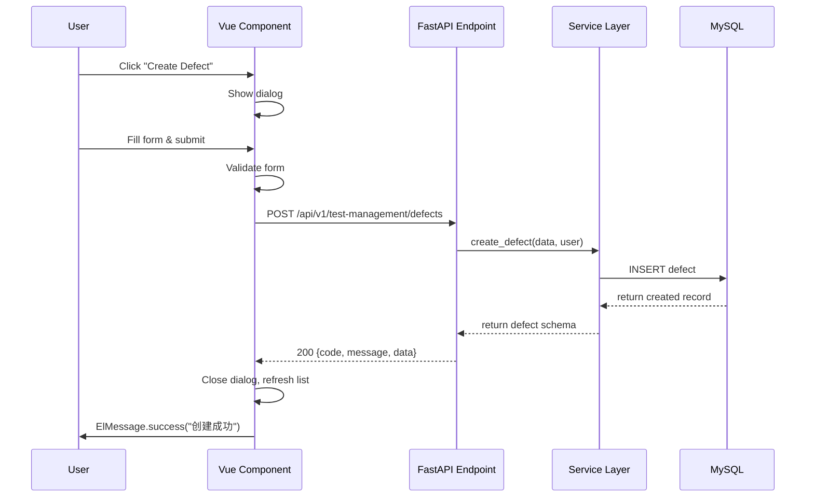

# 功能模块规格说明书模板

> **使用说明**：复制本模板，将 `[占位符]` 替换为实际值。每个切片（Slice）对应一个独立的模块规格说明。

---

## 1. 模块概述

### 1.1 模块定位

- **模块名称**：[模块名，如 defect_management]
- **所属服务**：`service/[module_name]/`
- **一句话定位**：[例如：管理测试过程中发现的缺陷，支持创建、编辑、状态流转和历史追踪]

### 1.2 核心用户故事

| # | 角色 | 故事 | 价值 |
|---|------|------|------|
| US-1 | As a [tester] | I want to [create a defect linked to a failed test result] | so that [developers can track and fix issues] |
| US-2 | As a [tester] | I want to [change defect status through workflow] | so that [the team knows the current resolution state] |
| US-3 | As a [project owner] | I want to [view defect statistics by module] | so that [I can identify quality hotspots] |
| US-[N] | ... | ... | ... |

### 1.3 关联 API 契约

- API契约文档：`templates/05-api-contract.md` 第 [X] 节
- 本模块涉及的端点数量：[N] 个

---

## 2. 功能清单表

> 优先级定义：P0=MVP必须, P1=第二迭代, P2=后续优化
> 复杂度定义：低=单表CRUD, 中=多表关联/简单业务规则, 高=复杂状态机/跨模块交互

| # | 功能点 | 优先级 | 复杂度 | 依赖 | 备注 |
|---|--------|--------|--------|------|------|
| F1 | 创建缺陷 | P0 | 低 | project(权限) | 关联测试结果ID(可选) |
| F2 | 编辑缺陷 | P0 | 中 | - | 仅open/reopen状态可编辑 |
| F3 | 状态流转 | P0 | 高 | - | 状态机约束(见业务规则) |
| F4 | 添加评论 | P1 | 低 | user(身份) | 支持@提及 |
| F5 | 查看历史 | P1 | 中 | - | 操作日志+字段变更记录 |
| F6 | 批量操作 | P2 | 中 | - | 批量修改状态/指派 |
| F7 | 导出列表 | P2 | 低 | - | Excel格式 |

---

## 3. 业务规则模板

> **Anti-hallucination**: 每条规则必须是可测试的断言，不可模糊描述。

### BR-1: [缺陷状态流转]

| 属性 | 值 |
|------|-----|
| 规则名 | 缺陷状态流转状态机 |
| 描述 | 缺陷状态只能按预定义的合法路径转换 |
| 触发条件 | 用户提交状态变更请求时 |
| 预期行为 | 见下方状态转换矩阵 |
| 异常处理 | 非法转换返回400，消息："不允许从 {current} 转换为 {target}" |

**状态转换矩阵**：

| 当前状态 → 目标状态 | open | in_progress | resolved | closed | reopened |
|---------------------|------|-------------|----------|--------|----------|
| open | - | YES | NO | NO | NO |
| in_progress | NO | - | YES | NO | NO |
| resolved | NO | NO | - | YES | YES |
| closed | NO | NO | NO | - | YES |
| reopened | YES | YES | NO | NO | - |

### BR-2: [规则名称]

| 属性 | 值 |
|------|-----|
| 规则名 | [简短名称] |
| 描述 | [具体描述] |
| 触发条件 | [何时检查] |
| 预期行为 | [期望结果] |
| 异常处理 | [错误时的行为] |

---

## 4. 交互流程模板

### 4.1 流程步骤

**流程名称**：[例如：创建缺陷]

| 步骤 | 用户操作 | 系统响应 | 异常处理 |
|------|---------|---------|---------|
| 1 | 点击"新建缺陷"按钮 | 弹出创建对话框 | - |
| 2 | 填写标题(必填)、描述、严重程度 | 实时表单验证 | 标题为空时显示错误提示 |
| 3 | 选择关联的测试结果(可选) | 下拉搜索已失败的测试结果 | 无关联数据时显示空状态 |
| 4 | 点击"确认创建" | 调用API → 关闭弹窗 → 刷新列表 → 成功提示 | API失败 → 保留弹窗内容 → 显示错误消息 |

### 4.2 Mermaid 序列图

---

## 5. UI 规格模板

> 引用设计系统：`templates/02-design-system.md`

| 属性 | 值 |
|------|-----|
| 页面类型 | [列表页 / 详情页 / 表单页 / 分屏视图] (参见 02 第8节) |
| 特殊组件 | [如：状态标签(Tag)、富文本编辑器、时间线] |
| 状态展示 | 参见 02 第5节状态色映射 |
| 列表布局 | 参见 02 第9节列表页布局规范 |
| 详情布局 | 参见 02 第10节详情页布局规范 |
| 确认交互 | 参见 02 第12节确认与删除交互规范 |
| 反馈通知 | 参见 02 第13节反馈通知规范 |

**UI特殊要求**（如有）：
- [例如：缺陷详情页使用分屏视图(SplitView)，左侧为缺陷列表，右侧为详情面板]
- [例如：状态流转按钮根据当前状态动态显示可用的目标状态]

---

## 6. 验收标准模板

### 6.1 后端验收清单

- [ ] API端点路径与契约文档一致
- [ ] 请求参数校验(Pydantic schema)覆盖所有必填字段
- [ ] 响应格式符合 `{code, message, data, timestamp}` 结构
- [ ] 业务规则(BR-*)全部实现并有单元测试
- [ ] 权限检查(require_project_editor/viewer)正确应用
- [ ] 错误响应包含明确的中文错误消息
- [ ] 数据库迁移文件已生成并可正常upgrade/downgrade
- [ ] 分页查询性能可接受(1000条记录 < 200ms)

### 6.2 前端验收清单

- [ ] 页面布局符合设计系统模板(02 第8节)
- [ ] 列表页使用 PaginatedTable + FilterBar 组合
- [ ] 表单验证规则与后端schema一致
- [ ] 状态颜色使用CSS变量(非硬编码)
- [ ] 确认弹窗遵循统一文案模板(02 第12节)
- [ ] 操作反馈消息遵循粒度规范(02 第13节)
- [ ] 文本截断与Tooltip正常工作(02 第14节)
- [ ] 日期/数字格式化正确(02 第15节)
- [ ] i18n翻译完整(zh-CN + en-US)
- [ ] 页面状态保持(URL query参数)(02 第30节)

### 6.3 E2E 验收清单

- [ ] 完整用户旅程可走通(创建→查看→编辑→状态变更→关闭)
- [ ] 跨模块关联正常(如：从测试结果创建缺陷)
- [ ] 并发操作不产生数据不一致
- [ ] 权限隔离有效(viewer不可编辑，editor不可删除他人数据)
- [ ] 浏览器刷新后状态恢复正确

---

## 7. 依赖声明

| 依赖项 | 类型 | 说明 |
|--------|------|------|
| `user` 模块 | 运行时 | 获取当前用户信息、权限校验 |
| `project` 模块 | 运行时 | 项目级权限守卫 |
| `test_execution` 模块 | 可选关联 | 关联测试结果创建缺陷 |
| Element Plus | 前端 | UI组件库 |
| Pinia store | 前端 | 状态管理(project store) |

---

## 8. 数据需求摘要

> **注意**：此处仅描述业务层面的数据需求，完整的数据库Schema在 `templates/04-database-schema.md` 中定义。

| 实体 | 核心字段(业务视角) | 关系 | 备注 |
|------|-------------------|------|------|
| Defect | 标题, 描述, 严重程度, 状态, 指派人 | belongs_to Project, created_by User | 可关联TestResult |
| DefectComment | 内容, 创建时间 | belongs_to Defect, created_by User | - |
| DefectHistory | 字段名, 旧值, 新值, 操作人, 时间 | belongs_to Defect | 自动记录 |

---

## Anti-Hallucination 约束

1. **业务规则可测试**：每条BR必须有明确的触发条件和预期行为，可作为测试用例的依据
2. **API路径不在本文档定义**：API路径和请求/响应格式在 `templates/05-api-contract.md` 中定义，本文档仅引用
3. **UI样式不在本文档定义**：视觉样式在 `templates/02-design-system.md` 中定义，本文档仅引用章节号
4. **数据库Schema不在本文档定义**：完整表结构在 `templates/04-database-schema.md` 中定义，本文档仅描述业务实体
5. **模块名使用snake_case**：与 `service/` 下的目录名一致
6. **枚举值与后端一致**：状态、优先级等枚举值必须与 `service/core/enums.py` 中的定义匹配
