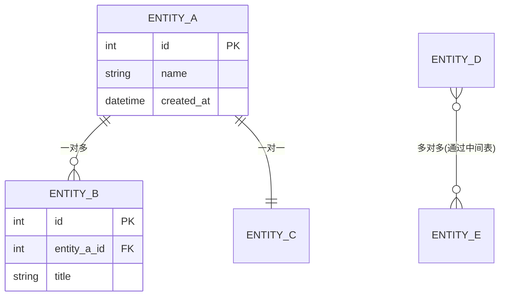
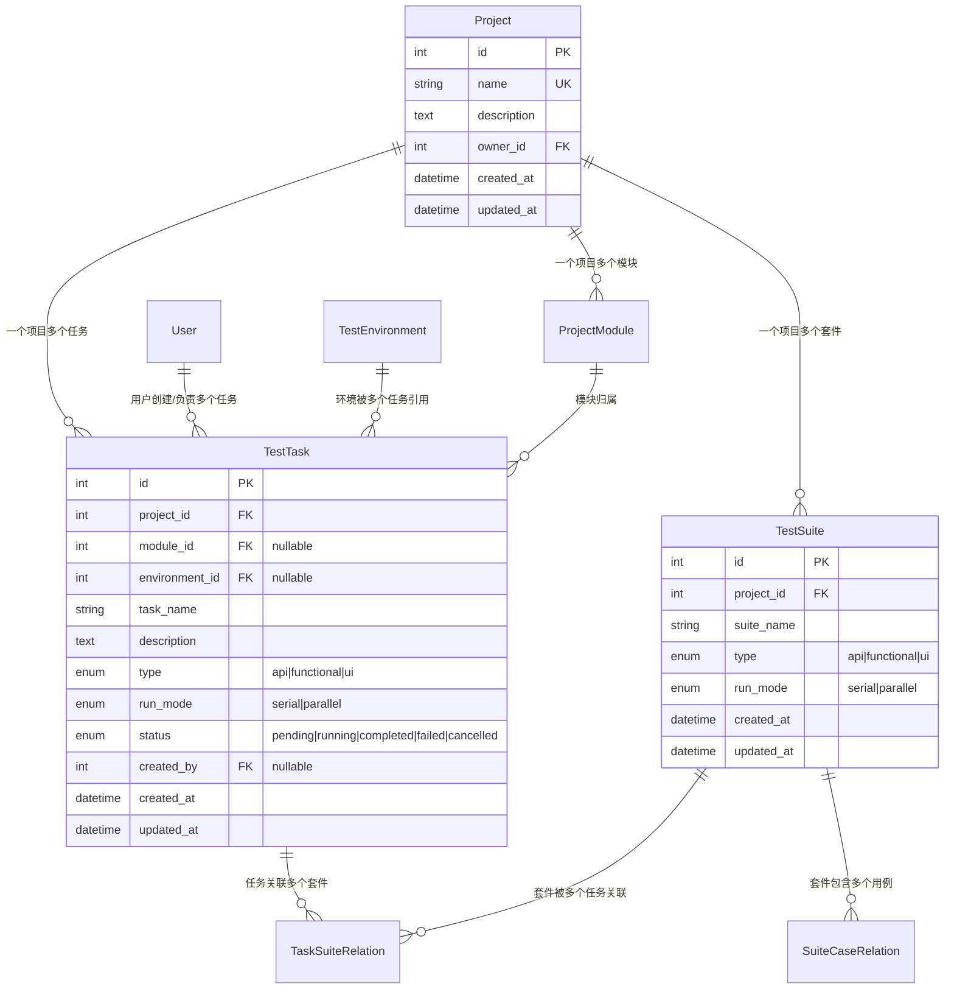

# 数据模型设计模板

> **用途**：新增/修改数据库表时，按本模板完成 ER 图、表定义、Model 代码、枚举、索引和迁移说明。
> AI 在生成 Model 代码前，**必须先阅读本文件 + `00-common-conventions.md`**。

---

## 1. ER 关系图模板

使用 Mermaid erDiagram 描述实体关系。新建模块时必须提供。

### 模板骨架



### 项目实际示例（测试管理模块）



---

## 2. 表定义文档模板

每张表必须填写以下表格，作为 Model 代码的规格说明。

### 模板

| 字段名 | 数据类型 | 必填 | 约束/默认值 | 描述 | 备注 |
|--------|---------|------|------------|------|------|
| id | INT | Y | PK, AUTO_INCREMENT | 主键 | - |
| ... | ... | ... | ... | ... | ... |

### 完整示例：TestTask 表

| 字段名 | 数据类型 | 必填 | 约束/默认值 | 描述 | 备注 |
|--------|---------|------|------------|------|------|
| id | INT | Y | PK, AUTO_INCREMENT | 主键 | - |
| project_id | INT | Y | FK → project.id, CASCADE | 所属项目 | - |
| module_id | INT | N | FK → project_module.id, SET_NULL | 所属模块 | 可为空表示未归类 |
| environment_id | INT | N | FK → test_environment.id, SET_NULL | 测试环境 | 运行时指定 |
| task_name | VARCHAR(255) | Y | - | 任务名称 | 同项目下唯一 |
| description | TEXT | N | NULL | 任务描述 | - |
| type | ENUM | Y | api/functional/ui | 任务类型 | TaskSuiteType 枚举 |
| run_mode | ENUM | N | serial/parallel, NULL | 执行模式 | RunMode 枚举 |
| status | ENUM | Y | pending (default) | 当前状态 | RunStatus 枚举 |
| created_by | INT | N | FK → user.id, SET_NULL | 创建人 | - |
| created_at | DATETIME(6) | Y | auto_now_add | 创建时间 | 微秒精度 |
| updated_at | DATETIME(6) | Y | auto_now | 更新时间 | 微秒精度 |

**业务约束**：
- `(project_id, task_name)` 联合唯一
- 删除项目时级联删除所有任务
- 删除用户时任务的 created_by 置 NULL

---

## 3. Tortoise ORM Model 代码模板

### 完整骨架（以 TestTask 为例）

```python
"""测试管理模块数据模型。"""

from tortoise import fields, models

from service.core.enums import RunMode, RunStatus, TaskSuiteType


class TestTask(models.Model):
    """测试任务。定义一轮测试执行的范围和参数。"""

    id = fields.IntField(pk=True)

    # ── 外键 ──────────────────────────────────────────────
    project = fields.ForeignKeyField(
        "models.Project",
        related_name="test_tasks",
        on_delete=fields.CASCADE,
    )
    module = fields.ForeignKeyField(
        "models.ProjectModule",
        related_name="test_tasks",
        null=True,
        on_delete=fields.SET_NULL,
    )
    environment = fields.ForeignKeyField(
        "models.TestEnvironment",
        related_name="test_tasks",
        null=True,
        on_delete=fields.SET_NULL,
    )

    # ── 业务字段 ───────────────────────────────────────────
    task_name = fields.CharField(max_length=255)
    description = fields.TextField(null=True)
    type = fields.CharEnumField(TaskSuiteType)
    run_mode = fields.CharEnumField(RunMode, null=True)
    status = fields.CharEnumField(RunStatus, default=RunStatus.pending)

    # ── 审计字段 ───────────────────────────────────────────
    created_by = fields.ForeignKeyField(
        "models.User",
        related_name="created_test_tasks",
        null=True,
        on_delete=fields.SET_NULL,
    )
    created_at = fields.DatetimeField(auto_now_add=True, precision=6)
    updated_at = fields.DatetimeField(auto_now=True, precision=6)

    class Meta:
        table = "test_task"
        unique_together = (("project_id", "task_name"),)

    def __str__(self) -> str:
        return f"TestTask({self.id}, {self.task_name})"
```

### 关键要点

1. **导入枚举**从 `service.core.enums`，不在模型文件中定义枚举
2. **外键字符串引用**格式：`"models.ModelClassName"`
3. **CharEnumField** 接收 Python Enum 类，Tortoise 自动映射到 VARCHAR
4. **Meta.table** 必须显式指定 snake_case 单数表名
5. **__str__** 方便调试日志输出

---

## 4. 枚举定义模板

### 后端（service/core/enums.py）

```python
from enum import Enum


class TaskSuiteType(str, Enum):
    """任务/套件类型。"""
    api = "api"
    functional = "functional"
    ui = "ui"


class RunStatus(str, Enum):
    """执行状态。用于任务、运行记录等。"""
    pending = "pending"       # 待执行
    running = "running"       # 运行中
    completed = "completed"   # 已完成
    failed = "failed"         # 已失败
    cancelled = "cancelled"   # 已取消
```

**规范**：
- 继承 `str, Enum`（确保 JSON 序列化输出字符串而非对象）
- 每个枚举值附中文注释说明含义
- 枚举类名 PascalCase，枚举值 snake_case
- **所有枚举集中定义在 `service/core/enums.py`**，禁止在模块本地定义

### 前端（frontend/src/utils/constants.js）

```javascript
// ── 任务/套件类型 ──────────────────────────────────
export const SUITE_TYPE_MAP = {
  api:        { type: 'primary', label: 'API' },
  functional: { type: 'success', label: '功能' },
  ui:         { type: 'warning', label: 'UI' },
}

// ── 执行状态 ───────────────────────────────────────
export const RUN_STATUS = ['pending', 'running', 'completed', 'failed', 'cancelled']

export const RUN_STATUS_MAP = {
  pending:   { type: 'info',    label: '未执行' },
  running:   { type: 'warning', label: '执行中' },
  completed: { type: 'success', label: '已完成' },
  failed:    { type: 'danger',  label: '已失败' },
  cancelled: { type: 'info',    label: '已停止' },
}
```

**同步规则**：
- 新增/修改枚举值时，**同时更新**后端 `enums.py` 和前端 `constants.js`
- MAP 的 `type` 对应 Element Plus Tag 组件类型：`success / warning / info / danger / primary / ''`
- MAP 的 `label` 应改用 i18n key（如 `t('runStatus.pending')`），硬编码中文仅作过渡
- 列表数组（如 `RUN_STATUS`）用于下拉选项遍历

---

## 5. 通用字段规范

所有业务表 **必须** 包含以下审计字段：

| 字段 | 类型 | 参数 | 说明 |
|------|------|------|------|
| `id` | `IntField` 或 `BigIntField` | `pk=True` | 主键。一般用 IntField；预计超千万行用 BigIntField |
| `created_at` | `DatetimeField` | `auto_now_add=True, precision=6` | 创建时间，插入时自动填充，微秒精度 |
| `updated_at` | `DatetimeField` | `auto_now=True, precision=6` | 更新时间，每次保存自动刷新，微秒精度 |
| `created_by` | `ForeignKeyField` | `"models.User", related_name="created_xxx", on_delete=fields.RESTRICT` | 创建人。若允许用户删除后保留记录，改用 `null=True, on_delete=fields.SET_NULL` |
| `updated_by` | `ForeignKeyField` | `"models.User", related_name="updated_xxx", null=True, on_delete=fields.SET_NULL` | 最后修改人。可选字段，非所有表都需要 |

**注意**：
- `precision=6` 是 **必须的**，MySQL DATETIME(6) 支持微秒
- `auto_now_add` 仅在 INSERT 时设置；`auto_now` 在每次 UPDATE 时刷新
- `related_name` 加前缀避免冲突：`created_test_tasks`、`updated_test_tasks`

---

## 6. 外键约定

### related_name 命名

- 使用 **复数 snake_case**：`"test_tasks"`, `"case_relations"`, `"owned_projects"`
- 当同一目标表有多个外键时，加语义前缀区分：
  ```python
  created_by = ForeignKeyField("models.User", related_name="created_test_tasks")
  assignee   = ForeignKeyField("models.User", related_name="assigned_test_tasks")
  ```

### on_delete 策略选择

| 策略 | 含义 | 适用场景 | 示例 |
|------|------|---------|------|
| `CASCADE` | 父记录删除时，子记录一并删除 | 强归属关系，子记录离开父记录无意义 | Project → TestTask, TestSuite → SuiteCaseRelation |
| `SET_NULL` | 父记录删除时，子记录外键置 NULL | 引用关系，父记录消失后子记录仍有效 | TestTask.created_by → User, TestTask.module → ProjectModule |
| `RESTRICT` | 若存在子记录则禁止删除父记录 | 核心引用，删除会造成数据不一致 | Project.owner → User |
| `NO_ACTION` | 数据库层面不处理（Tortoise 默认） | 极少使用，通常不如 RESTRICT 安全 | - |

**规则**：
- 使用 `SET_NULL` 时 **必须** 同时设置 `null=True`
- 默认选择 `CASCADE`（强归属）或 `SET_NULL`（弱引用），谨慎使用 `RESTRICT`
- 中间关联表的外键通常用 `CASCADE`

---

## 7. 索引设计指南

### 复合索引

```python
class Meta:
    table = "test_task"
    indexes = (
        ("project_id", "status"),       # 按项目+状态筛选
        ("project_id", "type"),         # 按项目+类型筛选
    )
```

**何时添加索引**：
- WHERE 条件频繁组合的字段对（如 `project_id + status`）
- 外键 + 状态字段的组合查询
- ORDER BY 经常使用的字段（尤其是与 WHERE 组合时）
- 高基数列（如 user_id）比低基数列（如 status）更适合单独索引

### 唯一约束

```python
class Meta:
    table = "test_task"
    unique_together = (("project_id", "task_name"),)
```

**何时使用 unique_together**：
- 业务上要求某组合不可重复（如同一项目下任务名不重复）
- 中间关联表防止重复关联（如 `(suite_id, case_type, case_id)`）
- **不要**用 unique_together 替代应用层的并发校验

### 索引命名（手动创建时）

```
idx_{table}_{field1}_{field2}
```

Tortoise ORM 的 Meta.indexes 会自动生成索引名，一般无需手动命名。

---

## 8. 迁移说明模板

### 描述变更

每次模型变更后，生成迁移并附带清晰说明：

```bash
python scripts/db_manage.py migrate -m "add_test_task_run_mode_field"
python scripts/db_manage.py upgrade
```

### Commit Message 格式

```
feat(db): add run_mode field to test_task table

- Add CharEnumField(RunMode, null=True) for serial/parallel execution
- Add composite index on (project_id, status) for list query optimization
- Migration: 20240101_add_test_task_run_mode_field
```

### 常见迁移类型对照

| 变更 | 操作 | 注意事项 |
|------|------|---------|
| 新增字段（有默认值） | 直接 migrate + upgrade | 安全，不影响现有数据 |
| 新增字段（无默认值，NOT NULL） | 先加 null=True，填充数据后再改 NOT NULL | 分两步迁移 |
| 删除字段 | migrate + upgrade | 确认无代码引用后再删 |
| 重命名字段 | Aerich 可能识别为删+增 | 检查迁移文件，必要时手动改为 RENAME COLUMN |
| 新增索引 | migrate + upgrade | 大表加索引可能需要较长时间 |
| 修改外键 on_delete | migrate + upgrade | 仅修改约束，不改数据 |

---

## 9. 反幻觉约束（AI 必读）

以下约束在生成 Model 代码时 **必须严格遵守**：

### 框架约束
- **ALL** Model 必须继承 `tortoise.models.Model`，**NEVER** 使用 SQLAlchemy、Peewee 或其他 ORM
- **ALL** 枚举字段必须使用 `fields.CharEnumField(EnumClass)`，**NEVER** 使用纯 `CharField` 存枚举值
- **EVERY** Model 必须有 `class Meta` 且显式指定 `table = "snake_case_name"`
- **EVERY** 新 Model 必须在 `service/core/config.py` 的 `TORTOISE_ORM["apps"]["models"]["models"]` 列表中注册

### 字段约束
- 时间戳字段 **MUST** 使用 `precision=6`
- 主键使用 `IntField(pk=True)` 或 `BigIntField(pk=True)`，**NEVER** 使用 UUIDField（除非特殊需求）
- 外键引用格式 **MUST** 为 `"models.ClassName"` 字符串，**NEVER** 直接导入 Model 类作为参数
- `SET_NULL` **MUST** 搭配 `null=True`

### 枚举约束
- **ALL** 枚举定义在 `service/core/enums.py`，**NEVER** 在模块 models.py 中就地定义
- 枚举类 **MUST** 继承 `str, Enum`（确保 JSON 兼容性）
- 枚举值使用 snake_case

### 导入约束
- Model 文件只导入：`tortoise.fields`, `tortoise.models`, `service.core.enums`
- **NEVER** 在 models.py 中导入 Service、API router、Pydantic Schema
- **NEVER** 在 models.py 中执行数据库查询
